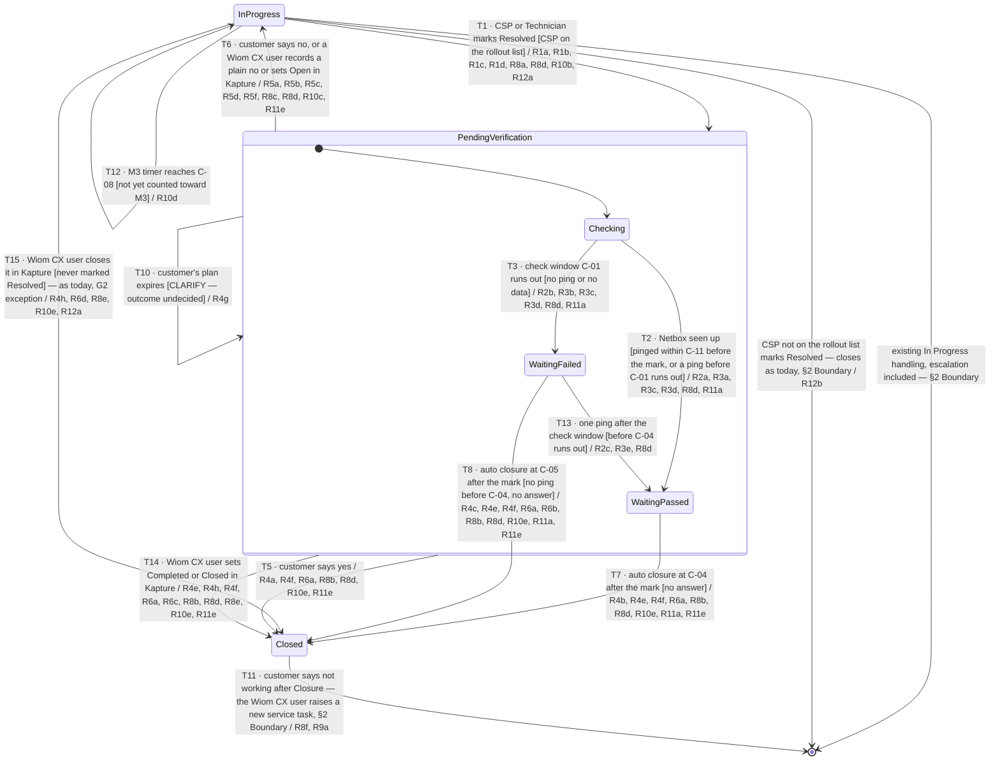

# Service Task Verification — confirming the CSP's fix

| | | | |
|---|---|---|---|
| **Owner** — Ashish Raj (PM) | **Reviewer** — [TBD — not asked] | **Status** — Draft | **Sign-off** — Pending |
| **Version** — v0.22 · 15 Oct 2026 | **Consulted — Solution design** — Ashish Agrawal | **Consulted — Customer OS** — Shail Patel, Manas | |
| **Terminology source** — Wiom Operational Terminology (v0.7) · 15 Oct 2026 · Wiom System Terminology (v0.7) · 15 Oct 2026 | | | |

---

## 1. Terminology Used

| Term | Meaning | Owner (domain) |
|---|---|---|
| Resolved | The mark a CSP or Technician puts on a service task to say the fault is fixed. It is a claim, not proof that the customer's internet works. | Support Resolution OS |
| In Progress | The state of a service task while a CSP or Technician is working on it. The CSP's TAT runs only in this state. | Support Resolution OS |
| Pending Verification | The state a service task enters at the Resolved mark and holds until it is Closed or goes back to In Progress. The CSP's TAT does not run here. | Support Resolution OS |
| Checking | The first stage of Pending Verification: from the Resolved mark until the verdict passes or the check window ends, whichever comes first. The customer has not been messaged yet. | Support Resolution OS |
| Waiting, verdict passed | The stage of Pending Verification once the Netbox has pinged, while the service task waits for the customer's answer or for C-04 to run out from the Resolved mark. | Support Resolution OS |
| Waiting, verdict failed | The stage of Pending Verification after the check window ended with no ping, while the service task waits for the customer's answer, a ping before C-04 runs out, or C-05. | Support Resolution OS |
| Check window | The wait after the Resolved mark (C-01) for the customer's Netbox to ping before the customer is messaged. | Support Resolution OS |
| Verdict | Whether Wiom has seen the customer's Netbox up in this round: **passed** once it pinged (one ping is enough, C-02) within C-11 before the Resolved mark or at any time after it until C-04 runs out; **failed** until then. It is judged the same way for ISD and RDNI. It sets the customer's message and how the service task closes, is never shown to the CSP, and moves from failed to passed at most once, never back. | Support Resolution OS |
| First ping | The moment the verdict passes: the Resolved mark itself, when the Netbox pinged within C-11 before it; otherwise the first ping after the mark. | Support Resolution OS |
| Reopen | The move of a service task from Pending Verification back to In Progress, caused only by the customer saying the internet is not working. The service task, the CSP and the issue stay the same. | Support Resolution OS |
| Closed | The final state of a service task. Nothing leaves it. | Support Resolution OS |
| Auto closure | Closure of a service task in Pending Verification when the customer has not answered: at C-04 after the Resolved mark if the Netbox pinged before then, otherwise at C-05 after the mark. One of three ways into Closed; the others are the customer saying yes and a Wiom CX user closing the service task in Kapture. | Support Resolution OS |
| Rollout list | The list of CSP IDs on which this feature is live (C-12). The feature is released CSP by CSP, under tight control; a CSP not on the list sees no change at all. | Wiom Product team |
| Closure reason | The cause recorded on every service task that goes from Pending Verification to Closed, one of four: **CUSTOMER_CONFIRMED** (the customer said yes), **CX_CLOSED_IN_KAPTURE** (a Wiom CX user closed it in Kapture during Pending Verification) ⚠️ *AI GENERATED — review*, **PING_UP_NO_RESPONSE** (auto closure: the Netbox pinged before C-04 ran out, no answer), **FINAL_CLOSURE_UNVERIFIED** (auto closure: no ping before C-04 ran out, no answer by C-05). | Support Resolution OS |
| Repeat | A new service task opened after a Closure, for the same connection and the same issue, within the repeat window (C-07). It is linked to the Closed service task. | Support Resolution OS |
| ISD | Internet supply down: a service task subtype for a customer with no internet. | Support Resolution OS |
| RDNI | Recharge done but no internet: a service task subtype for a customer who has recharged and still has no internet. | Support Resolution OS |
| Resolution signal | What Support Resolution OS sends Quality OS, and under this spec Compensation OS, when a service task finishes: its outcome and its closure reason. | Support Resolution OS |
| M3 | The Quality OS metric for long-open service tasks: how many of a CSP's service tasks stayed open past the long-open limit (C-08) in a cycle. | Quality OS |
| M3 timer | The clock M3 runs on each service task. It starts when the service task is raised, counts every hour of the day, pauses while the service task is in Pending Verification, and resumes where it stopped on a Reopen. | Quality OS |
| M3 cycle | The fixed half-month period M3 counts in (C-09). Each service task counts in at most one. | Quality OS |
| Kapture | The tool the Wiom CX team uses to see and work on service tasks. | Wiom CX team |
| Status, Sub Status (Kapture) | The two fields a Wiom CX user sees on a service task in the Kapture portal: Status (for example Pending, Complete) and Current Sub Status (for example Open, Resolved, Completed). | Wiom CX team |
| CSP TAT | The turnaround time from the service task reaching the CSP to the CSP's Resolved mark, counted only inside CSP working hours, summed over every round. | Support Resolution OS |

---

## 2. Objective & Guardrails

**Objective.** A customer whose internet a CSP marks as fixed does not have the service task closed on the CSP's word alone. The customer is told or asked about the fix, and a customer who says it still does not work gets the same CSP back on the same service task at once.

**Boundary.** This spec governs service tasks of two subtypes, internet supply down (ISD) and recharge done but no internet (RDNI), from the CSP's Resolved mark until the service task is Closed. It leaves unchanged:
- how a service task is created, assigned and worked on while In Progress, including escalation (AC-REG-1). A Wiom CX user closing it in Kapture while In Progress closes it exactly as today — reason, signals, messages and Kapture status — and this spec adds only that its M3 timer stops (G2 exception, T15);
- every other service task subtype, which keeps closing at the Resolved mark as today (AC-REG-2);
- the lifecycle of any new service task opened after a Closure. This spec sets only its repeat link (R9).

This spec also sets how M3 counts long-open service tasks (R10). Everything in this spec, M3 included, applies only to service tasks of CSPs on the rollout list (R12). For every other CSP, nothing changes: their service tasks close at the Resolved mark and M3 counts them as it does today.

Version 1 sets no limit on reopen rounds. A Reopened service task always goes back to the same CSP, with no fallback when that CSP cannot take it.

**Push notification copy.** The wording of every push notification in this spec — to the customer, the CSP and the Technician — is set by Design and shared in the Figma file (§7). This spec sets only when each one is sent and what it must convey.

### Guardrails — promises that hold on every path

| ID | Guardrail | One line | Anchors |
|---|---|---|---|
| G1 | **Closed is final** (zero tolerance) | A Closed service task never moves to any other state, and no one can reopen it — not the customer, not the CSP, and not a Wiom CX user, even from Kapture. A later "not working" opens a new service task. | R4 · R8 · R9 · AC-R9-1 · AC-R9-3 · AC-R8-7 · AC-GRD-1 |
| G2 | **No Closure without the CSP's mark** (zero tolerance) | A service task in scope never reaches Closed unless a CSP or Technician first marked it Resolved. **One exception:** a Wiom CX user closing the service task in Kapture closes it directly, with or without a Resolved mark; before any mark, the close works exactly as today. | R1 · R4 · R8 · AC-R1-1 · AC-GRD-2 · AC-R8-8 |
| G3 | **Never "fixed" on a failed verdict** (zero tolerance) | The customer is never told the issue is fixed when the verdict failed. | R3 · AC-R3-2 · AC-GRD-3 |
| G4 | **Signals only at Closed** | Quality OS and Compensation OS hear about a service task's resolution only when it is Closed, never at the Resolved mark. | R6 · AC-R6-1 · AC-GRD-4 |
| G5 | **Verification never counts against the CSP** | Time in Pending Verification never counts in the CSP TAT or on the M3 timer. | R1 · R7 · R10 · AC-R7-1 · AC-R10-2 · AC-GRD-5 · AC-GRD-7 |
| G6 | **Every exit has a recorded cause** | Every exit from Pending Verification comes from the customer's answer, a Wiom CX user's action in Kapture, or an auto closure, and its cause is recorded — never a silent change. | R4 · R5 · R8 · AC-GRD-6 |
| G7 | **The customer reopens only in Pending Verification** (zero tolerance) | A customer's "not working" sends a service task back to the CSP only while it is in Pending Verification; In Progress it changes nothing, and after Closure it opens a new service task. | R5 · R9 · AC-R5-1 · AC-R9-1 · AC-GRD-8 |
| G8 | **No change for CSPs off the rollout list** (zero tolerance) | A service task whose CSP is not on the rollout list behaves exactly as it does today, in every system this spec touches. | R12 · AC-R12-2 · AC-R12-5 · AC-GRD-9 |

---

## 3. Stories, Rules & Acceptance Criteria

### R1 — The Resolved mark starts Verification

| ID | Story | MUST | MUST NOT |
|---|---|---|---|
| R1 | As a customer whose internet is down, when the CSP says it is fixed, I want Wiom to check before my service task is closed, so that a false fix does not leave me stranded. | On T1: **(a)** move the service task to Pending Verification. **(b)** Stop the CSP TAT at the Resolved mark. **(c)** Show the CSP and the Technician only that Wiom will verify the fix. **(d)** Send the customer nothing at the mark, unless the verdict passes at the mark (R3a). | Close the service task at the Resolved mark. Show the CSP or the Technician whether the Netbox is pinging, or the verdict, at any point in Pending Verification. Let the CSP or Technician pull a service task back from Pending Verification, or mark it Resolved again while it is there. |

| AC | Given / When / Then | Verifies | Status |
|---|---|---|---|
| AC-R1-1 | **Given** an ISD service task for customer Rekha Verma, In Progress with CSP Shiv Net since 14 Oct 11:20, **When** the Technician marks it Resolved at 13:47, **Then** the service task is in Pending Verification at 13:47, not Closed. | R1a · G2 | Settled |
| AC-R1-2 | **Given** the service task from AC-R1-1, **When** the Technician marks it Resolved at 13:47, **Then** its CSP TAT reads 2 h 27 min and does not grow while it stays in Pending Verification. | R1b · G5 | Settled |
| AC-R1-3 | **Given** the service task from AC-R1-1, **When** the CSP opens it in the CSP app at 13:50, **Then** it shows that Wiom will verify the fix, and the Technician App shows the same. | R1c | Settled |
| AC-R1-4 | **Given** the service task from AC-R1-1, whose Netbox last pinged at 11:02, **When** the Technician marks it Resolved at 13:47 and no ping arrives until 14:17, **Then** no message about the fix is sent to Rekha Verma between 13:47 and 14:17. | R1d | Settled |
| AC-R1-6 | **Given** a service task whose verdict was recorded failed at 14:17, **When** the CSP opens it in the CSP app at 14:20 and the Technician opens it in the Technician App at 14:21, **Then** both show only that Wiom will verify the fix, with no ping status and no verdict. | R1 MUST NOT | Settled |
| AC-R1-5 | **Given** the service task from AC-R1-1 in Pending Verification at 14:30, **When** the CSP opens it in the CSP app, **Then** the app offers neither a Resolved mark nor a way to take it back to In Progress, and it is still in Pending Verification. | R1 MUST NOT | Settled |

### R2 — The verdict

| ID | Story | MUST | MUST NOT |
|---|---|---|---|
| R2 | As a customer, I want Wiom to judge from my own Netbox whether my internet is back, so that what I am told matches what is true. | **(a)** On T2, pass the verdict the moment the Netbox is seen up inside the check window: at the Resolved mark when it pinged within C-11 before the mark, or at the first ping after the mark before C-01 runs out. **(b)** On T3, when C-01 runs out with no ping or no ping data, record the verdict as failed. **(c)** On T13, pass the verdict at the first ping that arrives later, before C-04 runs out from the mark. | Judge the verdict, or handle the service task in any way, differently for RDNI than for ISD. Move a passed verdict back to failed. Count a ping older than C-11 before the Resolved mark. Count a ping that arrives after C-04 has run out. |

| AC | Given / When / Then | Verifies | Status |
|---|---|---|---|
| AC-R2-1 | **Given** the service task from AC-R1-1, whose Netbox last pinged at 11:02, Resolved at 13:47, **When** one ping from Rekha Verma's Netbox arrives at 14:09, **Then** the verdict passes at 14:09, inside C-01 (30 min), and 14:09 is its first ping. | R2a · T2 | Settled |
| AC-R2-6 | **Given** an ISD service task whose Netbox pinged at 13:38, **When** the CSP marks it Resolved at 13:47, **Then** the verdict passes at 13:47 (the ping was within C-11, 15 min, before the mark) and 13:47 is its first ping. | R2a · T2 | Settled |
| AC-R2-2 | **Given** an RDNI service task and an ISD service task, both Resolved at 13:47, **When** each Netbox pings once at 13:52, **Then** both verdicts pass at 13:52, both customers get the "fixed" message at 13:52, and nothing else about either service task differs. | R2a · R2 MUST NOT · T2 | Settled |
| AC-R2-3 | **Given** a service task Resolved at 13:47, **When** no ping data exists for the customer's Netbox between 13:47 and 14:17, **Then** the verdict at 14:17 is failed. | R2b · T3 | Settled |
| AC-R2-4 | **Given** a service task Resolved at 13:47 on 14 Oct whose verdict was recorded failed at 14:17, **When** one ping arrives at 19:52, **Then** the verdict passes at 19:52 and the service task will auto close at 13:47 on 16 Oct, C-04 (48 h) after the mark. | R2c · T13 | Settled |
| AC-R2-7 | **Given** a service task whose verdict passed at 14:09, **When** its Netbox stops pinging at 15:30, **Then** the verdict stays passed and it still auto closes C-04 after the mark. | R2 MUST NOT | Settled |

### R3 — Telling or asking the customer

| ID | Story | MUST | MUST NOT |
|---|---|---|---|
| R3 | As a customer, I want one clear message about my fix, worded to what Wiom actually knows, so that I can say if it still does not work. | **(a)** On T2, the moment the verdict passes, tell the customer the issue is fixed and give a way to say it is not working (copy: Figma file, §7). **(b)** On T3, when C-01 runs out with no ping, ask the customer whether the internet is working, yes or no (copy: Figma file, §7). **(c)** Reach the customer by app notification. **(d)** Count the customer as told once the message is sent. **(e)** On T13, send the customer nothing new. | Tell the customer the issue is fixed on a failed verdict. Send a second verdict message in the same round. |

| AC | Given / When / Then | Verifies | Status |
|---|---|---|---|
| AC-R3-1 | **Given** the service task from AC-R2-1, **When** its verdict passes at 14:09, **Then** Rekha Verma receives a message at 14:09 saying the issue is fixed, with a way to reply that it is not working. | R3a · T2 | Settled |
| AC-R3-6 | **Given** the service task from AC-R2-4, whose customer was asked "is it working?" at 14:17, **When** the first ping arrives at 19:52, **Then** the customer receives no new message. | R3e · T13 · R3 MUST NOT | Settled |
| AC-R3-2 | **Given** a service task Resolved at 13:47 with no ping since 11:02, **When** C-01 runs out at 14:17, **Then** the customer receives a message asking whether the internet is working, with yes and no replies, and no message to that customer says the issue is fixed. | R3b · T3 · G3 | Settled |
| AC-R3-3 | **Given** a service task Resolved at 13:47 whose Netbox is offline, **When** C-01 runs out at 14:17, **Then** the "is it working?" message goes to the customer as an app notification at 14:17. | R3c | Settled |
| AC-R3-4 | **Given** an "is it working?" message sent at 14:17 that never reaches the customer's phone, **When** a Wiom CX user opens the service task at 14:18, **Then** it shows the customer as told at 14:17. | R3d | Settled |

### R4 — Closure

| ID | Story | MUST | MUST NOT |
|---|---|---|---|
| R4 | As a customer, I want my service task to close only when the fix is confirmed or I have had time to say otherwise, so that a closed service task means something. | **(a)** On T5, when the customer says yes, close the service task at once with reason CUSTOMER_CONFIRMED, whatever the verdict. **(b)** On T7, auto close at C-04 after the Resolved mark when the Netbox has pinged at least once since C-11 before the mark and the customer has not answered, with reason PING_UP_NO_RESPONSE. **(c)** On T8, auto close at C-05 after the Resolved mark when the Netbox did not ping before C-04 ran out and the customer has not answered, with reason FINAL_CLOSURE_UNVERIFIED. **(d)** Keep a service task on C-05 when its first ping arrives after C-04 has run out. **(e)** On T7 and T8, tell the customer how to raise a new service task (copy: Figma file, §7); on T14, tell the customer the service task is closed and how to raise a new one if the internet is not working ⚠️ *AI GENERATED — review*. **(f)** On T5, T7, T8 and T14, show the CSP the closure reason, and send the CSP a CSP app notification, and the assigned Technician a Technician App notification, that the service task is Closed, with that reason, at the moment it closes (copy: Figma file, §7) ⚠️ *AI GENERATED — review*. **(g)** On T10, when the customer's plan expires during Pending Verification: [CLARIFY — what happens to the service task]. **(h)** On T14, when a Wiom CX user closes the service task in Kapture during Pending Verification — sets it to Status Complete / Sub Status Completed, or to Sub Status Closed — close it at once with reason CX_CLOSED_IN_KAPTURE ⚠️ *AI GENERATED — review*, as a Kapture close works today. On T15, a Wiom CX user's close of a service task never marked Resolved works exactly as today (G2 exception). | Close a service task in Pending Verification any way other than the customer's yes, a Wiom CX user's close in Kapture, or an auto closure. Close it before the customer's answer or the auto-closure time that applies. |

| AC | Given / When / Then | Verifies | Status |
|---|---|---|---|
| AC-R4-1 | **Given** a service task Resolved at 13:47 on 14 Oct with no ping yet, **When** the customer replies yes at 18:32, **Then** the service task is Closed at 18:32 with reason CUSTOMER_CONFIRMED. | R4a · T5 | Settled |
| AC-R4-2 | **Given** the service task from AC-R2-1, Resolved at 13:47 on 14 Oct, first ping at 14:09, no answer, **When** C-04 (48 h) after the mark passes at 13:47 on 16 Oct, **Then** it is Closed at 13:47 on 16 Oct with reason PING_UP_NO_RESPONSE. | R4b · T7 | Settled |
| AC-R4-9 | **Given** the service task from AC-R2-4, Resolved at 13:47 on 14 Oct, one ping at 19:52 on 14 Oct, no answer, **When** C-04 (48 h) after the mark passes at 13:47 on 16 Oct, **Then** it is Closed at 13:47 on 16 Oct with reason PING_UP_NO_RESPONSE. | R4b · T13 · T7 | Settled |
| AC-R4-3 | **Given** a service task Resolved at 13:47 on 14 Oct whose Netbox never pings, and no answer, **When** C-05 (72 h) after the mark passes at 13:47 on 17 Oct, **Then** it is Closed at 13:47 on 17 Oct with reason FINAL_CLOSURE_UNVERIFIED. | R4c · T8 | Settled |
| AC-R4-4 | **Given** a service task Resolved at 13:47 on 14 Oct with no ping by 13:47 on 16 Oct, **When** its first ping arrives at 09:30 on 17 Oct and the customer never answers, **Then** it is Closed at 13:47 on 17 Oct with reason FINAL_CLOSURE_UNVERIFIED. | R4d · R2 MUST NOT | Settled |
| AC-R4-5 | **Given** the service task from AC-R4-3, **When** it is Closed at 13:47 on 17 Oct, **Then** the customer receives a message telling them how to raise a new service task. | R4e · T8 | Settled |
| AC-R4-6 | **Given** the service task from AC-R4-2, **When** it is Closed at 13:47 on 16 Oct, **Then** the CSP app shows it as Closed with reason PING_UP_NO_RESPONSE. | R4f · T7 | Settled |
| AC-R4-10 | **Given** the service task from AC-R4-2, with CSP Shiv Net, **When** it auto closes at 13:47 on 16 Oct, **Then** Shiv Net receives a CSP app notification, and the assigned Technician a Technician App notification, at 13:47 that the service task is Closed with reason PING_UP_NO_RESPONSE. | R4f · T7 | Settled |
| AC-R4-8 | **Given** a service task Resolved at 13:47 on 14 Oct whose Netbox has not pinged, and no answer, **When** C-04 (48 h) after the mark passes at 13:47 on 16 Oct, **Then** it is still in Pending Verification, not Closed. | R4 MUST NOT | Settled |
| AC-R4-11 | **Given** the service task from AC-R1-1, Resolved at 13:47 on 14 Oct, no answer, **When** a Wiom CX user closes it in Kapture at 17:20 on 14 Oct, **Then** it is Closed at 17:20 with reason CX_CLOSED_IN_KAPTURE, and CSP Shiv Net and the assigned Technician receive their Closure notifications at 17:20 with that reason. | R4h · R4f · T14 | Settled |
| AC-R4-12 | **Given** the service task from AC-R4-11, **When** a Wiom CX user closes it in Kapture at 17:20 on 14 Oct, **Then** Rekha Verma receives a message at 17:20 that the service task is closed and how to raise a new one if the internet is not working. | R4e · T14 | Settled |
| AC-R4-7 | **Given** a service task in Pending Verification since 13:47 on 14 Oct, **When** the customer's plan expires at 23:59 on 15 Oct, **Then** [CLARIFY — the service task's state and the customer's message]. | R4g · T10 | OPEN |

### R5 — Reopen on the customer's no

| ID | Story | MUST | MUST NOT |
|---|---|---|---|
| R5 | As a customer whose internet still does not work, I want the same CSP back on my same service task at once, so that I never have to raise it again. | On T6: **(a)** move the service task back to In Progress at once, whatever the verdict; **(b)** keep the same service task and the same CSP, and tell the CSP it is the same issue; **(c)** count a plain "not working" recorded by a Wiom CX user against the service task, or a Wiom CX user setting it to Sub Status Open in Kapture, as the customer's no; **(d)** resume the CSP TAT, from the start of CSP working hours (C-06) when the no arrives outside them, while everything else in the Reopen happens at once, whatever the hour; **(e)** start a new Pending Verification at the CSP's next Resolved mark; **(f)** send the CSP a CSP app notification, and the assigned Technician a Technician App notification, at the moment of the Reopen, that the service task is back because the customer said it is not working (copy: Figma file, §7) ⚠️ *AI GENERATED — review*. | Open a new service task for a no given during Pending Verification. Hand a Reopened service task to a different CSP. Count any customer contact other than a plain no as a no, or open a new service task for it, during Pending Verification. |

| AC | Given / When / Then | Verifies | Status |
|---|---|---|---|
| AC-R5-1 | **Given** the service task from AC-R2-1, verdict passed at 14:09, **When** Rekha Verma replies "not working" at 16:05 on 14 Oct, **Then** the service task is In Progress at 16:05, with CSP Shiv Net, under the same service task. | R5a · T6 · G7 | Settled |
| AC-R5-2 | **Given** the Reopen in AC-R5-1, **When** the CSP opens the service task at 16:10, **Then** the CSP app shows it as the same issue, Reopened, not as a new service task. | R5b · T6 | Settled |
| AC-R5-3 | **Given** a service task in Pending Verification, **When** a Wiom CX user records a plain "not working" against it at 17:40 after the customer calls, **Then** the service task is In Progress at 17:40 with the same CSP, and no new service task exists for that connection. | R5c · T6 | Settled |
| AC-R5-4 | **Given** a service task in Pending Verification, **When** the customer calls the Wiom CX team at 17:40 to ask when the CSP will visit and no plain no is recorded, **Then** the service task stays in Pending Verification and no new service task exists for that connection. | R5 MUST NOT | Settled |
| AC-R5-7 | **Given** a service task In Progress since 11:20, not yet marked Resolved, **When** a Wiom CX user records a plain "not working" from the customer at 12:40, **Then** it stays In Progress, unchanged, and no new service task exists. | G7 · R5 | Settled |
| AC-R5-5 | **Given** a service task in Pending Verification with CSP TAT 2 h 27 min, **When** the customer replies "not working" at 22:30 on 14 Oct, **Then** it is In Progress at 22:30, and its CSP TAT reads 2 h 27 min until 11:00 on 15 Oct, then grows. | R5d · T6 | Settled |
| AC-R5-9 | **Given** a service task of CSP Shiv Net in Pending Verification, with M3 timer at 9 h 10 min, **When** the customer replies "not working" at 22:30 on 14 Oct, **Then** at 22:30 it is In Progress with Shiv Net, Shiv Net and the assigned Technician receive their Reopen notifications, and its M3 timer resumes from 9 h 10 min (wall clock); only its CSP TAT waits until 11:00 on 15 Oct. | R5d · R5f · R10c · T6 | Settled |
| AC-R5-6 | **Given** the Reopened service task from AC-R5-1, **When** the CSP marks it Resolved again at 19:12, **Then** it is in Pending Verification with a new check window ending at 19:42 and a new verdict. | R5e · T1 | Settled |
| AC-R5-8 | **Given** the service task from AC-R5-1, **When** Rekha Verma replies "not working" at 16:05, **Then** CSP Shiv Net receives a CSP app notification, and the assigned Technician a Technician App notification, at 16:05 that the service task is Reopened because the customer said it is not working, same issue. | R5f · T6 | Settled |

### R6 — Signals at Closure

| ID | Story | MUST | MUST NOT |
|---|---|---|---|
| R6 | As a CSP, I want my quality and earnings to rest on what happened to the customer, so that a confirmed fix counts and a claimed one does not. | **(a)** At every Closure, send Quality OS and Compensation OS the resolution signal with the closure reason. **(b)** For FINAL_CLOSURE_UNVERIFIED, never signal the service task as fixed. **(c)** For CX_CLOSED_IN_KAPTURE, signal the service task as fixed. **(d)** On T15, send whatever signal is sent today; this spec adds none. | Send any resolution signal at the Resolved mark or during Pending Verification. |

| AC | Given / When / Then | Verifies | Status |
|---|---|---|---|
| AC-R6-1 | **Given** the service task from AC-R1-1, Resolved at 13:47 on 14 Oct, **When** it is Closed at 18:32 with reason CUSTOMER_CONFIRMED, **Then** Quality OS and Compensation OS each receive one resolution signal at 18:32 carrying CUSTOMER_CONFIRMED, and neither received one between 13:47 and 18:32. | R6a · T5 · G4 | Settled |
| AC-R6-2 | **Given** the service task from AC-R4-3, **When** it is Closed with reason FINAL_CLOSURE_UNVERIFIED, **Then** the signal Quality OS and Compensation OS receive does not mark it as fixed. | R6b · T8 | Settled |
| AC-R6-3 | **Given** the service task from AC-R4-11, **When** a Wiom CX user closes it in Kapture at 17:20 on 14 Oct, **Then** Quality OS and Compensation OS each receive one resolution signal at 17:20, carrying CX_CLOSED_IN_KAPTURE and marking it as fixed. | R6a · R6c · T14 | Settled |

### R7 — CSP TAT

| ID | Story | MUST | MUST NOT |
|---|---|---|---|
| R7 | As a CSP, I want my TAT to count only the time I spend on the service task, so that Wiom's checking never counts against me. | **(a)** Count the CSP TAT only while the service task is In Progress, inside CSP working hours (C-06). **(b)** Add up every In Progress round. | Count time in Pending Verification. |

| AC | Given / When / Then | Verifies | Status |
|---|---|---|---|
| AC-R7-1 | **Given** a service task In Progress from 11:20, Resolved at 13:47, Reopened at 16:05 and Resolved again at 19:12 on 14 Oct, **When** the customer replies yes at 08:40 on 15 Oct and it is Closed, **Then** its CSP TAT is 5 h 34 min (2 h 27 min plus 3 h 07 min). | R7a · R7b · G5 | Settled |
| AC-R7-2 | **Given** a service task that reaches the CSP at 20:40 on 14 Oct, **When** the CSP marks it Resolved at 11:25 on 15 Oct, **Then** its CSP TAT is 45 min (20 min on 14 Oct and 25 min on 15 Oct). | R7a | Settled |

### R8 — The Wiom CX team in Kapture

| ID | Story | MUST | MUST NOT |
|---|---|---|---|
| R8 | As a Wiom CX user, I want Kapture to show live where a service task stands in Verification and every action taken on it, so that I can tell a customer the truth and act on their call. | **(a)** On T1, and while the service task is in Pending Verification, Kapture shows Status **Pending**, Sub Status **Resolved**. **(b)** At Closure, Kapture shows Status **Complete**, Sub Status **Completed**. **(c)** On T6, and while the Reopened service task is In Progress, Kapture shows Status **Pending**, Sub Status **Open**. **(d)** Add a Kapture comment for every action in this spec, at the moment it happens, with exactly the text in the table *Kapture status and comment per action* below (K1–K11), filling each `{…}` with the actual value. **(e)** Let a Wiom CX user close the service task in Kapture, as today: during Pending Verification by setting Complete / Completed or Closed (T14), while setting it to Open Reopens it (T6, R5c), and while In Progress before any Resolved mark, where the close and everything it sets off stay exactly as today (T15, the G2 exception) (R4h). **(f)** When a customer says it is not working after Closure, the Wiom CX user raises a new service task, linked to the Closed one as a repeat within C-07 (R9a). **(g)** Show these statuses so the Wiom CX team sees the service task live; a Status or Sub Status that Wiom sets in Kapture is never taken as a Wiom CX user's action. | Show Status Complete while the service task is in Pending Verification. Close, Reopen or otherwise change a service task because of a Status or Sub Status Wiom itself set in Kapture. Change a service task in Pending Verification for any Wiom CX user action in Kapture other than Completed, Closed or Open. Close a Reopened service task because Kapture shows it Open. Let anyone reopen a Closed service task, including a Wiom CX user from Kapture: the reopen is blocked and the service task stays Closed. Show the CSP or the Technician what the Kapture comments say about the verdict. |

| AC | Given / When / Then | Verifies | Status |
|---|---|---|---|
| AC-R8-1 | **Given** the service task from AC-R1-1, Resolved at 13:47 on 14 Oct, **When** a Wiom CX user opens it in Kapture at 14:30, **Then** it shows Status Pending and Sub Status Resolved, not Status Complete. | R8a · T1 · R8 MUST NOT | Settled |
| AC-R8-2 | **Given** the service task from AC-R4-1, Closed at 18:32 on 14 Oct, **When** a Wiom CX user opens it in Kapture at 18:40, **Then** it shows Status Complete and Sub Status Completed. | R8b · T5 | Settled |
| AC-R8-3 | **Given** the service task from AC-R5-1, Reopened at 16:05 on 14 Oct, **When** a Wiom CX user opens it in Kapture at 16:30, **Then** it shows Status Pending and Sub Status Open, not Sub Status Resolved. | R8c · T6 | Settled |
| AC-R8-4 | **Given** the service task from AC-R2-1, marked Resolved by Technician Ravi at 13:47 on 14 Oct, "fixed" message sent at 14:09, customer's yes at 18:32, **When** a Wiom CX user opens it in Kapture at 18:40, **Then** it has three comments in order, with the K1 text at 13:47 ("Marked Resolved by Technician Ravi at 13:47. Wiom is now verifying the fix…"), the K2 text at 14:09 and the K5 text at 18:32. | R8d · T1 · T2 · T5 | Settled |
| AC-R8-5 | **Given** the service task from AC-R5-1, **When** Rekha Verma replies "not working" at 16:05 on 14 Oct, **Then** its Kapture record has a comment at 16:05 that the customer said it is not working and the service task is back with CSP Shiv Net. | R8d · T6 | Settled |
| AC-R8-6 | **Given** the service task from AC-R4-11, **When** a Wiom CX user closes it in Kapture at 17:20 on 14 Oct, **Then** it is Closed with reason CX_CLOSED_IN_KAPTURE, and its Kapture record has a comment at 17:20 with that reason. | R8e · R8d · T14 | Settled |
| AC-R8-7 | **Given** the service task from AC-R4-2, Closed at 13:47 on 16 Oct, **When** Rekha Verma calls at 09:15 on 2 Nov to say it is not working and a Wiom CX user tries to reopen it in Kapture, **Then** Kapture refuses the reopen and the Closed service task stays Closed; the Wiom CX user raises a new service task, linked to the Closed one as a repeat. | R8f · R8 MUST NOT · R9a · T11 · G1 | Settled |
| AC-R8-8 | **Given** an ISD service task of CSP Shiv Net, on the rollout list, In Progress since 11:20 on 14 Oct and never marked Resolved, M3 timer at 3 h 10 min, **When** a Wiom CX user closes it in Kapture at 14:30, **Then** it is Closed at 14:30 without Pending Verification, with the same closure reason, signals, customer message and CSP notifications a Kapture close produces today; it does not get CX_CLOSED_IN_KAPTURE; and its M3 timer stops at 3 h 10 min. | R8e · R4h · R6d · R10e · R12a · T15 · G2 | Settled |
| AC-R8-9 | **Given** the service task from AC-R1-1, set to Status Pending and Sub Status Resolved in Kapture by Wiom at 13:47 on 14 Oct, **When** no Wiom CX user acts on it and no customer answers by 13:47 on 15 Oct, **Then** it is still in Pending Verification, and no closure, signal or customer message has come from that Sub Status. | R8g · R8 MUST NOT · G6 | Settled |
| AC-R8-10 | **Given** the service task from AC-R5-1, Reopened at 16:05 on 14 Oct and shown Open in Kapture, **When** no one acts on it until 20:05 on 14 Oct, **Then** it is still In Progress with CSP Shiv Net, not Completed. | R8 MUST NOT · G6 | Settled |
| AC-R8-11 | **Given** a service task Resolved at 13:47 on 14 Oct with no ping, whose "is it working?" push notification could not be sent at 14:17, and no answer, **When** a Wiom CX user opens it in Kapture at 13:50 on 15 Oct, **Then** it has the K1 comment at 13:47 and the K3 comment at 14:17, and no comment about the push notification that could not be sent. | R8d · T1 · T3 | Settled |
| AC-R8-12 | **Given** the service task from AC-R4-2, auto closed at 13:47 on 16 Oct, **When** a Wiom CX user opens it in Kapture at 14:00, **Then** it has a comment at 13:47 that it is Closed with reason PING_UP_NO_RESPONSE, and comments that the Closure notifications went to CSP Shiv Net and the assigned Technician at 13:47. | R8d · T7 | Settled |
| AC-R8-13 | **Given** the service task from AC-R1-1, Resolved at 13:47 on 14 Oct, no answer, **When** a Wiom CX user sets it to Sub Status Closed in Kapture at 17:20, **Then** it is Closed at 17:20 with reason CX_CLOSED_IN_KAPTURE, exactly as when they set Complete / Completed (AC-R4-11). | R4h · R8e · T14 | Settled |
| AC-R8-14 | **Given** the service task from AC-R1-1, Resolved at 13:47 on 14 Oct, **When** a Wiom CX user sets it to Sub Status Open in Kapture at 17:40, **Then** it is Reopened at 17:40, In Progress with CSP Shiv Net, Kapture shows Status Pending / Sub Status Open, and no new service task exists. | R5c · R8e · T6 | Settled |
| AC-R8-15 | **Given** the service task from AC-R1-1, Resolved at 13:47 on 14 Oct, **When** a Wiom CX user changes its priority from Low to High in Kapture at 17:50, **Then** it is still in Pending Verification, with Status Pending / Sub Status Resolved. | R8 MUST NOT | Settled |
| AC-R8-16 | **Given** the service task from AC-R4-3, Resolved at 13:47 on 14 Oct, never pinged, no answer, **When** it auto closes at 13:47 on 17 Oct, **Then** its Kapture record shows Status Complete, Sub Status Completed, and a comment at 13:47 with the K9 text, the durations filled as 72 h and 48 h. | R8b · R8d · T8 | Settled |

#### Kapture status and comment per action ⚠️ *AI GENERATED — review*

Each comment is added by Wiom in Kapture at the moment of the action, and only for the actions listed here (an app notification that could not be sent gets no comment), with the Status and Sub Status shown. `{…}` is filled with the actual value; times are IST; durations are the current values of C-01, C-04 and C-05. A Kapture close before any Resolved mark (T15) adds nothing new: it works as today.

| # | Action | Status · Sub Status after it | Comment text |
|---|---|---|---|
| K1 | T1 · CSP or Technician marks Resolved | Pending · Resolved | Marked Resolved by {CSP / Technician} {name} at {time}. Wiom is now verifying the fix with the customer. The ticket closes when the customer confirms, or automatically after {C-04} or {C-05}. |
| K2 | T2 · Netbox seen up at the mark or within C-01 | Pending · Resolved | Customer's Netbox seen online at {time}. App notification sent to the customer at {time}: issue fixed, with an option to say it is not working. |
| K3 | T3 · C-01 runs out with no ping | Pending · Resolved | No Netbox ping within {C-01} of the Resolved mark. App notification sent to the customer at {time} asking whether the internet is working. |
| K4 | T13 · first ping after C-01, before C-04 runs out | Pending · Resolved | Customer's Netbox seen online at {time}, after the check window. No new message sent to the customer. |
| K5 | T5 · customer says yes | Complete · Completed | Customer confirmed the internet is working at {time} (via app). Ticket closed — reason: Customer confirmed (CUSTOMER_CONFIRMED). CSP {CSP name} and Technician {name} notified. |
| K6 | T6 · customer says not working | Pending · Open | Customer said the internet is not working at {time} (via app). Ticket reopened and sent back to CSP {CSP name}; CSP and Technician {name} notified. |
| K7 | T6 · Wiom CX user records a plain no, or sets Open in Kapture | Pending · Open | {Agent name} recorded the customer's "not working" at {time}. Ticket reopened and sent back to CSP {CSP name}; CSP and Technician {name} notified. |
| K8 | T7 · auto closure at C-04 | Complete · Completed | No answer from the customer within {C-04} of the Resolved mark; the Netbox was seen online at {time}. Ticket closed automatically — reason: Ping up, no response (PING_UP_NO_RESPONSE). Customer told how to raise a new ticket. CSP and Technician notified. |
| K9 | T8 · auto closure at C-05 | Complete · Completed | No answer from the customer within {C-05} of the Resolved mark, and the Netbox was not seen online within {C-04}. Ticket closed automatically — reason: Not verified (FINAL_CLOSURE_UNVERIFIED). Customer told how to raise a new ticket. CSP and Technician notified. |
| K10 | T14 · Wiom CX user sets Completed or Closed during Pending Verification | Complete · Completed | Closed by {Agent name} in Kapture at {time} during verification — reason: Closed by CX (CX_CLOSED_IN_KAPTURE). Customer told the ticket is closed. CSP and Technician notified. |
| K11 | A Wiom CX user tries to reopen a Closed ticket in Kapture — blocked | Unchanged (Complete · Completed) | Reopen blocked at {time}: a closed ticket cannot be reopened. Raise a new ticket for the customer; it is linked to this one as a repeat if within {C-07}. |

### R9 — After Closure

| ID | Story | MUST | MUST NOT |
|---|---|---|---|
| R9 | As a customer whose internet fails again after my service task closed, I want a new service task that knows my history, so that my repeat is not treated as a first fault. | **(a)** On T11, when the customer says it is not working after Closure, open a new service task and link it to the Closed one as a repeat when it comes within C-07 of the Closure. **(b)** When the customer says yes after Closure, change nothing. | Reopen or change a Closed service task. |

| AC | Given / When / Then | Verifies | Status |
|---|---|---|---|
| AC-R9-1 | **Given** the service task from AC-R4-2, Closed at 13:47 on 16 Oct, **When** Rekha Verma reports "not working" at 09:15 on 2 Nov, **Then** a new service task exists, linked to the Closed one as a repeat, and the Closed service task is still Closed. | R9a · T11 · G1 · G7 | Settled |
| AC-R9-2 | **Given** the service task from AC-R4-2, **When** Rekha Verma replies yes at 10:00 on 17 Oct, **Then** it is still Closed with reason PING_UP_NO_RESPONSE, and no signal is sent. | R9b | Settled |
| AC-R9-3 | **Given** a Closed service task, **When** any actor tries to move it to In Progress or Pending Verification, **Then** it stays Closed. | R9 MUST NOT · G1 | Settled |

### R10 — M3 counts only time waiting on the CSP

| ID | Story | MUST | MUST NOT |
|---|---|---|---|
| R10 | As a CSP, I want M3 to count only the time a service task waits on me, so that Wiom checking a fix never makes a service task look long-open. | **(a)** Start the M3 timer when the service task is raised, and run it on the wall clock, every hour of the day. **(b)** On T1, pause the M3 timer at the Resolved mark. **(c)** On T6, resume the M3 timer from where it stopped. **(d)** On T12, when the M3 timer reaches C-08, count the service task once toward M3, in the M3 cycle (C-09) in which that happens. **(e)** On T5, T7, T8, T14 and T15, stop the M3 timer; a service task whose timer never reached C-08 is never counted. **(f)** Give a CSP a PASS on M3 for a cycle when C-10 or fewer of its service tasks were counted in it, and a FAIL otherwise. | Count time in Pending Verification on the M3 timer. Count the same service task in more than one M3 cycle, even if it stays open or is Reopened. Pause the M3 timer for any reason other than Pending Verification. |

| AC | Given / When / Then | Verifies | Status |
|---|---|---|---|
| AC-R10-1 | **Given** an ISD service task raised at 20:10 on 9 Oct and never marked Resolved, **When** its M3 timer reaches C-08 (48 h) at 20:10 on 11 Oct, **Then** it is counted once toward M3 in the 1–15 Oct cycle, although its CSP TAT, counted in working hours only, is 20 h. | R10a · R10d · T12 | Settled |
| AC-R10-2 | **Given** a service task raised at 10:20 on 14 Oct and marked Resolved at 06:20 on 15 Oct (M3 timer 20 h), with no ping since the mark, **When** the customer replies yes at 08:05 on 17 Oct and it is Closed, **Then** its M3 timer reads 20 h and it is never counted toward M3. | R10b · R10e · T1 · T5 · G5 | Settled |
| AC-R10-3 | **Given** a service task raised at 09:20 on 14 Oct, marked Resolved at 15:20 on 15 Oct (M3 timer 30 h) and Reopened at 09:05 on 16 Oct, **When** it is still not marked Resolved again at 03:05 on 17 Oct, **Then** its M3 timer reaches 48 h at 03:05 on 17 Oct and it is counted once in the 16–31 Oct cycle. | R10c · R10d · T6 · T12 | Settled |
| AC-R10-4 | **Given** a service task counted toward M3 at 22:40 on 14 Oct in the 1–15 Oct cycle, **When** it is still open on 16 Oct, is marked Resolved at 09:00 on 17 Oct and is Reopened at 11:30 on 18 Oct, **Then** it is not counted in the 16–31 Oct cycle. | R10 MUST NOT | Settled |
| AC-R10-5 | **Given** a CSP with 2 service tasks counted toward M3 in the 1–15 Oct cycle, **When** Quality OS evaluates that cycle, **Then** the CSP's M3 result is PASS. | R10f | Settled |
| AC-R10-6 | **Given** a CSP with 3 service tasks counted toward M3 in the 1–15 Oct cycle, **When** Quality OS evaluates that cycle, **Then** the CSP's M3 result is FAIL. | R10f | Settled |
| AC-R10-7 | **Given** a service task raised at 08:00 on 14 Oct and In Progress, **When** 21:00 on 14 Oct passes and the CSP's working hours end, **Then** its M3 timer keeps running through the night and reads 25 h at 09:00 on 15 Oct. | R10a · R10 MUST NOT | Settled |

### R11 — Notifications are tracked in the Customer app and the CSP app

| ID | Story | MUST | MUST NOT |
|---|---|---|---|
| R11 | As the Wiom Product team, I want every notification in Verification tracked in the Customer app and the CSP app, so that we can see whether customers and CSPs get, open and act on them. | **(a)** On T2, T3, T7, T8 and T14, record each push notification sent to the customer — the "fixed" message, the "is it working?" message, and the message at auto closure or at a Kapture close — with the service task, the message type and the time sent ⚠️ *AI GENERATED — review*. **(b)** Record when the customer opens a push notification ⚠️ *AI GENERATED — review*. **(c)** Record a yes or no the customer gives from a push notification against the same service task ⚠️ *AI GENERATED — review*. **(d)** Record a push notification that could not be sent ⚠️ *AI GENERATED — review*. **(e)** In the CSP app and the Technician App, record each Reopen and Closure notification sent to the CSP and the assigned Technician (R5f, R4f), with the service task, the type and the time sent, and when it is opened ⚠️ *AI GENERATED — review*. | Delay or hold back a message while it is being recorded ⚠️ *AI GENERATED — review*. Let whether a push notification was opened change when the service task closes; sent still counts as told (R3d). |

| AC | Given / When / Then | Verifies | Status |
|---|---|---|---|
| AC-R11-1 | **Given** the service task from AC-R2-1, **When** the "fixed" push notification goes to Rekha Verma at 14:09, **Then** a record exists for that service task with message type "fixed" and time 14:09. | R11a · T2 | Settled |
| AC-R11-2 | **Given** the push notification from AC-R11-1, **When** Rekha Verma opens it at 14:31, **Then** a record exists for that service task showing it opened at 14:31. | R11b | Settled |
| AC-R11-3 | **Given** an "is it working?" push notification sent at 14:17, **When** the customer taps "not working" in it at 14:52, **Then** the service task is Reopened at 14:52 and a record shows the answer "not working" at 14:52 from that push notification. | R11c · T6 | Settled |
| AC-R11-4 | **Given** a customer whose phone has no app notifications, **When** the "is it working?" message is due at 14:17, **Then** a record shows the push notification could not be sent at 14:17. | R11d · R3c | Settled |
| AC-R11-5 | **Given** a "fixed" push notification sent at 14:09 on 14 Oct that the customer never opens, **When** C-04 (48 h) after the mark runs out at 13:47 on 16 Oct, **Then** the service task auto closes at 13:47 on 16 Oct as usual. | R11 MUST NOT | Settled |
| AC-R11-7 | **Given** the Reopen notification from AC-R5-8, sent at 16:05, **When** the CSP opens it in the CSP app at 16:20, **Then** records exist for that service task showing a "reopened" notification sent at 16:05 and opened at 16:20. | R11e · T6 | Settled |
| AC-R11-8 | **Given** the Closure notification from AC-R4-10, sent at 13:47 on 16 Oct, **When** the CSP never opens it, **Then** a record exists for that service task showing a "closed" notification sent at 13:47 and no open. | R11e · T7 | Settled |
| AC-R11-9 | **Given** the Reopen from AC-R5-8, **When** the assigned Technician opens the Technician App notification at 16:12, **Then** records exist for that service task showing a "reopened" Technician App notification sent at 16:05 and opened at 16:12. | R11e · T6 | Settled |

### R12 — Live only for CSPs on the rollout list

| ID | Story | MUST | MUST NOT |
|---|---|---|---|
| R12 | As the Wiom Product team, I want to switch this feature on CSP by CSP, so that we release it under tight control and no other CSP is touched. | **(a)** Apply this spec only to ISD and RDNI service tasks whose CSP is on the rollout list (C-12) at the moment of the Resolved mark ⚠️ *AI GENERATED — review*, or, for a service task closed in Kapture before any Resolved mark, at the moment of that close (which then decides only how M3 counts it, R10). **(b)** For a CSP not on the list, keep every system this spec touches exactly as it is today: the service task closes at the Resolved mark, the customer gets today's message, Quality OS hears at the mark, Kapture shows today's status, and M3 counts it as it does today. **(c)** Let a Wiom Product user add or remove a CSP ID on the list without a release ⚠️ *AI GENERATED — review*. **(d)** Keep a service task already in Pending Verification on this spec until it is Closed, even if its CSP is removed from the list ⚠️ *AI GENERATED — review*. | Change anything for a CSP that is not on the rollout list. Put a service task into Pending Verification because a CSP is added to the list after its Resolved mark. |

| AC | Given / When / Then | Verifies | Status |
|---|---|---|---|
| AC-R12-1 | **Given** CSP Shiv Net is on the rollout list, **When** its Technician marks an ISD service task Resolved at 13:47, **Then** the service task is in Pending Verification at 13:47. | R12a · T1 | Settled |
| AC-R12-2 | **Given** CSP Om Sai Cable is not on the rollout list, **When** it marks an ISD service task Resolved at 13:47, **Then** the service task closes at 13:47 as today, the customer gets today's "resolved" message, and Quality OS receives the resolution signal at 13:47. | R12b · G8 | Settled |
| AC-R12-3 | **Given** CSP Om Sai Cable is added to the rollout list at 15:00, **When** one of its service tasks was marked Resolved at 14:40 and another is marked Resolved at 15:10, **Then** the 14:40 one closed as today and the 15:10 one is in Pending Verification. | R12a · R12c · R12 MUST NOT | Settled |
| AC-R12-4 | **Given** a service task of CSP Shiv Net in Pending Verification since 13:47, **When** Shiv Net is removed from the rollout list at 16:00, **Then** the service task stays in Pending Verification and closes by the customer's yes, a Wiom CX user's close in Kapture, or an auto closure, as this spec sets out. | R12d | Settled |
| AC-R12-5 | **Given** CSP Om Sai Cable is not on the rollout list, **When** Quality OS counts M3 for it, **Then** it uses today's rolling window and today's clock, with no pause and no fixed M3 cycles. | R12b · R10 · G8 | Settled |

---

## 4. Cross-cutting Acceptance Criteria

| AC | Given / When / Then | Verifies | Status |
|---|---|---|---|
| AC-WF-1 | **Given** an ISD service task In Progress from 11:20 on 14 Oct, **When** the Technician marks it Resolved at 13:47, a ping arrives at 14:16, and Rekha Verma replies yes at 15:02, **Then** she received the "fixed" message at 14:16, the service task is Closed at 15:02 with reason CUSTOMER_CONFIRMED, and Quality OS and Compensation OS each received one signal at 15:02. | T1 · T2 · T5 · G4 | Settled |
| AC-WF-2 | **Given** the same service task, **When** no ping arrives by 14:17, the customer replies "not working" at 16:05, the CSP marks it Resolved again at 19:12, a ping arrives at 19:20, and no answer comes, **Then** it is Closed at 19:12 on 16 Oct (C-04 after the second Resolved mark) with reason PING_UP_NO_RESPONSE and CSP TAT 5 h 34 min. | T1 · T3 · T6 · T2 · T7 · G5 | Settled |
| AC-FAIL-1 | **Given** a service task Resolved at 13:47 with no ping, **When** C-01 (30 min) runs out at 14:17, **Then** the verdict is recorded failed and the customer has been asked whether the internet is working. | C-01 · R2b · R3b | Settled |
| AC-FAIL-3 | **Given** a service task Resolved at 13:47 on 14 Oct whose Netbox pinged at 13:41, no answer, **When** C-04 (48 h) after the mark runs out at 13:47 on 16 Oct, **Then** the service task is Closed with PING_UP_NO_RESPONSE and the customer has been told how to raise a new service task. | C-04 · R4b · R4e | Settled |
| AC-FAIL-4 | **Given** a service task Resolved at 13:47 on 14 Oct whose Netbox never pings, no answer, **When** C-05 (72 h) runs out at 13:47 on 17 Oct, **Then** the service task is Closed with FINAL_CLOSURE_UNVERIFIED and the customer has been told how to raise a new service task. | C-05 · R4c · R4e | Settled |
| AC-REG-1 | **Given** a service task In Progress that has not been marked Resolved, **When** it reaches its escalation point, **Then** it escalates exactly as before this change [TBD — not asked]. | §2 Boundary | OPEN |
| AC-REG-2 | **Given** a service task of a subtype other than ISD or RDNI, **When** the CSP marks it Resolved, **Then** it closes as before this change [TBD — not asked]. | §2 Boundary | OPEN |
| AC-GRD-1 | **Given** service tasks Closed by each of the four closure reasons, **When** the customer replies yes, the CSP opens each one in the CSP app, and a Wiom CX user tries to reopen each one in Kapture, **Then** each stays Closed. | G1 | Settled |
| AC-GRD-2 | **Given** an ISD service task never marked Resolved, **When** the customer replies yes to any message, or C-04 or C-05 passes from its creation, **Then** it is not Closed; the only way it closes is a Wiom CX user's close in Kapture (AC-R8-8). | G2 | Settled |
| AC-GRD-3 | **Given** every failed-verdict service task in a day, **When** a Wiom Product user reads every message sent to those customers, **Then** none says the issue is fixed. | G3 | Settled |
| AC-GRD-4 | **Given** every service task Resolved in a day, **When** a Wiom Product user compares the Quality OS and Compensation OS signals with the Closures, **Then** every signal falls at a Closure and none at a Resolved mark. | G4 | Settled |
| AC-GRD-5 | **Given** a service task with three rounds of 2 h 10 min, 1 h 05 min and 40 min In Progress, and 30 h in Pending Verification, **When** it is Closed, **Then** its CSP TAT is 3 h 55 min. | G5 | Settled |
| AC-GRD-6 | **Given** every service task that left Pending Verification in a day, **When** a Wiom Product user reads the recorded cause of each exit, **Then** each was the customer's yes, the customer's no, a Wiom CX user's plain no or close in Kapture, or an auto closure, and each has a matching Kapture comment. | G6 · R8d | Settled |
| AC-GRD-7 | **Given** a service task with 2 h 10 min on the M3 timer before its Resolved mark and 72 h in Pending Verification, **When** it is Closed with FINAL_CLOSURE_UNVERIFIED, **Then** its M3 timer reads 2 h 10 min and it is not counted toward M3. | G5 · R10b · R10e | Settled |
| AC-GRD-8 | **Given** three service tasks for the same customer area — one In Progress, one in Pending Verification, one Closed at 10:00 that day — **When** each customer reports "not working" at 15:00, **Then** only the one in Pending Verification goes back to In Progress; the In Progress one is unchanged, and for the Closed one a new service task opens while it stays Closed. | G7 | Settled |
| AC-GRD-9 | **Given** every service task Resolved in a day by CSPs not on the rollout list, **When** a Wiom Product user compares them with the same day a week earlier, before the feature, **Then** none entered Pending Verification, every one closed at its Resolved mark, and none received a verification message. | G8 | Settled |
| AC-BV-1 | **Given** a service task Resolved at 13:47:00, **When** its only ping arrives at 14:16:59, **Then** the verdict is passed. | C-01 · C-02 · R2a | Settled |
| AC-BV-2 | **Given** a service task Resolved at 13:47:00, **When** its only ping arrives at 14:17:01, **Then** the customer was asked "is it working?" at 14:17:00, the verdict passes at 14:17:01, and no second message is sent. | C-01 · R2b · R2c · R3e | Settled |
| AC-BV-3 | **Given** a service task whose Netbox last pinged at 13:32:00, **When** the CSP marks it Resolved at 13:47:00, **Then** the verdict passes at 13:47:00 (exactly C-11, 15 min, before). | C-11 · R2a | Settled |
| AC-BV-10 | **Given** a service task whose Netbox last pinged at 13:31:59, **When** the CSP marks it Resolved at 13:47:00 and no ping follows by 14:17:00, **Then** the verdict is recorded failed at 14:17:00. | C-11 · R2 MUST NOT | Settled |
| AC-BV-4 | **Given** a verdict passed at the Resolved mark, 13:47 on 14 Oct, **When** the customer replies yes at 13:46 on 16 Oct, **Then** it is Closed with CUSTOMER_CONFIRMED, not PING_UP_NO_RESPONSE. | C-04 · R4a | Settled |
| AC-BV-5 | **Given** a service task Closed at 13:47 on 16 Oct, **When** the customer reports "not working" at 13:46 on 15 Nov, **Then** the new service task is linked as a repeat. | C-07 · R9a | Settled |
| AC-BV-6 | **Given** a service task Closed at 13:47 on 16 Oct, **When** the customer reports "not working" at 13:48 on 15 Nov, **Then** the new service task is not linked as a repeat. | C-07 · R9a | Settled |
| AC-BV-7 | **Given** a service task whose M3 timer reads 47 h 59 min when the CSP marks it Resolved, **When** it is later Closed with CUSTOMER_CONFIRMED, **Then** it is not counted toward M3. | C-08 · R10e | Settled |
| AC-BV-8 | **Given** a service task In Progress, **When** its M3 timer reaches 48 h 00 min at 23:59 on 15 Oct, **Then** it is counted in the 1–15 Oct cycle, not the 16–31 Oct cycle. | C-09 · R10d | Settled |
| AC-BV-9 | **Given** a service task In Progress, **When** its M3 timer reaches 48 h 00 min at 00:00 on 16 Oct, **Then** it is counted in the 16–31 Oct cycle. | C-09 · R10d | Settled |
| AC-RACE-1 | **Given** a passed verdict and no answer, **When** the customer replies "not working" at the same instant C-04 runs out, **Then** the service task is Reopened, not Closed ⚠️ *AI GENERATED — review*. | Precedence · T6 · T7 | Settled |
| AC-RACE-2 | **Given** no ping and no answer, **When** the customer replies yes at the same instant C-05 runs out, **Then** it is Closed with CUSTOMER_CONFIRMED ⚠️ *AI GENERATED — review*. | Precedence · T5 · T8 | Settled |
| AC-RACE-3 | **Given** a service task In Progress whose M3 timer reaches 48 h at 13:47:00, **When** the CSP marks it Resolved at 13:47:00, **Then** it is counted toward M3 ⚠️ *AI GENERATED — review*. | Precedence · T1 · T12 | Settled |
| AC-RACE-5 | **Given** a service task in Pending Verification, **When** the customer replies "not working" at the same instant a Wiom CX user closes it in Kapture, **Then** it is Reopened, not Closed ⚠️ *AI GENERATED — review*. | Precedence · T6 · T14 | Settled |
| AC-CFG-1 | **Given** a Wiom Product user has set C-01 to 45 min, **When** a service task is Resolved at 13:47 and no ping arrives, **Then** the customer is asked "is it working?" at 14:32, not 14:17. | C-01 · R3b | Settled |
| AC-CFG-2 | **Given** a Wiom Product user has set C-04 to 36 h, **When** a service task Resolved at 13:47 on 14 Oct pings at 14:09 and the customer never answers, **Then** it is Closed with PING_UP_NO_RESPONSE at 01:47 on 16 Oct. | C-04 · R4b | Settled |
| AC-CFG-3 | **Given** a Wiom Product user has set C-05 to 96 h, **When** a service task Resolved at 13:47 on 14 Oct never pings and the customer never answers, **Then** it is Closed with FINAL_CLOSURE_UNVERIFIED at 13:47 on 18 Oct. | C-05 · R4c | Settled |
| AC-CFG-5 | **Given** C-04 is 48 h, **When** a Wiom Product user tries to set C-05 to 48 h, **Then** the change is refused, because C-05 must be longer than C-04 ⚠️ *AI GENERATED — review*. | C-05 range | Settled |
| AC-BV-11 | **Given** C-01 is 30 min, **When** a Wiom Product user tries to set it to 61 min, outside its range of 15–60 min, **Then** the change is refused and C-01 stays 30 min. | C-01 range | Settled |
| AC-BV-12 | **Given** a service task Resolved at 13:47:00 on 14 Oct with no ping since, **When** its only ping arrives at 13:46:59 on 16 Oct, 1 s before C-04 runs out, **Then** it auto closes at 13:47:00 on 16 Oct with PING_UP_NO_RESPONSE. | C-04 · R4b · R2c | Settled |
| AC-BV-13 | **Given** a service task Resolved at 13:47:00 on 14 Oct with no ping since, **When** its only ping arrives at 13:47:01 on 16 Oct, 1 s after C-04 runs out, **Then** it auto closes at 13:47:00 on 17 Oct with FINAL_CLOSURE_UNVERIFIED. | C-04 · C-05 · R4d | Settled |
| AC-DUP-1 | **Given** a service task in Pending Verification, **When** the customer replies yes twice, at 15:02 and 15:03, **Then** it is Closed once at 15:02, and Quality OS and Compensation OS each receive one signal. | T5 · R6a | Settled |
| AC-DUP-2 | **Given** a service task in Pending Verification, **When** the customer replies "not working" twice, at 16:05 and 16:06, **Then** it is Reopened once, at 16:05. | T6 · R5a | Settled |
| AC-DUP-3 | **Given** a service task In Progress, **When** the Technician taps Resolved twice, at 13:47:00 and 13:47:02, **Then** one Pending Verification starts, with one check window ending at 14:17:00. | T1 · R1a | Settled |

---

## 5. System Behaviour

**Lifecycle test:** persists yes · two or more named statuses yes (In Progress, Pending Verification, Closed) · moved later yes (the customer's answer, window expiry) → state diagram.

Lifecycle of an **ISD or RDNI service task** from the CSP's Resolved mark to Closed. Pending Verification is drawn with its three stages (Checking, Waiting, verdict passed, Waiting, verdict failed); an edge leaving the Pending Verification box applies from any of them. It enters In Progress from the existing service task lifecycle; creation, assignment and escalation while In Progress are out of scope; so is the lifecycle of a new service task opened after Closure.

**Not possible from here:**
- In Progress × check window end, C-04, C-05 — these clocks start only at the Resolved mark (R1a).
- In Progress × customer yes or no about the fix — the customer is asked only after the verdict (R3); a report while In Progress is existing handling (§2 Boundary).
- In Progress × plan expiry — existing handling (§2 Boundary).
- Pending Verification × CSP or Technician marks Resolved — the mark is not offered while Pending Verification (R1 MUST NOT).
- Pending Verification × customer contact that is not a plain no — no state change and no new service task (R5 MUST NOT).
- Pending Verification × a Wiom CX user's Kapture change other than Completed, Closed or Open, or a status Wiom itself set — no state change (R8 MUST NOT).
- Waiting, verdict failed × C-04, and Waiting, verdict passed × C-05 — only the window matching the verdict applies (R4b, R4c).
- Checking × C-04 or C-05 — both run longer than the check window (C-01), so none can expire while Checking.
- Waiting, verdict passed × a ping, or the Netbox going offline — the verdict never moves back (R2 MUST NOT).
- Waiting, verdict failed × a ping after C-04 has run out — it changes nothing; the service task stays on C-05 (R4d).
- In Progress × the customer's "not working" — nothing is Reopened (G7).
- Waiting, verdict passed or failed × check window end — the check window has already ended.
- In Progress × M3 timer reaches C-08 when the service task was already counted — counted once only (R10 MUST NOT).
- Pending Verification × M3 timer reaches C-08 — the timer is paused there (R10b).
- Closed × every trigger except T11 — Closed is final (G1); a reopen from Kapture is refused (R8 MUST NOT); a yes after Closure changes nothing (R9b), and the M3 timer has stopped (R10e).

**Precedence:** a customer answer arriving at the same instant as C-04 or C-05 running out is applied first (AC-RACE-1, AC-RACE-2) ⚠️ *AI GENERATED — review*.  The M3 timer reaching C-08 at the same instant as a Resolved mark is applied before the mark (AC-RACE-3) ⚠️ *AI GENERATED — review*. A customer answer at the same instant as a Wiom CX user's Kapture close is applied first (AC-RACE-5) ⚠️ *AI GENERATED — review*.

---

## 6. Configurability

| ID | Parameter | Value / Default | Kind | Range · Owner · Why configurable |
|---|---|---|---|---|
| C-01 | Check window: the longest wait after the Resolved mark for a ping before the customer is messaged | 30 minutes | Configurable | 15–60 min · Wiom Product team · PM: these values must change without a release (15 Oct 2026) |
| C-02 | Pings needed inside the check window for a passed verdict | 1 | Fixed | — |
| C-04 | Ping-up auto closure: from the Resolved mark to Closure, when the Netbox pinged (once is enough) before it ran out and the customer has not answered | 48 hours | Configurable | 24–72 h · Wiom Product team · PM: these values must change without a release (15 Oct 2026) |
| C-05 | No-ping auto closure: from the Resolved mark to Closure, when there was no ping before C-04 ran out and no answer. Must be longer than C-04 ⚠️ *AI GENERATED — review* | 72 hours | Configurable | 3–14 days · Wiom Product team · PM: these values must change without a release (15 Oct 2026) |
| C-06 | CSP working hours, inside which the CSP TAT runs | 11:00–21:00 IST, every day | Fixed | — |
| C-07 | Repeat window: from Closure to a new service task, inside which it is linked as a repeat | 30 days | Fixed | — |
| C-08 | M3 long-open limit: M3 timer time, wall clock, after which a service task counts toward M3 | 48 hours | Fixed | — |
| C-09 | M3 cycles | 1st–15th, and 16th–last day of each month (IST) | Fixed | — |
| C-10 | M3 pass mark: most service tasks counted in one cycle for a PASS | 2 | Fixed | — |
| C-11 | How recent a ping before the Resolved mark counts as the Netbox being up at the mark | 15 minutes | Fixed | — |
| C-12 | Rollout list: the CSP IDs on which this feature is live | Empty at launch; CSPs added one by one ⚠️ *AI GENERATED — review* | Configurable | Any CSP ID · Wiom Product team ⚠️ *AI GENERATED — review* · PM: the feature is released in a phased, tightly controlled way (15 Oct 2026) |

**Interaction note (C-11 × C-01 × C-04 / C-05):** a Netbox that pinged within C-11 before the mark gets the "fixed" message at once. Otherwise the customer hears nothing until the first ping or until C-01 runs out, whichever is first. The CSP sees only that Wiom will verify the fix, throughout. A first ping after C-01 sends nothing new. Both auto closures count from the Resolved mark: one ping before C-04 runs out closes the service task at C-04; otherwise it closes at C-05, and a ping between C-04 and C-05 changes nothing.

**Interaction note (C-08 × C-04 / C-05):** the M3 timer runs only outside Pending Verification and the verification windows run only inside it, so the two never overlap. A service task can wait the full 72 hours of C-05 without moving closer to C-08.

---

## 7. Impacted Systems & References

| System / Service | Impact | Reference material | What was checked · ACs grounded on it |
|---|---|---|---|
| Support Resolution OS (`csp-support-resolution-service`) | Owns the service task; gains Pending Verification, the verdict, Reopen and the four closure reasons | `csp-os-yaml` main, 12 Oct 2026 | Today the service task closes at the Resolved mark whatever the ping check shows, and repeats link only within the existing reopen window (`REOPEN_LINEAGE_WINDOW`), shorter than C-07 · AC-R1-1 · AC-R4-1 to AC-R4-4 · AC-R9-1 |
| Connection Validation Service (ping check, called by Support Resolution OS) | Its reading of the customer's Netbox pings sets the verdict and the first ping, from C-11 before the mark onwards | Same repository | Today it is read once, at the mark, and its result is not shown for the decision · AC-R2-1 to AC-R2-7 |
| TAS (CSP app and Technician App) | Shows only that Wiom will verify the fix, then the Reopen and the closure reason; never the ping status or verdict | CSP app, 12 Oct 2026 | Today, after the mark, the CSP app says the connection is back online whatever the ping check showed · AC-R1-3 · AC-R1-6 · AC-R4-6 · AC-R5-2 |
| Kapture, through `ticket-service-java` | Shows Status Pending / Sub Status Resolved during Pending Verification, Pending / Open after a Reopen, Complete / Completed at Closure; carries a comment for every action; a Wiom CX user's close during Pending Verification closes the service task with CX_CLOSED_IN_KAPTURE, and before any Resolved mark works as today; a reopen of a Closed one is refused | `ticket-service-java` main, 29 Sep 2026 | Sub Status codes: `OP` Open, `IP` In progress, `RS` Resolved, `CO` Completed, `CL` Closed. Today the mark sends `RS` or `CO`. Today an `RS` coming **from** Kapture resolves the service task, `OP` reopens it, `CL` closes it and `IP` is rejected (`KaptureTicketController.java:178`); a CC-queue ticket left `OP` with a primary/existing disposition is auto-completed after 2 hours (`CCTicketAutoClosureHandler.java:57`) · AC-R8-1 to AC-R8-12 · AC-R4-11 |
| Quality OS | Receives the resolution signal only at Closure | `csp-os-yaml` main, 12 Oct 2026 | Today it receives the signal at the mark · AC-R6-1 to AC-R6-3 · AC-GRD-4 |
| Quality OS, M3 | M3 timer pauses in Pending Verification and resumes on a Reopen; counting moves to fixed M3 cycles, once per service task | `csp-quality-service` main, 14 Oct 2026: `DailyMetricSnapshotServiceImpl` (M3 pass/fail), `ComplaintResolutionLedgerRepository.countBreachedNotExcluded` (breach count), `application.yml` (`QU_M3_BREACH_HOURS` 48, `QU_M3_BREACH_THRESHOLD` 2); M3 decision page (claude.ai artifact 8QRrrRYtSmayVyxdC9VZhL) | Today M3 counts a service task unresolved 48 wall-clock hours after filing, never pauses, and uses a rolling 15-day window; a repeat is a new record with its own 48 hours. Minimum service tasks for an M3 verdict in a cycle: [TBD — not asked] · AC-R10-1 to AC-R10-7 · AC-GRD-7 · AC-BV-7 to AC-BV-9 |
| Compensation OS | Receives the resolution signal only at Closure | Solution flow v3 | No receiver of the resolution signal found in code today · AC-R6-1 to AC-R6-3 |
| Message orchestrator | Sends the customer's app notifications: the verdict message and the message at Closure | — | Today the customer gets a "resolved" app notification, or SMS if it fails, at the mark, with no way to answer · AC-R3-1 to AC-R3-5 |
| Figma file, Design | Holds the copy of every push notification in this spec: the customer's "fixed", "is it working?" and Closure messages, and the CSP and Technician Reopen and Closure notifications | Link [TBD — not asked] | Copy to be shared by Design · AC-R3-1 · AC-R3-2 · AC-R4-5 · AC-R4-12 · AC-R4-10 · AC-R5-8 |
| CleverTap, Customer app project (R95-6RK-5K6Z, prod) | Holds the push notification records R11 needs | — | Not checked which push notification events exist today [TBD — not asked] · AC-R11-1 to AC-R11-6 |
| CleverTap, CSP app project (44Z-644-777Z, prod; shared with the Technician App) | Holds the CSP app notification records R11e needs | — | Not checked which CSP app notification events exist today [TBD — not asked] · AC-R11-7 · AC-R11-8 |
| Notification service (CSP side) | Sends the CSP the Reopen and Closure notifications | `csp-notification-service` main, 15 Oct 2026 | Today it notifies the owner, managers and Technician when a restore task is completed, which happens at the Resolved tap; there is no notification on a Reopen · AC-R4-10 · AC-R5-8 |

---

## 8. Notes for System Capabilities

| Capability | Needed by |
|---|---|
| Hold a service task in Pending Verification, with the CSP TAT stopped, from the Resolved mark until it is Closed or Reopened, showing the CSP only that Wiom will verify the fix. | T1 · R1 · R7 · G5 |
| Read the customer's Netbox pings from C-11 before the Resolved mark onwards, and pass the verdict at the first ping, the same way for every subtype in scope. | T2 · T3 · T13 · R2 · C-01 · C-11 |
| Send the customer one verdict-matched message, the moment the verdict passes or when C-01 runs out, by app notification only. | T2 · T3 · R3 · C-01 · G3 |
| Record every push notification in Verification — sent, opened, answered from, or not sent — against its service task, without delaying it. | T2 · T3 · T7 · T8 · T14 · R11 |
| Send the CSP a CSP app notification and the assigned Technician a Technician App notification at every Reopen and every Closure, with the reason, and record them and their opening. | T5 · T6 · T7 · T8 · R4f · R5f · R11e |
| Take the customer's yes or no, and a plain no recorded by a Wiom CX user, against the service task. | T5 · T6 · R4a · R5c |
| Auto close a service task at C-04 after the Resolved mark if it pinged before then, otherwise at C-05 after the mark, recording one of four closure reasons. | T7 · T8 · R4 · C-04 · C-05 |
| Let a Wiom Product user change C-01, C-04 and C-05 within their ranges, and add or remove CSPs on the rollout list (C-12), without a release. | C-01 · C-04 · C-05 · C-12 · R12 |
| Send Quality OS and Compensation OS the resolution signal, with the closure reason, only at Closure. | R6 · G4 |
| Show the Wiom CX team in Kapture Status Pending / Sub Status Resolved during Pending Verification, Pending / Open after a Reopen and Complete / Completed at Closure, with a comment for every action; never act on a status Wiom itself set; take a Wiom CX user's Kapture close as a Closure — in Pending Verification, or In Progress before any Resolved mark — and refuse a Kapture reopen of a Closed service task. | T1 · T5 · T6 · T14 · T15 · R8 · G2 · G6 |
| Link a new service task to a Closed one as a repeat within C-07. | T11 · R9 · C-07 |
| Run a wall-clock M3 timer per service task from when it is raised, paused in Pending Verification and resumed on a Reopen, and count it once, in the M3 cycle in which it reaches C-08. | T1 · T6 · T12 · R10 · C-08 · C-09 · C-10 · G5 |

---

## AI-generated content for review *(working drafts only — deleted at finalise)*

| Location (section · ID) | What was generated | Basis |
|---|---|---|
| §1 · Closure reason · §3 · R4h | The name CX_CLOSED_IN_KAPTURE for the fourth closure reason | Inference — you decided a Kapture close stays allowed; it needs its own reason so it is never read as the customer's yes |
| §3 · R8d · K1–K11 · AC-R8-4 · AC-R8-16 | The text of every Kapture comment, which actions get one, and the readable reason names (Ping up, no response; Not verified; Closed by CX). The comments say "ticket", the word the Wiom CX team sees in Kapture, though the PRD's own prose says "service task" | You asked for the comment written per case so it is built that way; the wording is mine |
| §3 · R4e · AC-R4-12 | What the customer's message on a Kapture close during Pending Verification must convey (closed, and how to raise a new one); the wording comes from Design's Figma file | Inference, matching the auto-closure message |
| §4 · AC-RACE-1, AC-RACE-2, AC-RACE-5 · §5 Precedence | A customer answer at the same instant as a window expiry or a Wiom CX user's Kapture close is applied first | Inference — the customer's word outranks a timer and an agent |
| §6 · C-05 · §4 · AC-CFG-5 | C-05 must stay longer than C-04, so a Product user cannot set them in the wrong order | Inference — a no-ping closure earlier than a ping-up closure would invert the rule |
| §3 · R11a–d · R11 MUST NOT | What is recorded for each push notification (sent with type and time, opened, answered from, not sent) and that recording never delays a message — you asked only that push notifications be instrumented | Inference from what the flow needs to show whether silent customers saw the message |
| §3 · R4f · R5f | The CSP is told by a CSP app notification, at the moment of the Reopen or Closure — you asked that the CSP should know; the channel and timing are mine | Inference — the CSP app is where the CSP works the service task |
| §3 · R11e | What is recorded for CSP app notifications: sent with type and time, and opened | Inference, mirroring R11a–b for the Customer app |
| §3 · R12a · R12c · R12d · §6 · C-12 | The rollout list is checked at the Resolved mark; a Wiom Product user maintains it without a release; a service task already in Pending Verification stays on this spec if its CSP is removed; the list starts empty | Inference — keeps each service task on one set of rules from mark to Closure |
| §4 · AC-RACE-3 · §5 Precedence | When the M3 timer reaches 48 h at the same instant as a Resolved mark, the service task is counted | Inference — the timer had already run its full 48 hours |

## Not asked *(working drafts only — deleted at finalise)*

| Location (section · ID) | What was never asked |
|---|---|
| Header · Reviewer | Which engineering lead reviews this PRD |
| §7 · Figma file | The link to Design's Figma file with the push notification copy |
| §4 · AC-REG-1, AC-REG-2 | What to observe to prove escalation and other subtypes are unchanged, and the reference for it |
| §6 · C-02, C-06 to C-11 | Whether these numbers must change without a release (C-01, C-04, C-05 are Configurable by the PM's decision; the rest stay Fixed, the default) |
| §3 · R3 | What happens when the app notification cannot be sent: is the customer still counted as told |
| §3 · R4 / R6 | When the customer's existing "resolved" message and apology coupon fire — at Closure, or on which closure reasons |
| §3 · R5 | Whether a customer raising the same issue again in the app during Pending Verification counts as a no |
| §7 · Quality OS, M3 | The minimum number of service tasks a CSP needs in an M3 cycle for a PASS or FAIL (today 10 in the rolling window), and from which date the fixed M3 cycles start |
| §7 · CleverTap | Which push notification events the Customer app, and which notification events the CSP app, already send, and whether R11 reuses them |
| §3 · R12 | What happens to a service task in Pending Verification when its connection is moved to a CSP not on the rollout list (CSP reassignment) |
| §2 Boundary · G2 · AC-GRD-2 | Whether any existing In Progress handling other than a Wiom CX user's Kapture close can close a service task; if so, it breaches G2 outside its one exception |
