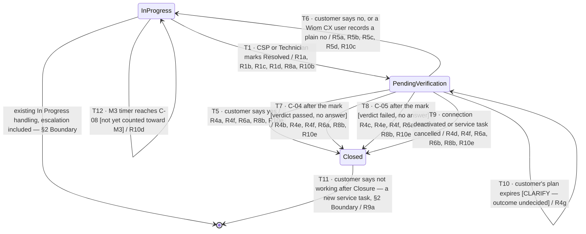

# Service Task Verification — confirming the CSP's fix

| | | | |
|---|---|---|---|
| **Owner** — Ashish Raj (PM) | **Reviewer** — [TBD — not asked] | **Status** — Draft | **Sign-off** — Pending |
| **Version** — v0.2 · 14 Oct 2026 | **Consulted — Solution design** — Ashish Agrawal | **Consulted — Customer OS** — Shail Patel, Manas | **Consulted — Support Resolution OS rules** — Varun, Akhil |
| **Terminology source** — Wiom Operational Terminology · 14 Oct 2026 · Wiom System Terminology · 14 Oct 2026 | | | |

---

## 1. Terminology Used

| Term | Meaning | Owner (domain) |
|---|---|---|
| Resolved | The mark a CSP or Technician puts on a service task to say the fault is fixed. It is a claim, not proof that the customer's internet works. | Support Resolution OS |
| In Progress | The state of a service task while a CSP or Technician is working on it. The CSP's TAT runs only in this state. | Support Resolution OS |
| Pending Verification | The state a service task enters at the Resolved mark and holds until it is Closed or goes back to In Progress. The CSP's TAT does not run here. | Support Resolution OS |
| Check window | The period right after the Resolved mark in which Wiom reads the customer's pings to reach the verdict. | Support Resolution OS |
| Verdict | Wiom's one-time judgement, at the end of the check window, of whether the customer's internet is up: **passed** or **failed**. Failed covers both "no ping" and "no data". Once set, it does not change. | Support Resolution OS |
| Reopen | The move of a service task from Pending Verification back to In Progress, caused only by the customer saying the internet is not working. The service task, the CSP and the issue stay the same. | Support Resolution OS |
| Closed | The final state of a service task. Nothing leaves it. | Support Resolution OS |
| Closure reason | The cause recorded on every Closed service task, one of four: **CUSTOMER_CONFIRMED** (the customer said yes), **PING_UP_NO_RESPONSE** (verdict passed, no answer in time), **FINAL_CLOSURE_UNVERIFIED** (verdict failed, no answer in time), **ENDED_NOT_VERIFIED** (the connection was deactivated or the service task cancelled during Pending Verification). | Support Resolution OS |
| Repeat | A new service task opened after a Closure, for the same connection and the same issue, within the repeat window (C-07). It is linked to the Closed service task. | Support Resolution OS |
| ISD | Internet supply down: a service task subtype for a customer with no internet. | Support Resolution OS |
| RDNI | Recharge done but no internet: a service task subtype for a customer who has recharged and still has no internet. | Support Resolution OS |
| Resolution signal | What Support Resolution OS sends Quality OS, and under this spec Compensation OS, when a service task finishes: its outcome and its closure reason. | Support Resolution OS |
| M3 | The Quality OS metric for long-open service tasks: how many of a CSP's service tasks stayed open past the long-open limit (C-08) in a cycle. | Quality OS |
| M3 timer | The clock M3 runs on each service task. It starts when the service task is raised, counts every hour of the day, pauses while the service task is in Pending Verification, and resumes where it stopped on a Reopen. | Quality OS |
| M3 cycle | The fixed half-month period M3 counts in (C-09). Each service task counts in at most one. | Quality OS |
| Kapture | The tool the Wiom CX team uses to see and work on service tasks. | Wiom CX team |
| CSP TAT | The turnaround time from the service task reaching the CSP to the CSP's Resolved mark, counted only inside CSP working hours, summed over every round. | Support Resolution OS |

---

## 2. Objective & Guardrails

**Objective.** A customer whose internet a CSP marks as fixed does not have the service task closed on the CSP's word alone. The customer is told or asked about the fix, and a customer who says it still does not work gets the same CSP back on the same service task at once.

**Boundary.** This spec governs service tasks of two subtypes, internet supply down (ISD) and recharge done but no internet (RDNI), from the CSP's Resolved mark until the service task is Closed. It leaves unchanged:
- how a service task is created, assigned and worked on while In Progress, including escalation (AC-REG-1);
- every other service task subtype, which keeps closing at the Resolved mark as today (AC-REG-2);
- the lifecycle of any new service task opened after a Closure. This spec sets only its repeat link (R9).

This spec also sets how M3 counts long-open service tasks (R10). The move to fixed M3 cycles applies to every service task M3 counts ⚠️ *AI GENERATED — review*; the pause applies only where Pending Verification exists, that is ISD and RDNI.

Version 1 sets no limit on reopen rounds. A Reopened service task always goes back to the same CSP, with no fallback when that CSP cannot take it.

### Guardrails — promises that hold on every path

| ID | Guardrail | One line | Anchors |
|---|---|---|---|
| G1 | **Closed is final** (zero tolerance) | A Closed service task never moves to any other state; a later "not working" opens a new service task. | R4 · R9 · AC-R9-1 · AC-R9-3 · AC-GRD-1 |
| G2 | **No Closure without the CSP's mark** (zero tolerance) | A service task in scope never reaches Closed unless a CSP or Technician first marked it Resolved. | R1 · R4 · AC-R1-1 · AC-GRD-2 |
| G3 | **Never "fixed" on a failed verdict** (zero tolerance) | The customer is never told the issue is fixed when the verdict failed. | R3 · AC-R3-2 · AC-GRD-3 |
| G4 | **Signals only at Closed** | Quality OS and Compensation OS hear about a service task's resolution only when it is Closed, never at the Resolved mark. | R6 · AC-R6-1 · AC-GRD-4 |
| G5 | **Verification never counts against the CSP** | Time in Pending Verification never counts in the CSP TAT or on the M3 timer. | R1 · R7 · R10 · AC-R7-1 · AC-R10-2 · AC-GRD-5 · AC-GRD-7 |
| G6 | **Rules and timers decide** | Every exit from Pending Verification comes from the customer's answer, a window expiring, or the connection ending — never from a person judging the case. | R4 · R5 · AC-GRD-6 |

---

## 3. Stories, Rules & Acceptance Criteria

### R1 — The Resolved mark starts Verification

| ID | Story | MUST | MUST NOT |
|---|---|---|---|
| R1 | As a customer whose internet is down, when the CSP says it is fixed, I want Wiom to check before my service task is closed, so that a false fix does not leave me stranded. | On T1: **(a)** move the service task to Pending Verification. **(b)** Stop the CSP TAT at the Resolved mark. **(c)** Show the CSP and the Technician that Wiom is verifying the fix. **(d)** Send the customer nothing at the mark. | Close the service task at the Resolved mark. Let the CSP or Technician pull a service task back from Pending Verification, or mark it Resolved again while it is there ⚠️ *AI GENERATED — review*. |

| AC | Given / When / Then | Verifies | Status |
|---|---|---|---|
| AC-R1-1 | **Given** an ISD service task for Cx Rekha Verma, In Progress with CSP Shiv Net since 14 Oct 11:20, **When** the Technician marks it Resolved at 13:47, **Then** the service task is in Pending Verification at 13:47, not Closed. | R1a · G2 | Settled |
| AC-R1-2 | **Given** the service task from AC-R1-1, **When** the Technician marks it Resolved at 13:47, **Then** its CSP TAT reads 2 h 27 min and does not grow while it stays in Pending Verification. | R1b · G5 | Settled |
| AC-R1-3 | **Given** the service task from AC-R1-1, **When** the CSP opens it in the CSP app at 13:50, **Then** it shows that Wiom is verifying the fix, and the app the Technician uses shows the same. | R1c | Settled |
| AC-R1-4 | **Given** the service task from AC-R1-1, **When** the Technician marks it Resolved at 13:47, **Then** no message about the fix is sent to Rekha Verma between 13:47 and the end of the check window at 14:17. | R1d | Settled |
| AC-R1-5 | **Given** the service task from AC-R1-1 in Pending Verification at 14:30, **When** the CSP opens it in the CSP app, **Then** the app offers neither a Resolved mark nor a way to take it back to In Progress, and it is still in Pending Verification. | R1 MUST NOT | Settled |

### R2 — The verdict

| ID | Story | MUST | MUST NOT |
|---|---|---|---|
| R2 | As a customer, I want Wiom to judge from my own Netbox whether my internet is back, so that what I am told matches what is true. | **(a)** On T2, at the end of the check window (C-01), set the verdict to passed when at least C-02 ping arrives from the customer's Netbox inside the window — and, for an RDNI service task, the customer's plan is active. **(b)** On T3, set the verdict to failed when no ping arrives inside the window, when no ping data is available, or when an RDNI customer's plan is not active. **(c)** On a failed verdict, show the CSP that the fix is not confirmed yet. | Change the verdict after the check window ends, whatever later pings show. Count a ping that arrived before the Resolved mark. |

| AC | Given / When / Then | Verifies | Status |
|---|---|---|---|
| AC-R2-1 | **Given** the service task from AC-R1-1, Resolved at 13:47, **When** one ping from Rekha Verma's Netbox arrives at 14:16, **Then** the verdict at 14:17 (C-01, 30 min) is passed. | R2a · T2 | Settled |
| AC-R2-2 | **Given** an RDNI service task Resolved at 13:47 whose customer's plan expired at 09:00 the same day, **When** pings arrive at 13:52 and 14:05, **Then** the verdict at 14:17 is failed. | R2a · R2b · T3 | Settled |
| AC-R2-3 | **Given** a service task Resolved at 13:47, **When** no ping data exists for the customer's Netbox between 13:47 and 14:17, **Then** the verdict at 14:17 is failed. | R2b · T3 | Settled |
| AC-R2-4 | **Given** a service task whose verdict failed at 14:17, **When** pings arrive from the customer's Netbox from 15:02 onwards, **Then** the verdict stays failed and the service task stays on the C-04 window. | R2 MUST NOT | Settled |
| AC-R2-5 | **Given** a service task whose verdict failed at 14:17, **When** the CSP opens it in the CSP app at 14:20, **Then** it shows that the fix is not confirmed yet. | R2c | Settled |

### R3 — Telling or asking the customer

| ID | Story | MUST | MUST NOT |
|---|---|---|---|
| R3 | As a customer, I want one clear message about my fix, worded to what Wiom actually knows, so that I can say if it still does not work. | On T2 and T3, at the end of the check window ⚠️ *AI GENERATED — review*: **(a)** on a passed verdict, tell the customer the issue is fixed and give a way to say it is not working; **(b)** on a failed verdict, ask the customer whether the internet is working, yes or no. **(c)** Reach the customer by app notification, SMS ⚠️ *AI GENERATED — review* and IVR call. **(d)** Count the customer as told once the message is sent. **(e)** On T4, if the customer has not answered C-03 after the Resolved mark ⚠️ *AI GENERATED — review*, send one reminder. | Tell the customer the issue is fixed on a failed verdict. Send more than one reminder. |

| AC | Given / When / Then | Verifies | Status |
|---|---|---|---|
| AC-R3-1 | **Given** the service task from AC-R2-1, verdict passed at 14:17, **When** the check window ends, **Then** Rekha Verma receives a message saying the issue is fixed, with a way to reply that it is not working. | R3a · T2 | Settled |
| AC-R3-2 | **Given** a service task whose verdict failed at 14:17, **When** the check window ends, **Then** the customer receives a message asking whether the internet is working, with yes and no replies, and no message to that customer says the issue is fixed. | R3b · T3 · G3 | Settled |
| AC-R3-3 | **Given** a failed verdict at 14:17 for a customer whose Netbox is offline, **When** the check window ends, **Then** an IVR call to the customer asking yes or no is placed. | R3c | Settled |
| AC-R3-4 | **Given** a failed-verdict message sent at 14:17 that never reaches the customer's phone, **When** a Wiom CX user opens the service task at 14:18, **Then** it shows the customer as told at 14:17. | R3d | Settled |
| AC-R3-5 | **Given** a service task Resolved at 13:47 on 14 Oct with no answer from the customer, **When** C-03 (24 h) after the mark passes at 13:47 on 15 Oct, **Then** the customer receives one reminder, and no further reminder before the service task is Closed. | R3e · T4 | Settled |

### R4 — Closure

| ID | Story | MUST | MUST NOT |
|---|---|---|---|
| R4 | As a customer, I want my service task to close only when the fix is confirmed or I have had time to say otherwise, so that a closed service task means something. | **(a)** On T5, when the customer says yes, close the service task at once with reason CUSTOMER_CONFIRMED, whatever the verdict. **(b)** On T7, when the verdict passed and the customer has not answered C-04 after the Resolved mark, close it with reason PING_UP_NO_RESPONSE. **(c)** On T8, when the verdict failed and the customer has not answered C-05 after the Resolved mark, close it with reason FINAL_CLOSURE_UNVERIFIED. **(d)** On T9, when the connection is deactivated or the service task is cancelled during Pending Verification, close it with reason ENDED_NOT_VERIFIED. **(e)** On T7 and T8, tell the customer how to raise a new service task. **(f)** On every Closure, show the CSP the closure reason. **(g)** On T10, when the customer's plan expires during Pending Verification: [CLARIFY — what happens to the service task]. | Close a service task in scope any other way. Close it before the customer's answer or the window that applies. |

| AC | Given / When / Then | Verifies | Status |
|---|---|---|---|
| AC-R4-1 | **Given** a service task with a failed verdict at 14:17 on 14 Oct, **When** the customer replies yes at 18:32, **Then** the service task is Closed at 18:32 with reason CUSTOMER_CONFIRMED. | R4a · T5 | Settled |
| AC-R4-2 | **Given** the service task from AC-R2-1, verdict passed, no answer, **When** C-04 (48 h) after the Resolved mark passes at 13:47 on 16 Oct, **Then** it is Closed at 13:47 on 16 Oct with reason PING_UP_NO_RESPONSE. | R4b · T7 | Settled |
| AC-R4-3 | **Given** a service task Resolved at 13:47 on 14 Oct, verdict failed, no answer, **When** C-05 (7 days) after the mark passes at 13:47 on 21 Oct, **Then** it is Closed at 13:47 on 21 Oct with reason FINAL_CLOSURE_UNVERIFIED. | R4c · T8 | Settled |
| AC-R4-4 | **Given** a service task in Pending Verification since 13:47 on 14 Oct, **When** its connection is deactivated at 10:05 on 15 Oct, **Then** it is Closed at 10:05 on 15 Oct with reason ENDED_NOT_VERIFIED. | R4d · T9 | Settled |
| AC-R4-5 | **Given** the service task from AC-R4-3, **When** it is Closed at 13:47 on 21 Oct, **Then** the customer receives a message telling them how to raise a new service task. | R4e · T8 | Settled |
| AC-R4-6 | **Given** the service task from AC-R4-2, **When** it is Closed at 13:47 on 16 Oct, **Then** the CSP app shows it as Closed with reason PING_UP_NO_RESPONSE. | R4f · T7 | Settled |
| AC-R4-8 | **Given** a service task Resolved at 13:47 on 14 Oct, verdict failed, no answer, **When** C-04 (48 h) after the mark passes at 13:47 on 16 Oct, **Then** it is still in Pending Verification, not Closed. | R4 MUST NOT | Settled |
| AC-R4-7 | **Given** a service task in Pending Verification since 13:47 on 14 Oct, **When** the customer's plan expires at 23:59 on 15 Oct, **Then** [CLARIFY — the service task's state and the customer's message]. | R4g · T10 | OPEN |

### R5 — Reopen on the customer's no

| ID | Story | MUST | MUST NOT |
|---|---|---|---|
| R5 | As a customer whose internet still does not work, I want the same CSP back on my same service task at once, so that I never have to raise it again. | On T6: **(a)** move the service task back to In Progress at once, whatever the verdict; **(b)** keep the same service task and the same CSP, and tell the CSP it is the same issue; **(c)** count a plain "not working" recorded by a Wiom CX user against the service task as the customer's no; **(d)** resume the CSP TAT, from the start of CSP working hours (C-06) when the no arrives outside them; **(e)** start a new Pending Verification at the CSP's next Resolved mark. | Open a new service task for a no given during Pending Verification. Hand a Reopened service task to a different CSP. Count any customer contact other than a plain no as a no, or open a new service task for it, during Pending Verification. |

| AC | Given / When / Then | Verifies | Status |
|---|---|---|---|
| AC-R5-1 | **Given** the service task from AC-R2-1, verdict passed, **When** Rekha Verma replies "not working" at 16:05 on 14 Oct, **Then** the service task is In Progress at 16:05, with CSP Shiv Net, under the same service task. | R5a · T6 | Settled |
| AC-R5-2 | **Given** the Reopen in AC-R5-1, **When** the CSP opens the service task at 16:10, **Then** the CSP app shows it as the same issue, Reopened, not as a new service task. | R5b · T6 | Settled |
| AC-R5-3 | **Given** a service task in Pending Verification, **When** a Wiom CX user records a plain "not working" against it at 17:40 after the customer calls, **Then** the service task is In Progress at 17:40 with the same CSP, and no new service task exists for that connection. | R5c · T6 | Settled |
| AC-R5-4 | **Given** a service task in Pending Verification, **When** the customer calls the Wiom CX team at 17:40 to ask when the CSP will visit and no plain no is recorded, **Then** the service task stays in Pending Verification and no new service task exists for that connection. | R5 MUST NOT | Settled |
| AC-R5-5 | **Given** a service task in Pending Verification with CSP TAT 2 h 27 min, **When** the customer replies "not working" at 22:30 on 14 Oct, **Then** it is In Progress at 22:30, and its CSP TAT reads 2 h 27 min until 11:00 on 15 Oct, then grows. | R5d · T6 | Settled |
| AC-R5-6 | **Given** the Reopened service task from AC-R5-1, **When** the CSP marks it Resolved again at 19:12, **Then** it is in Pending Verification with a new check window ending at 19:42 and a new verdict. | R5e · T1 | Settled |

### R6 — Signals at Closure

| ID | Story | MUST | MUST NOT |
|---|---|---|---|
| R6 | As a CSP, I want my quality and earnings to rest on what happened to the customer, so that a confirmed fix counts and a claimed one does not. | **(a)** At every Closure, send Quality OS and Compensation OS the resolution signal with the closure reason. **(b)** For FINAL_CLOSURE_UNVERIFIED and ENDED_NOT_VERIFIED, never signal the service task as fixed. | Send any resolution signal at the Resolved mark or during Pending Verification. |

| AC | Given / When / Then | Verifies | Status |
|---|---|---|---|
| AC-R6-1 | **Given** the service task from AC-R1-1, Resolved at 13:47 on 14 Oct, **When** it is Closed at 18:32 with reason CUSTOMER_CONFIRMED, **Then** Quality OS and Compensation OS each receive one resolution signal at 18:32 carrying CUSTOMER_CONFIRMED, and neither received one between 13:47 and 18:32. | R6a · T5 · G4 | Settled |
| AC-R6-2 | **Given** the service task from AC-R4-3, **When** it is Closed with reason FINAL_CLOSURE_UNVERIFIED, **Then** the signal Quality OS and Compensation OS receive does not mark it as fixed. | R6b · T8 | Settled |
| AC-R6-3 | **Given** the service task from AC-R4-4, **When** it is Closed with reason ENDED_NOT_VERIFIED, **Then** the signal Quality OS and Compensation OS receive does not mark it as fixed. | R6b · T9 | Settled |

### R7 — CSP TAT

| ID | Story | MUST | MUST NOT |
|---|---|---|---|
| R7 | As a CSP, I want my TAT to count only the time I spend on the service task, so that Wiom's checking never counts against me. | **(a)** Count the CSP TAT only while the service task is In Progress, inside CSP working hours (C-06). **(b)** Add up every In Progress round. | Count time in Pending Verification. |

| AC | Given / When / Then | Verifies | Status |
|---|---|---|---|
| AC-R7-1 | **Given** a service task In Progress from 11:20, Resolved at 13:47, Reopened at 16:05 and Resolved again at 19:12 on 14 Oct, **When** it is Closed at 08:40 on 15 Oct, **Then** its CSP TAT is 5 h 34 min (2 h 27 min plus 3 h 07 min). | R7a · R7b · G5 | Settled |
| AC-R7-2 | **Given** a service task that reaches the CSP at 20:40 on 14 Oct, **When** the CSP marks it Resolved at 11:25 on 15 Oct, **Then** its CSP TAT is 45 min (20 min on 14 Oct and 25 min on 15 Oct). | R7a | Settled |

### R8 — The Wiom CX team sees Verification

| ID | Story | MUST | MUST NOT |
|---|---|---|---|
| R8 | As a Wiom CX user, I want to see that a service task is being verified, so that I can tell a customer where it stands. | **(a)** On T1, and while the service task is in Pending Verification, Kapture shows it as In progress. **(b)** At Closure, Kapture shows it as completed ⚠️ *AI GENERATED — review*. | Show a service task as resolved or completed in Kapture while it is in Pending Verification. |

| AC | Given / When / Then | Verifies | Status |
|---|---|---|---|
| AC-R8-1 | **Given** the service task from AC-R1-1, **When** a Wiom CX user opens it in Kapture at 14:30 on 14 Oct, **Then** its Kapture sub-status is `IP`, not `RS` or `CO`. | R8a · R8 MUST NOT | Settled |
| AC-R8-2 | **Given** the service task from AC-R4-1, **When** a Wiom CX user opens it in Kapture at 18:40 on 14 Oct, **Then** its Kapture sub-status is `CO` ⚠️ *AI GENERATED — review*. | R8b · T5 | Settled |

### R9 — After Closure

| ID | Story | MUST | MUST NOT |
|---|---|---|---|
| R9 | As a customer whose internet fails again after my service task closed, I want a new service task that knows my history, so that my repeat is not treated as a first fault. | **(a)** On T11, when the customer says it is not working after Closure, open a new service task and link it to the Closed one as a repeat when it comes within C-07 of the Closure. **(b)** When the customer says yes after Closure, change nothing. | Reopen or change a Closed service task. |

| AC | Given / When / Then | Verifies | Status |
|---|---|---|---|
| AC-R9-1 | **Given** the service task from AC-R4-2, Closed at 13:47 on 16 Oct, **When** Rekha Verma reports "not working" at 09:15 on 2 Nov, **Then** a new service task exists, linked to the Closed one as a repeat, and the Closed service task is still Closed. | R9a · T11 · G1 | Settled |
| AC-R9-2 | **Given** the service task from AC-R4-2, **When** Rekha Verma replies yes at 10:00 on 17 Oct, **Then** it is still Closed with reason PING_UP_NO_RESPONSE, and no signal is sent. | R9b | Settled |
| AC-R9-3 | **Given** a Closed service task, **When** any actor tries to move it to In Progress or Pending Verification, **Then** it stays Closed. | R9 MUST NOT · G1 | Settled |

### R10 — M3 counts only time waiting on the CSP

| ID | Story | MUST | MUST NOT |
|---|---|---|---|
| R10 | As a CSP, I want M3 to count only the time a service task waits on me, so that Wiom checking a fix never makes a service task look long-open. | **(a)** Start the M3 timer when the service task is raised, and run it on the wall clock, every hour of the day. **(b)** On T1, pause the M3 timer at the Resolved mark. **(c)** On T6, resume the M3 timer from where it stopped. **(d)** On T12, when the M3 timer reaches C-08, count the service task once toward M3, in the M3 cycle (C-09) in which that happens. **(e)** On T5, T7, T8 and T9, stop the M3 timer; a service task whose timer never reached C-08 is never counted. **(f)** Give a CSP a PASS on M3 for a cycle when C-10 or fewer of its service tasks were counted in it, and a FAIL otherwise. | Count time in Pending Verification on the M3 timer. Count the same service task in more than one M3 cycle, even if it stays open or is Reopened. Pause the M3 timer for any reason other than Pending Verification. |

| AC | Given / When / Then | Verifies | Status |
|---|---|---|---|
| AC-R10-1 | **Given** an ISD service task raised at 20:10 on 9 Oct and never marked Resolved, **When** its M3 timer reaches C-08 (48 h) at 20:10 on 11 Oct, **Then** it is counted once toward M3 in the 1–15 Oct cycle, although its CSP TAT, counted in working hours only, is 20 h. | R10a · R10d · T12 | Settled |
| AC-R10-2 | **Given** a service task raised at 10:20 on 14 Oct and marked Resolved at 06:20 on 15 Oct (M3 timer 20 h), **When** the customer replies yes at 08:05 on 17 Oct and it is Closed, **Then** its M3 timer reads 20 h and it is never counted toward M3. | R10b · R10e · T1 · T5 · G5 | Settled |
| AC-R10-3 | **Given** a service task raised at 09:20 on 14 Oct, marked Resolved at 15:20 on 15 Oct (M3 timer 30 h) and Reopened at 09:05 on 16 Oct, **When** it is still not marked Resolved again at 03:05 on 17 Oct, **Then** its M3 timer reaches 48 h at 03:05 on 17 Oct and it is counted once in the 16–31 Oct cycle. | R10c · R10d · T6 · T12 | Settled |
| AC-R10-4 | **Given** a service task counted toward M3 at 22:40 on 14 Oct in the 1–15 Oct cycle, **When** it is still open on 16 Oct, is marked Resolved at 09:00 on 17 Oct and is Reopened at 11:30 on 18 Oct, **Then** it is not counted in the 16–31 Oct cycle. | R10 MUST NOT | Settled |
| AC-R10-5 | **Given** a CSP with 2 service tasks counted toward M3 in the 1–15 Oct cycle, **When** Quality OS evaluates that cycle, **Then** the CSP's M3 result is PASS. | R10f | Settled |
| AC-R10-6 | **Given** a CSP with 3 service tasks counted toward M3 in the 1–15 Oct cycle, **When** Quality OS evaluates that cycle, **Then** the CSP's M3 result is FAIL. | R10f | Settled |
| AC-R10-7 | **Given** a service task raised at 08:00 on 14 Oct and In Progress, **When** 21:00 on 14 Oct passes and the CSP's working hours end, **Then** its M3 timer keeps running through the night and reads 25 h at 09:00 on 15 Oct. | R10a · R10 MUST NOT | Settled |

---

## 4. Cross-cutting Acceptance Criteria

| AC | Given / When / Then | Verifies | Status |
|---|---|---|---|
| AC-WF-1 | **Given** an ISD service task In Progress from 11:20 on 14 Oct, **When** the Technician marks it Resolved at 13:47, a ping arrives at 14:16, and Rekha Verma replies yes at 15:02, **Then** she received the "fixed" message at 14:17, the service task is Closed at 15:02 with reason CUSTOMER_CONFIRMED, and Quality OS received one signal at 15:02. | T1 · T2 · T5 · G4 | Settled |
| AC-WF-2 | **Given** the same service task, **When** no ping arrives by 14:17, the customer replies "not working" at 16:05, the CSP marks it Resolved again at 19:12, a ping arrives at 19:20, and no answer comes, **Then** it is Closed at 19:12 on 16 Oct with reason PING_UP_NO_RESPONSE and CSP TAT 5 h 34 min. | T1 · T3 · T6 · T2 · T7 · G5 | Settled |
| AC-FAIL-1 | **Given** a service task Resolved at 13:47, **When** C-01 (30 min) expires at 14:17, **Then** the verdict is set and the matching message has been sent to the customer. | C-01 · R2 · R3 | Settled |
| AC-FAIL-2 | **Given** a service task Resolved at 13:47 on 14 Oct with no answer, **When** C-03 (24 h) expires at 13:47 on 15 Oct, **Then** the customer has received exactly one reminder. | C-03 · R3e | Settled |
| AC-FAIL-3 | **Given** a service task Resolved at 13:47 on 14 Oct, verdict passed, no answer, **When** C-04 (48 h) expires at 13:47 on 16 Oct, **Then** the service task is Closed with PING_UP_NO_RESPONSE and the customer has been told how to raise a new service task. | C-04 · R4b · R4e | Settled |
| AC-FAIL-4 | **Given** a service task Resolved at 13:47 on 14 Oct, verdict failed, no answer, **When** C-05 (7 days) expires at 13:47 on 21 Oct, **Then** the service task is Closed with FINAL_CLOSURE_UNVERIFIED and the customer has been told how to raise a new service task. | C-05 · R4c · R4e | Settled |
| AC-REG-1 | **Given** a service task In Progress that has not been marked Resolved, **When** it reaches its escalation point, **Then** it escalates exactly as before this change [TBD — not asked]. | §2 Boundary | OPEN |
| AC-REG-2 | **Given** a service task of a subtype other than ISD or RDNI, **When** the CSP marks it Resolved, **Then** it closes as before this change [TBD — not asked]. | §2 Boundary | OPEN |
| AC-GRD-1 | **Given** service tasks Closed by each of the four closure reasons, **When** the customer replies yes, the CSP opens each one in the CSP app, and a Wiom CX user opens each one in Kapture, **Then** each stays Closed. | G1 | Settled |
| AC-GRD-2 | **Given** an ISD service task never marked Resolved, **When** the customer replies yes to any message, or C-04 or C-05 passes from its creation, **Then** it is not Closed. | G2 | Settled |
| AC-GRD-3 | **Given** every failed-verdict service task in a day, **When** a Wiom Product user reads every message and reminder sent to those customers, **Then** none says the issue is fixed. | G3 | Settled |
| AC-GRD-4 | **Given** every service task Resolved in a day, **When** a Wiom Product user compares the Quality OS and Compensation OS signals with the Closures, **Then** every signal falls at a Closure and none at a Resolved mark. | G4 | Settled |
| AC-GRD-5 | **Given** a service task with three rounds of 2 h 10 min, 1 h 05 min and 40 min In Progress, and 30 h in Pending Verification, **When** it is Closed, **Then** its CSP TAT is 3 h 55 min. | G5 | Settled |
| AC-GRD-6 | **Given** every service task that left Pending Verification in a day, **When** a Wiom Product user reads the recorded cause of each exit, **Then** each was a customer answer, a window expiry, or a connection deactivation or cancellation. | G6 | Settled |
| AC-GRD-7 | **Given** a service task with 2 h 10 min on the M3 timer before its Resolved mark and 6 days 4 h in Pending Verification, **When** it is Closed with FINAL_CLOSURE_UNVERIFIED, **Then** its M3 timer reads 2 h 10 min and it is not counted toward M3. | G5 · R10b · R10e | Settled |
| AC-BV-1 | **Given** a service task Resolved at 13:47:00, **When** its only ping arrives at 14:16:59, **Then** the verdict is passed. | C-01 · C-02 · R2a | Settled |
| AC-BV-2 | **Given** a service task Resolved at 13:47:00, **When** its only ping arrives at 14:17:01, **Then** the verdict is failed. | C-01 · R2b | Settled |
| AC-BV-3 | **Given** a service task Resolved at 13:47:00, **When** its only ping arrives at 13:46:30, before the mark, **Then** the verdict is failed. | C-02 · R2 MUST NOT | Settled |
| AC-BV-4 | **Given** a passed verdict, Resolved at 13:47 on 14 Oct, **When** the customer replies yes at 13:46 on 16 Oct, **Then** it is Closed with CUSTOMER_CONFIRMED, not PING_UP_NO_RESPONSE. | C-04 · R4a | Settled |
| AC-BV-5 | **Given** a service task Closed at 13:47 on 16 Oct, **When** the customer reports "not working" at 13:46 on 15 Nov, **Then** the new service task is linked as a repeat. | C-07 · R9a | Settled |
| AC-BV-6 | **Given** a service task Closed at 13:47 on 16 Oct, **When** the customer reports "not working" at 13:48 on 15 Nov, **Then** the new service task is not linked as a repeat. | C-07 · R9a | Settled |
| AC-BV-7 | **Given** a service task whose M3 timer reads 47 h 59 min when the CSP marks it Resolved, **When** it is later Closed with CUSTOMER_CONFIRMED, **Then** it is not counted toward M3. | C-08 · R10e | Settled |
| AC-BV-8 | **Given** a service task In Progress, **When** its M3 timer reaches 48 h 00 min at 23:59 on 15 Oct, **Then** it is counted in the 1–15 Oct cycle, not the 16–31 Oct cycle. | C-09 · R10d | Settled |
| AC-BV-9 | **Given** a service task In Progress, **When** its M3 timer reaches 48 h 00 min at 00:00 on 16 Oct, **Then** it is counted in the 16–31 Oct cycle. | C-09 · R10d | Settled |
| AC-RACE-1 | **Given** a passed verdict and no answer, **When** the customer replies "not working" at the same instant C-04 expires, **Then** the service task is Reopened, not Closed ⚠️ *AI GENERATED — review*. | Precedence · T6 · T7 | Settled |
| AC-RACE-2 | **Given** a failed verdict and no answer, **When** the customer replies yes at the same instant C-05 expires, **Then** it is Closed with CUSTOMER_CONFIRMED ⚠️ *AI GENERATED — review*. | Precedence · T5 · T8 | Settled |
| AC-RACE-3 | **Given** a service task In Progress whose M3 timer reaches 48 h at 13:47:00, **When** the CSP marks it Resolved at 13:47:00, **Then** it is counted toward M3 ⚠️ *AI GENERATED — review*. | Precedence · T1 · T12 | Settled |
| AC-DUP-1 | **Given** a service task in Pending Verification, **When** the customer replies yes twice, at 15:02 and 15:03, **Then** it is Closed once at 15:02, and Quality OS and Compensation OS each receive one signal. | T5 · R6a | Settled |
| AC-DUP-2 | **Given** a service task in Pending Verification, **When** the customer replies "not working" twice, at 16:05 and 16:06, **Then** it is Reopened once, at 16:05. | T6 · R5a | Settled |
| AC-DUP-3 | **Given** a service task In Progress, **When** the Technician taps Resolved twice, at 13:47:00 and 13:47:02, **Then** one Pending Verification starts, with one check window ending at 14:17:00. | T1 · R1a | Settled |

---

## 5. System Behaviour

**Lifecycle test:** persists yes · two or more named statuses yes (In Progress, Pending Verification, Closed) · moved later yes (the customer's answer, window expiry) → state diagram.

Lifecycle of an **ISD or RDNI service task** from the CSP's Resolved mark to Closed. It enters In Progress from the existing service task lifecycle; creation, assignment and escalation while In Progress are out of scope; so is the lifecycle of a new service task opened after Closure.

**Not possible from here:**
- In Progress × check window end, C-03, C-04, C-05 — these clocks start only at the Resolved mark (R1a).
- In Progress × customer yes or no about the fix — the customer is asked only after the verdict (R3); a report while In Progress is existing handling (§2 Boundary).
- In Progress × plan expiry — existing handling (§2 Boundary).
- Pending Verification × CSP or Technician marks Resolved — the mark is not offered while Pending Verification (R1 MUST NOT).
- Pending Verification × customer contact that is not a plain no — no state change and no new service task (R5 MUST NOT).
- Pending Verification × C-04 when the verdict failed, and × C-05 when it passed — only the window matching the verdict applies (R4b, R4c).
- In Progress × M3 timer reaches C-08 when the service task was already counted — counted once only (R10 MUST NOT).
- Pending Verification × M3 timer reaches C-08 — the timer is paused there (R10b).
- Closed × every trigger except T11 — Closed is final (G1); a yes after Closure changes nothing (R9b), and the M3 timer has stopped (R10e).

**Precedence:** a customer answer arriving at the same instant as C-04 or C-05 expiry is applied before the expiry (AC-RACE-1, AC-RACE-2) ⚠️ *AI GENERATED — review*. The M3 timer reaching C-08 at the same instant as a Resolved mark is applied before the mark (AC-RACE-3) ⚠️ *AI GENERATED — review*.

---

## 6. Configurability

| ID | Parameter | Value / Default | Kind | Range · Owner · Why configurable |
|---|---|---|---|---|
| C-01 | Check window: from the Resolved mark to the verdict | 30 minutes | Fixed | — |
| C-02 | Pings needed inside the check window for a passed verdict | 1 | Fixed | — |
| C-03 | Reminder: from the Resolved mark to the one reminder, if no answer | 24 hours ⚠️ *AI GENERATED — review* | Fixed | — |
| C-04 | Verification window when the verdict passed: from the Resolved mark to Closure with no answer | 48 hours | Fixed | — |
| C-05 | Verification window when the verdict failed: from the Resolved mark to Closure with no answer | 7 days | Fixed | — |
| C-06 | CSP working hours, inside which the CSP TAT runs | 11:00–21:00 IST, every day | Fixed | — |
| C-07 | Repeat window: from Closure to a new service task, inside which it is linked as a repeat | 30 days | Fixed | — |
| C-08 | M3 long-open limit: M3 timer time, wall clock, after which a service task counts toward M3 | 48 hours | Fixed | — |
| C-09 | M3 cycles | 1st–15th, and 16th–last day of each month (IST) | Fixed | — |
| C-10 | M3 pass mark: most service tasks counted in one cycle for a PASS | 2 | Fixed | — |

**Interaction note (C-01 × C-03 × C-04 / C-05):** for the first 30 minutes after the Resolved mark the customer hears nothing and the CSP sees that Wiom is verifying. After the verdict, the customer has one message and, at 24 hours, one reminder; the service task then waits silently until the customer answers or the matching window ends.

**Interaction note (C-08 × C-04 / C-05):** the M3 timer runs only outside Pending Verification and the verification windows run only inside it, so the two never overlap. A service task can wait the full 7 days of C-05 without moving closer to C-08.

---

## 7. Impacted Systems & References

| System / Service | Impact | Reference material | What was checked · ACs grounded on it |
|---|---|---|---|
| Support Resolution OS (`csp-support-resolution-service`) | Owns the service task; gains Pending Verification, the verdict, Reopen and the four closure reasons | `csp-os-yaml` main, 12 Oct 2026 | Today the service task closes at the Resolved mark whatever the ping check shows, and repeats link only within the existing reopen window (`REOPEN_LINEAGE_WINDOW`), shorter than C-07 · AC-R1-1 · AC-R4-1 to AC-R4-4 · AC-R9-1 |
| CVS (ping check, called by Support Resolution OS) | Its reading of the customer's Netbox pings decides the verdict | Same repository | Today it is read once, at the mark · AC-R2-1 to AC-R2-4 |
| TAS (CSP app and the app the Technician uses) | Shows Wiom is verifying, "not confirmed yet", the Reopen, and the closure reason | CSP app, 12 Oct 2026 | Today, after the mark, the CSP app says the connection is back online whatever the ping check showed · AC-R1-3 · AC-R2-5 · AC-R4-6 · AC-R5-2 |
| Kapture, through `ticket-service-java` | Shows `IP` during Pending Verification and a completed sub-status at Closure | `ticket-service-java` main, 29 Sep 2026 | Kapture sub-status codes include `IP` (In progress), `RS` (Resolved), `CO` (Completed). Today the mark sends `RS` or `CO`, and an `IP` coming from Kapture is not accepted · AC-R8-1 · AC-R8-2 |
| Quality OS | Receives the resolution signal only at Closure | `csp-os-yaml` main, 12 Oct 2026 | Today it receives the signal at the mark · AC-R6-1 to AC-R6-3 · AC-GRD-4 |
| Quality OS, M3 | M3 timer pauses in Pending Verification and resumes on a Reopen; counting moves to fixed M3 cycles, once per service task | `csp-quality-service` main, 14 Oct 2026: `DailyMetricSnapshotServiceImpl` (M3 pass/fail), `ComplaintResolutionLedgerRepository.countBreachedNotExcluded` (breach count), `application.yml` (`QU_M3_BREACH_HOURS` 48, `QU_M3_BREACH_THRESHOLD` 2); M3 decision page (claude.ai artifact 8QRrrRYtSmayVyxdC9VZhL) | Today M3 counts a service task unresolved 48 wall-clock hours after filing, never pauses, and uses a rolling 15-day window; a repeat is a new record with its own 48 hours. Minimum service tasks for an M3 verdict in a cycle: [TBD — not asked] · AC-R10-1 to AC-R10-7 · AC-GRD-7 · AC-BV-7 to AC-BV-9 |
| Compensation OS | Receives the resolution signal only at Closure | Solution flow v3 | No receiver of the resolution signal found in code today · AC-R6-1 to AC-R6-3 |
| IVR service, Message orchestrator | Send the customer's message, the IVR call and the reminder | — | Today the customer gets a "resolved" app notification, or SMS if it fails, at the mark, with no way to answer · AC-R3-1 to AC-R3-5 |
| Customer backend | Says whether an RDNI customer's plan is active at the verdict | — | Not checked [TBD — not asked] · AC-R2-2 |

---

## 8. Notes for System Capabilities

| Capability | Needed by |
|---|---|
| Hold a service task in Pending Verification, with the CSP TAT stopped, from the Resolved mark until it is Closed or Reopened. | T1 · R1 · R7 · G5 |
| Read the customer's Netbox pings over the check window (C-01) and set a verdict once — plus whether an RDNI customer's plan is active. | T2 · T3 · R2 · C-01 · C-02 |
| Send the customer one verdict-matched message by app notification, SMS and IVR call, and one reminder at C-03. | T2 · T3 · T4 · R3 · C-03 · G3 |
| Take the customer's yes or no, and a plain no recorded by a Wiom CX user, against the service task. | T5 · T6 · R4a · R5c |
| Close a service task at C-04 or C-05 after the Resolved mark, recording one of four closure reasons. | T7 · T8 · T9 · R4 · C-04 · C-05 |
| Send Quality OS and Compensation OS the resolution signal, with the closure reason, only at Closure. | R6 · G4 |
| Show the Wiom CX team `IP` in Kapture during Pending Verification. | R8 |
| Link a new service task to a Closed one as a repeat within C-07. | T11 · R9 · C-07 |
| Run a wall-clock M3 timer per service task from when it is raised, paused in Pending Verification and resumed on a Reopen, and count it once, in the M3 cycle in which it reaches C-08. | T1 · T6 · T12 · R10 · C-08 · C-09 · C-10 · G5 |

---

## AI-generated content for review *(working drafts only — deleted at finalise)*

| Location (section · ID) | What was generated | Basis |
|---|---|---|
| §3 · R3 MUST | The message goes out at the end of the check window (v3 says only "after the verdict") | Inference — the verdict is set at that moment |
| §3 · R3c | SMS as one of the channels (you named IVR; v3 names no channels) | Inference from today's "resolved" message, which uses push then SMS |
| §6 · C-03 · §3 · R3e · §5 · T4 | The reminder is counted from the Resolved mark (v3 counts it from when the customer is told). The T4 diagram label cannot carry a marker | Follows your decision that the windows run from Resolved |
| §3 · R8b · AC-R8-2 | Kapture shows `CO` (Completed) at Closure, not `RS` or `CL` | Inference — `CO` is what a normal-priority service task gets today |
| §3 · R1 MUST NOT | The CSP cannot mark the service task Resolved again while it is in Pending Verification (v3 says only that it cannot be pulled back) | Inference — a second mark would restart the check window |
| §4 · AC-RACE-1, AC-RACE-2 · §5 Precedence | A customer answer at the same instant as a window expiry is applied first | Inference — the customer's word outranks a timer |
| §2 Boundary | The move to fixed M3 cycles applies to every service task M3 counts, not only ISD and RDNI | Inference — M3 is one count per CSP, so its cycles cannot differ by subtype |
| §4 · AC-RACE-3 · §5 Precedence | When the M3 timer reaches 48 h at the same instant as a Resolved mark, the service task is counted | Inference — the timer had already run its full 48 hours |

## Not asked *(working drafts only — deleted at finalise)*

| Location (section · ID) | What was never asked |
|---|---|
| Header · Reviewer | Which engineering lead reviews this PRD |
| §4 · AC-REG-1, AC-REG-2 | What to observe to prove escalation and other subtypes are unchanged, and the reference for it |
| §7 · Customer backend | Which system answers "is the RDNI customer's plan active", and its reference |
| §6 · every row | Whether any number must change without a release, and who would change it (all left Fixed, the default) |
| §3 · R3 | What happens when the message cannot be sent on any channel |
| §3 · R4 / R6 | When the customer's existing "resolved" message and apology coupon fire — at Closure, or on which closure reasons |
| §2 Boundary | Whether a Wiom CX user closing the service task in Kapture during Pending Verification counts as the customer's yes, or is blocked |
| §3 · R5 | Whether a customer raising the same issue again in the app during Pending Verification counts as a no |
| §3 · R8 | What Kapture shows after a Reopen, while the service task is back In Progress |
| §7 · Quality OS, M3 | The minimum number of service tasks a CSP needs in an M3 cycle for a PASS or FAIL (today 10 in the rolling window), and from which date the fixed M3 cycles start |
