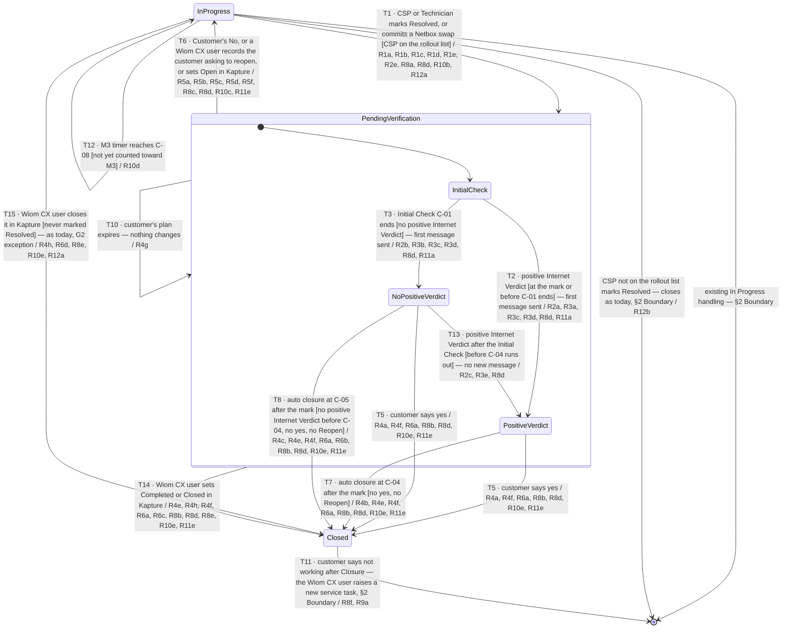

# Service Task Verification — confirming the CSP's fix

| | | | |
|---|---|---|---|
| **Owner** — Ashish Raj (PM) | **Reviewer** — Akash (engineering) · Dhruv (product) | **Status** — Draft (shortened copy of v1.2) | **Sign-off** — — |
| **Version** — v1.2-short · 20 Oct 2026 · from v1.2 (signed off 15 Oct 2026) | **Consulted — Solution design** — Ashish Agrawal | **Consulted — Customer OS** — Shail Patel, Manas | |
| **Terminology source** — Wiom Operational Terminology (v0.7) · 15 Oct 2026 · Wiom System Terminology (v0.7) · 15 Oct 2026 | | | |

**Designs (Figma)** — screens, flows and copy for this spec:

| App | Design file | Prototype |
|---|---|---|
| CSP app | [CSP app design](https://www.figma.com/design/W2Z3B5xfFO3UibJSzkyHn2/PA---Dev--%253E-January-2026-Onwards?node-id=18054-2602) | [CSP app prototype](https://www.figma.com/proto/W2Z3B5xfFO3UibJSzkyHn2/PA---Dev--%3E-January-2026-Onwards?node-id=18054-2603&starting-point-node-id=18054%3A2603&show-proto-sidebar=1&page-id=18054%3A1217) |
| Technician App | [Technician App design](https://www.figma.com/design/W2Z3B5xfFO3UibJSzkyHn2/PA---Dev--%253E-January-2026-Onwards?node-id=18054-4702) | [Technician App prototype](https://www.figma.com/proto/W2Z3B5xfFO3UibJSzkyHn2/PA---Dev--%3E-January-2026-Onwards?node-id=18054-4703&starting-point-node-id=18054%3A4703&show-proto-sidebar=1&page-id=18054%3A1217) |
| Customer app — chat and push notification | [Customer chat design](https://www.figma.com/design/8OMg9BTNhVDJxQ5ii10OWj/CA-Final-Dev--%3E-Jan-2026-Onwards-Re.wa.Gh.ka.Net?node-id=17557-48543) | [Customer chat prototype](https://www.figma.com/proto/8OMg9BTNhVDJxQ5ii10OWj/CA-Final-Dev--%3E-Jan-2026-Onwards-Re.wa.Gh.ka.Net?node-id=17557-48543&scaling=contain&content-scaling=fixed) |

Where a design and this spec differ, this spec decides. The designs were reviewed against this spec on 15 Oct 2026, and every difference was decided in v0.31.

---

## 1. Terminology Used

Only the terms this spec coins or gives a new meaning. Everything else follows the Wiom Operational and System Terminology (header).

| Term | Meaning | Owner (domain) |
|---|---|---|
| Pending Verification | The state a service task enters at the Resolved mark and holds until it is Closed or goes back to In Progress. The CSP's TAT does not run here. | Support Resolution OS |
| Initial Check | The first stage of Pending Verification: from the Resolved mark for up to C-01 (30 min, configurable). Its only purpose is to decide when the first message reaches the customer: the moment a positive Internet Verdict is received, or at the end of the Initial Check if none is. The first message is the same either way. | Support Resolution OS |
| Positive verdict | The stage of Pending Verification once a positive Internet Verdict has been received and the first message sent. It waits on the customer's answer; with no answer, the service task closes at C-04 after the Resolved mark. | Support Resolution OS |
| No positive verdict | The stage of Pending Verification after the Initial Check ended with no positive Internet Verdict and the first message was sent. It waits on the customer's answer while Wiom keeps asking for the Internet Verdict; with no answer, the service task closes at C-04 if a positive Internet Verdict arrives before then, otherwise at C-05. | Support Resolution OS |
| First message | The one message the customer gets in each round of Pending Verification, the same whatever the Internet Verdict: the issue has been resolved, please check — is your internet working? with a yes and a no reply. Sent by app notification and in the customer chat (copy: Figma, header). | Support Resolution OS |
| Internet Verdict | Connection Validation Service's answer when Wiom asks whether the customer's internet is working: **positive** (working) or not. How it reaches the answer is its own — today from Netbox signals, later possibly optical power and more; this spec only asks for it. Wiom asks at the Resolved mark, every C-13 (5 min) during the Initial Check, then every C-14 (1 h) until the customer answers, the service task closes, or C-04 runs out. It is judged the same way for ISD and RDNI, is never shown to the CSP, and once positive in a round it stays positive. | Support Resolution OS |
| First positive verdict | The moment the first positive Internet Verdict of a round is received — at the Resolved mark itself, during the Initial Check, or after it. | Support Resolution OS |
| Reopen | The move of a service task from Pending Verification back to In Progress, on a Customer's No or when a Wiom CX user acts for the customer (R5c). The service task, the CSP and the issue stay the same. | Support Resolution OS |
| Customer's No | The customer taps नहीं, बंद है **and then** chooses to reopen the previous service task — "पिछली शिकायत फिर से दर्ज करें" in the customer chat (Figma, above). Only this counts as the customer saying No, and it Reopens the same service task. A नहीं without that choice counts for nothing: the service task carries on as if the customer had not replied. | Support Resolution OS |
| Auto closure | Closure of a service task in Pending Verification when the customer has neither said yes nor Reopened it (a नहीं without the reopen choice is not an answer): at C-04 after the Resolved mark if a positive Internet Verdict was received before then, otherwise at C-05 after the mark. The timers act only when there is no such answer. One of three ways into Closed; the others are the customer saying yes and a Wiom CX user closing the service task in Kapture. | Support Resolution OS |
| Rollout list | The list of CSP IDs on which this feature is live (C-12). The feature is released CSP by CSP, under tight control; a CSP not on the list sees no change at all. | Wiom Product team |
| Netbox swap | A CSP or Technician replacing the Netbox on the customer's connection while working on a service task. Once the swap is committed, it counts as the Resolved mark (R1e). | Support Resolution OS |
| Closure reason | Why a service task in Pending Verification was Closed, recorded on every such Closure so that it can be tracked and reported. The possible scenarios are four: **Customer confirmed** — the customer said yes; **Closed by the Wiom CX team** — a Wiom CX user closed it in Kapture during Pending Verification; **Internet working, no response** — auto closure at C-04 after a positive Internet Verdict, with no yes and no Reopen; **Not verified** — auto closure at C-05 with no positive Internet Verdict before C-04, and no yes and no Reopen. The exact values that record them are for engineering to define. | Support Resolution OS |
| M3 timer | The clock M3 runs on each service task. It starts when the service task is raised, counts every hour of the day, pauses while the service task is in Pending Verification, and resumes where it stopped on a Reopen. | Quality OS |
| M3 cycle | The fixed half-month period M3 counts in (C-09). Each service task counts in at most one. | Quality OS |
| CSP TAT | The turnaround time from the service task reaching the CSP to the CSP's Resolved mark, counted only inside CSP working hours (11:00–21:00 IST, C-06), summed over every round. | Support Resolution OS |
| Within TAT | Whether a service task was fixed in time, judged when it is Closed: its CSP TAT — the time the CSP spent on it, In Progress rounds only, inside CSP working hours (11:00–21:00 IST, C-06), with every hour in Pending Verification left out — compared with the TAT for its subtype (C-15). Within TAT when the CSP TAT is no longer than C-15; otherwise breached. It is the same time the SLA timer in the CSP app counts, and it is judged the same way however the service task closes — the customer's yes, a Wiom CX user's close, or an auto closure at C-04 or C-05. Sent to Quality OS in the resolution signal. | Support Resolution OS |

---

## 2. Objective & Guardrails

**Objective.** A customer whose internet a CSP marks as fixed does not have the service task closed on the CSP's word alone. The customer is always asked whether the fix worked, and a customer who says it still does not work and asks to reopen gets the same CSP back on the same service task at once. Verification turns on what the customer says: the Internet Verdict only decides when and how the customer is first messaged, and the timers act only when the customer does not answer.

**Boundary.** This spec governs service tasks of two subtypes, internet supply down (ISD) and recharge done but no internet (RDNI), from the CSP's Resolved mark until the service task is Closed. It leaves unchanged:
- how a Netbox swap is started, run, confirmed or fails while the service task is In Progress; this spec sets only what happens when a swap is committed (R1e);
- how a service task is created, assigned and worked on while In Progress. A Wiom CX user closing it in Kapture while In Progress closes it exactly as today — reason, signals, messages and Kapture status — and this spec adds only that its M3 timer stops (G2 exception, T15);
- every other service task subtype, which keeps closing at the Resolved mark as today (AC-REG-2);
- the lifecycle of any new service task opened after a Closure. This spec sets only that it is a fresh service task, not linked to the Closed one (R9);
- moving a service task to another CSP, including one not on the rollout list, during Pending Verification;
- the apology coupon, which follows today's mechanism unchanged; this spec does not change how or when it is issued.

This spec also sets how M3 counts long-open service tasks (R10). Everything in this spec, M3 included, applies only to service tasks of CSPs on the rollout list (R12). For every other CSP, nothing changes: their service tasks close at the Resolved mark and M3 counts them as it does today.

Version 1 sets no limit on reopen rounds. A Reopened service task always goes back to the same CSP, with no fallback when that CSP cannot take it.

**Push notification copy.** The wording of every push notification in this spec — to the customer, the CSP and the Technician — is set by Design and shared in the Figma files (header): CSP app, Technician App and customer chat. This spec sets only when each one is sent and what it must convey.

### Guardrails — promises that hold on every path

| ID | Guardrail | One line | Anchors |
|---|---|---|---|
| G1 | **Closed is final** (zero tolerance) | A Closed service task never moves to any other state, and no one can reopen it — not the customer, not the CSP, and not a Wiom CX user, even from Kapture. A later "not working" leads to a new service task, never a reopen. | R4 · R8 · R9 · AC-R9-1 · AC-GRD-1 |
| G2 | **No Closure without the CSP's mark** (zero tolerance) | A service task in scope never reaches Closed unless a CSP or Technician first marked it Resolved, or committed a Netbox swap on it. **One exception:** a Wiom CX user closing the service task in Kapture closes it directly, with or without a Resolved mark; before any mark, the close works exactly as today. | R1 · R4 · R8 · AC-R1-1 · AC-GRD-2 · AC-R8-8 |
| G3 | **The customer is always asked** (zero tolerance) | Every customer whose service task enters Pending Verification gets the first message asking whether the internet is working — the same message whatever the Internet Verdict. | R3 · AC-R3-1 · AC-R3-2 · AC-GRD-3 |
| G4 | **Signals only at Closed** | Quality OS hears about a service task's resolution only when it is Closed, never at the Resolved mark. | R6 · AC-R6-1 · AC-DUP-1 |
| G5 | **Verification never counts against the CSP** | Time in Pending Verification never counts in the CSP TAT, in the within-TAT judgement sent to Quality OS, or on the M3 timer. | R1 · R6 · R7 · R10 · AC-R1-2 · AC-R6-4 · AC-R6-5 · AC-R7-1 · AC-R10-2 |
| G6 | **Every exit has a recorded cause** | Every exit from Pending Verification comes from the customer's answer, a Wiom CX user's action in Kapture, or an auto closure, and its cause is recorded — never a silent change. | R4 · R5 · R8 · AC-GRD-6 |
| G7 | **The customer reopens only in Pending Verification** (zero tolerance) | A Customer's No sends a service task back to the CSP only while it is in Pending Verification; a "not working" while In Progress changes nothing, and after Closure it leads to a new service task. | R5 · R9 · AC-R5-1 · AC-R9-1 · AC-GRD-8 |
| G8 | **No change for CSPs off the rollout list** (zero tolerance) | A service task whose CSP is not on the rollout list behaves exactly as it does today, in every system this spec touches. | R12 · AC-R12-2 · AC-R12-5 · AC-R12-6 · AC-R12-7 · AC-R12-8 · AC-GRD-9 |

---

## 3. Stories, Rules & Acceptance Criteria

### R1 — The Resolved mark starts Verification

| ID | Story | MUST | MUST NOT |
|---|---|---|---|
| R1 | As a customer whose internet is down, when the CSP says it is fixed, I want Wiom to check before my service task is closed, so that a false fix does not leave me stranded. | On T1: **(a)** move the service task to Pending Verification. **(b)** Stop the CSP TAT at the Resolved mark. **(c)** Show the CSP only that Wiom will verify the fix; after the mark, the Technician App works as it does today, except for the Reopen and Closure notifications (R4f, R5f). **(d)** Send the customer nothing at the mark, unless the Internet Verdict at the mark is positive (R3a). **(e)** Count a committed Netbox swap as the Resolved mark, made by the CSP or Technician who confirmed the swap: everything in this spec that happens at the mark happens when the swap commits. A failed swap is not a mark: the service task stays In Progress, as today. | Close the service task at the Resolved mark, or when a Netbox swap commits. Record a committed swap as verified without the Internet Verdict. Let a Netbox swap start while the service task is in Pending Verification. Show the CSP or the Technician the Internet Verdict at any point in Pending Verification. Let the CSP or Technician pull a service task back from Pending Verification, or mark it Resolved again while it is there. |

| AC | Given / When / Then | Verifies | Status |
|---|---|---|---|
| AC-R1-1 | **Given** an ISD service task for customer Rekha Verma, In Progress with CSP Shiv Net (on the rollout list) since 14 Oct 11:20, **When** the Technician marks it Resolved at 13:47, **Then** the service task is in Pending Verification at 13:47, not Closed. | R1a · R12a · T1 · G2 | Settled |
| AC-R1-2 | **Given** the service task from AC-R1-1, **When** the Technician marks it Resolved at 13:47, **Then** its CSP TAT reads 2 h 27 min and does not grow while it stays in Pending Verification. | R1b · G5 | Settled |
| AC-R1-4 | **Given** the service task from AC-R1-1, **When** the Technician marks it Resolved at 13:47, the Internet Verdict at the mark is not positive, and no positive Internet Verdict comes until 14:17, **Then** no message about the fix is sent to Rekha Verma between 13:47 and 14:17, including today's "resolved" message. | R1d · R3 MUST NOT | Settled |
| AC-R1-6 | **Given** a service task with no positive Internet Verdict by 14:17, **When** the CSP opens it in the CSP app at 14:20 and the Technician opens the Technician App at 14:21, **Then** the CSP app shows only that Wiom will verify the fix, the Technician App behaves as it does today after a Resolved mark, and neither app shows the Internet Verdict. | R1c · R1 MUST NOT | Settled |
| AC-R1-5 | **Given** the service task from AC-R1-1 in Pending Verification at 14:30, **When** the CSP opens it in the CSP app, **Then** the app offers neither a Resolved mark, nor a Netbox swap, nor a way to take it back to In Progress, and it is still in Pending Verification. | R1 MUST NOT · R1e | Settled |
| AC-R1-9 | **Given** an ISD service task for customer Rekha Verma, In Progress with CSP Shiv Net (on the rollout list) since 11:20 on 14 Oct, **When** Technician Ravi's Netbox swap from SY000111 to GX000222 commits at 13:47, **Then** the service task is in Pending Verification at 13:47, not Closed and not recorded as verified, and its CSP TAT stops at 2 h 27 min. | R1e · R1a · R1b · R1 MUST NOT · T1 · G2 | Settled |
| AC-R1-10 | **Given** a service task In Progress, **When** a Netbox swap started at 13:30 fails at 13:40, **Then** it is still In Progress at 13:40, with no Pending Verification and no message to the customer. | R1e · T1 | Settled |

### R2 — The Internet Verdict

| ID | Story | MUST | MUST NOT |
|---|---|---|---|
| R2 | As a customer, I want Wiom to check whether my internet is actually working, so that what I am told matches what is true. | **(a)** On T2, when a positive Internet Verdict is received during the Initial Check — at the Resolved mark itself or after it, before C-01 runs out — move to Positive verdict at once. **(b)** On T3, when C-01 runs out without that, including when Connection Validation Service gives no answer, move to No positive verdict. **(c)** On T13, when a positive Internet Verdict is received after the Initial Check and before C-04 runs out from the mark, or at the same instant, move to Positive verdict. **(d)** On T1, ask Connection Validation Service for the Internet Verdict at the Resolved mark; during the Initial Check, ask again every C-13; after it, ask every C-14. Stop at the round's first positive Internet Verdict, the customer's answer, a Reopen, the Closure, or when C-04 runs out, whichever is first. **(e)** After a committed Netbox swap, ask for the Internet Verdict of the Netbox now on the connection, the one swapped in. | Judge the Internet Verdict, or handle the service task in any way, differently for RDNI than for ISD. Move from Positive verdict back to No positive verdict. Count a positive Internet Verdict received after C-04 has run out. |

| AC | Given / When / Then | Verifies | Status |
|---|---|---|---|
| AC-R2-1 | **Given** the service task from AC-R1-1, Resolved at 13:47 with an Internet Verdict that is not positive, **When** a positive Internet Verdict is received at 14:09, **Then** it is in Positive verdict at 14:09, inside C-01 (30 min), and 14:09 is its first positive verdict. | R2a · T2 | Settled |
| AC-R2-6 | **Given** an ISD service task, **When** the CSP marks it Resolved at 13:47 and the Internet Verdict at the mark is positive, **Then** it is in Positive verdict at 13:47, and 13:47 is its first positive verdict. | R2a · T2 | Settled |
| AC-R2-2 | **Given** an RDNI service task and an ISD service task, both Resolved at 13:47, **When** each gets a positive Internet Verdict at 13:52, **Then** both are in Positive verdict at 13:52, both customers get the first message at 13:52, and nothing else about either service task differs. | R2a · R2 MUST NOT · T2 | Settled |
| AC-R2-3 | **Given** a service task Resolved at 13:47, **When** Connection Validation Service gives no answer between 13:47 and 14:17, **Then** at 14:17 it is in No positive verdict. | R2b · T3 | Settled |
| AC-R2-4 | **Given** a service task Resolved at 13:47 on 14 Oct, in No positive verdict since 14:17, **When** a positive Internet Verdict is received at 19:52 and the customer never answers, **Then** it is in Positive verdict at 19:52 and is Closed at 13:47 on 16 Oct, C-04 (48 h) after the mark, with closure reason “Internet working, no response”. | R2c · T13 · R4b · T7 | Settled |
| AC-R2-7 | **Given** a service task Resolved at 13:47 whose first positive Internet Verdict comes at 14:09, **When** the Initial Check and C-04 run on with no answer, **Then** Wiom asks for no Internet Verdict after 14:09, it stays in Positive verdict, and it auto closes C-04 after the mark. | R2d · R2 MUST NOT | Settled |
| AC-R2-8 | **Given** a service task Resolved at 13:47 on 14 Oct that gets no positive Internet Verdict and no answer from the customer, **When** C-04 runs out at 13:47 on 16 Oct, **Then** Wiom asked Connection Validation Service for the Internet Verdict at 13:47, 13:52, 13:57, 14:02, 14:07, 14:12 and 14:17 on 14 Oct, then every hour from 15:17 on 14 Oct to 13:17 on 16 Oct (47 asks), and not after. | R2d · T1 · C-13 · C-14 | Settled |
| AC-R2-11 | **Given** the service task from AC-R1-9, **When** Wiom asks for the Internet Verdict at 13:47, 13:52 and 13:57, and GX000222 is back online at 13:55, **Then** each ask is for GX000222, not SY000111; the ask at 13:57 is positive, it moves to Positive verdict and Rekha Verma gets the first message at 13:57. | R2e · R2a · R3a · T2 | Settled |
| AC-R2-10 | **Given** a service task Resolved at 13:47 on 14 Oct, in No positive verdict since 14:17, **When** a Wiom CX user Reopens it at 16:00 (R5c), **Then** Wiom asks for no Internet Verdict from 16:00 until the CSP's next Resolved mark. | R2d · T6 | Settled |

### R3 — The first message

| ID | Story | MUST | MUST NOT |
|---|---|---|---|
| R3 | As a customer, I want one clear question after the CSP's fix, so that I can say whether my internet works. | **(a)** On T2, the moment a positive Internet Verdict is received, send the customer the first message (copy: Figma, header). **(b)** On T3, when C-01 runs out with no positive Internet Verdict, send the customer the same first message. **(c)** Reach the customer by app notification and in the customer chat. **(d)** Count the customer as told once the message is sent. **(e)** On T13, send the customer nothing new: they already have the first message. **(f)** Take the customer's answer only on the current round's first message: a yes, or नहीं with a choice, on an earlier round's first message changes nothing, and the chat tells the customer the issue is being worked on. | Send a different first message depending on the Internet Verdict. Send more than one first message in a round. Send today's "resolved" message at the Resolved mark to a customer whose CSP is on the rollout list: the messages in this spec replace it (customers of other CSPs keep today's messages, R12b). |

| AC | Given / When / Then | Verifies | Status |
|---|---|---|---|
| AC-R3-1 | **Given** the service task from AC-R2-1, **When** a positive Internet Verdict is received at 14:09, **Then** Rekha Verma receives the first message at 14:09: the issue has been resolved, please check whether the internet is working, with yes and no replies. | R3a · T2 · G3 | Settled |
| AC-R3-6 | **Given** the service task from AC-R2-4, whose customer got the first message at 14:17, **When** a positive Internet Verdict is received at 19:52, **Then** the customer receives no new message. | R3e · T13 · R3 MUST NOT | Settled |
| AC-R3-2 | **Given** a service task Resolved at 13:47 with no positive Internet Verdict, **When** C-01 runs out at 14:17, **Then** the customer receives at 14:17 the same first message as in AC-R3-1, word for word, with yes and no replies, as an app notification and in the customer chat. | R3b · R3c · T3 · G3 · R3 MUST NOT | Settled |
| AC-R3-4 | **Given** a first message sent at 14:17 that never reaches the customer's phone, **When** a Wiom CX user opens the service task at 14:18, **Then** it shows the customer as told at 14:17. | R3d | Settled |
| AC-R3-8 | **Given** the service task from AC-R5-1, Reopened at 16:05 and In Progress with Shiv Net, **When** Rekha Verma taps yes on the 14:09 first message at 17:00, **Then** it is still In Progress with Shiv Net, not Closed, and the chat tells her the issue is being worked on. | R3f · T5 · G2 | Settled |
| AC-R3-9 | **Given** the service task from AC-R1-9, **When** the Netbox swap commits at 13:47, **Then** Rekha Verma gets no "resolved" message at 13:47; her only message about the fix is the first message. | R3 MUST NOT · R1d · R1e | Settled |

### R4 — Closure

| ID | Story | MUST | MUST NOT |
|---|---|---|---|
| R4 | As a customer, I want my service task to close only when the fix is confirmed or I have had time to say otherwise, so that a closed service task means something. | **(a)** On T5, when the customer says yes — after the first message, in Positive verdict or No positive verdict — close the service task at once with closure reason “Customer confirmed”, whatever the Internet Verdict. **(b)** On T7, auto close at C-04 after the Resolved mark when a positive Internet Verdict was received before then and the customer has neither said yes nor Reopened it, with closure reason “Internet working, no response”. **(c)** On T8, auto close at C-05 after the Resolved mark when no positive Internet Verdict was received before C-04 ran out and the customer has neither said yes nor Reopened it, with closure reason “Not verified”. **(d)** When C-04 runs out with no positive Internet Verdict, stop asking for it (R2d) and keep the service task on C-05; between C-04 and C-05 only the customer's answer or a Wiom CX user's action can change it. **(e)** On T7 and T8, send the customer no message: the customer does not need to know about an auto closure. On T14, send the customer the same closure message a Kapture close sends today, and nothing new. **(f)** On T5, T7, T8 and T14, send the CSP's Owner, Manager and Manager+ a CSP app notification, and the Technician assigned to the service task, if any, the same notification in the Technician App, that the service task is Closed, at the moment it closes (copy: Figma, header); only the last assignee, and earlier Technicians on the task are not notified. Never show the CSP or the Technician the closure reason: it is recorded for reporting only. **(g)** On T10, when the customer's plan expires during Pending Verification, change nothing: the same C-04 / C-05 logic applies. **(h)** On T14, when a Wiom CX user closes the service task in Kapture during Pending Verification — sets it to Status Complete / Sub Status Completed, or to Sub Status Closed — close it at once with closure reason “Closed by the Wiom CX team”, as a Kapture close works today, even when the customer told the Wiom CX user the internet works. On T15, a Wiom CX user's close of a service task never marked Resolved works exactly as today (G2 exception). | Close a service task in Pending Verification any way other than the customer's yes, a Wiom CX user's close in Kapture, or an auto closure. Close it before the customer's answer or the auto-closure time that applies. |

| AC | Given / When / Then | Verifies | Status |
|---|---|---|---|
| AC-R4-1 | **Given** a service task Resolved at 13:47 on 14 Oct with no positive Internet Verdict yet, **When** the customer replies yes at 18:32, **Then** the service task is Closed at 18:32 with closure reason “Customer confirmed”. | R4a · T5 | Settled |
| AC-R4-2 | **Given** the service task from AC-R2-1, Resolved at 13:47 on 14 Oct, positive Internet Verdict at 14:09, no answer, **When** C-04 (48 h) after the mark passes at 13:47 on 16 Oct, **Then** it is Closed at 13:47 on 16 Oct with closure reason “Internet working, no response”, and Rekha Verma receives no message about the Closure. | R4b · R4e · T7 | Settled |
| AC-R4-3 | **Given** a service task Resolved at 13:47:00 on 14 Oct that never gets a positive Internet Verdict, and no answer, **When** C-05 (72 h) after the mark passes at 13:47:00 on 17 Oct, **Then** it is Closed at 13:47:00 on 17 Oct with closure reason “Not verified”, and the customer receives no message about the Closure. | R4c · R4e · T8 | Settled |
| AC-R4-10 | **Given** the service task from AC-R4-2, with CSP Shiv Net and Technician Ravi assigned, **When** it auto closes at 13:47 on 16 Oct, **Then** Shiv Net's Owner, Manager and Manager+ each receive a CSP app notification, and Ravi the same notification in the Technician App, at 13:47 that the service task is Closed; the CSP app shows it as Closed; and none of them is shown the closure reason. | R4f · T7 | Settled |
| AC-R4-8 | **Given** a service task Resolved at 13:47:00 on 14 Oct with no positive Internet Verdict, and no answer, **When** C-04 (48 h) after the mark passes at 13:47:00 on 16 Oct, **Then** it is still in Pending Verification, not Closed, and waits for C-05 (AC-R4-3); Wiom has stopped asking for the Internet Verdict (AC-R2-8). | R4d · R4 MUST NOT | Settled |
| AC-R4-11 | **Given** the service task from AC-R1-1, Resolved at 13:47 on 14 Oct, no answer, **When** a Wiom CX user closes it in Kapture at 17:20 on 14 Oct, **Then** it is Closed at 17:20 with closure reason “Closed by the Wiom CX team”, recorded for reporting; Shiv Net's Owner, Manager and Manager+ and the assigned Technician receive their Closure notifications at 17:20, without the reason; and Rekha Verma receives the closure message a Kapture close sends today, and no other message. | R4h · R4e · R4f · T14 | Settled |
| AC-R4-13 | **Given** a service task with no assigned Technician, **When** it auto closes at 13:47 on 16 Oct, **Then** only the CSP's Owner, Manager and Manager+ receive the Closure notification. | R4f · T7 | Settled |
| AC-R4-7 | **Given** a service task Resolved at 13:47 on 14 Oct with a positive Internet Verdict at 14:09 and no answer, **When** the customer's plan expires at 23:59 on 15 Oct, **Then** nothing changes: it stays in Pending Verification and auto closes at 13:47 on 16 Oct with “Internet working, no response”. | R4g · T10 | Settled |

### R5 — Reopen on the customer's no

| ID | Story | MUST | MUST NOT |
|---|---|---|---|
| R5 | As a customer whose internet still does not work, I want my previous service task reopened with the same CSP when I ask for it, or a way to raise a new one, so that I choose how to go on. | On T6: **(a)** move the service task back to In Progress at once, whatever the Internet Verdict, when the customer answers "not working" and chooses "पिछली शिकायत फिर से दर्ज करें"; **(b)** keep the same service task and the same CSP — the CSP that holds it at the Reopen, including one it was moved to during Pending Verification — and tell the CSP it is the same issue; the CSP app shows it again in every case, and the Technician App shows it again when the last assignee was a Technician who is still active with that CSP; otherwise it goes back to the CSP app, unassigned; **(c)** count a "not working" recorded by a Wiom CX user when the customer asks for this service task to be reopened, or a Wiom CX user setting it to Sub Status Open in Kapture, as a Customer's No; **(d)** resume the CSP TAT, from the start of CSP working hours (C-06) when the Reopen happens outside them, while everything else in the Reopen happens at once, whatever the hour; **(e)** start a new Pending Verification at the CSP's next Resolved mark; **(f)** send the CSP's Owner, Manager and Manager+ a CSP app notification, and the Technician assigned to the service task, if any, the same notification in the Technician App, at the moment of the Reopen, that the service task is back to be fixed (copy: Figma, header); only the last assignee, and earlier Technicians on the task are not notified. **(g)** When the customer taps नहीं and chooses "नई शिकायत दर्ज करें", direct the customer to call the Wiom CX team; this is not a No, and the service task carries on as if the customer had not replied. On that call the Wiom CX user may open a new service task; the one in Pending Verification stays there and closes by its own rules. **(h)** When the customer taps नहीं and chooses neither, it counts for nothing: the service task carries on exactly as if the customer had not replied. | Reopen on a नहीं alone, before the customer chooses to reopen the previous service task. Open a new service task by itself for a "not working" given during Pending Verification. Hand a Reopened service task to a different CSP. Tell the CSP or the Technician that the customer caused the Reopen: Wiom owns the verification. Treat any other customer contact as a "not working". |

| AC | Given / When / Then | Verifies | Status |
|---|---|---|---|
| AC-R5-1 | **Given** the service task from AC-R2-1, positive Internet Verdict at 14:09, **When** Rekha Verma answers "नहीं, बंद है" at 16:04 and chooses "पिछली शिकायत फिर से दर्ज करें" at 16:05 on 14 Oct, **Then** the service task is In Progress at 16:05, with CSP Shiv Net, under the same service task. | R5a · T6 · G7 | Settled |
| AC-R5-2 | **Given** the Reopen in AC-R5-1, **When** the CSP opens the service task at 16:10, **Then** the CSP app shows it as the same issue, Reopened, not as a new service task. | R5b · T6 | Settled |
| AC-R5-13 | **Given** the service task from AC-R5-1, worked by Technician Suresh in an earlier round and last assigned to Technician Ravi, **When** it is Reopened at 16:05, **Then** it is back in Ravi's Technician App list and in Shiv Net's CSP app at 16:05; Shiv Net's Owner, Manager and Manager+ receive a CSP app notification, and Ravi the same notification in the Technician App, at 16:05 that the service task is back to be fixed; and no notification or screen says that the customer reopened it; Suresh gets nothing. Had it been last assigned to the CSP's owner, it would be back in the CSP app only. | R5b · R5f · T6 · R5 MUST NOT | Settled |
| AC-R5-15 | **Given** a service task of CSP Shiv Net in Pending Verification, moved to CSP Om Sai Cable at 15:00, **When** the customer says No at 16:05, **Then** it is In Progress with Om Sai Cable, the same service task. | R5b · T6 | Settled |
| AC-R5-16 | **Given** the service task from AC-R5-1, last assigned to Technician Ravi, who was deactivated by Shiv Net at 15:00, **When** it is Reopened at 16:05, **Then** it is back in Shiv Net's CSP app, unassigned, and Shiv Net's Owner, Manager and Manager+ are notified. | R5b · R5f · T6 | Settled |
| AC-R5-17 | **Given** the service task from AC-R5-1, Reopened at 16:05 and In Progress with Shiv Net, **When** Technician Ravi's Netbox swap commits at 17:30, **Then** it is in Pending Verification at 17:30 with a new Initial Check ending at 18:00. | R1e · R5e · T1 | Settled |
| AC-R5-3 | **Given** a service task in Pending Verification, **When** the customer calls at 17:40, says it is not working and asks for this service task to be reopened, and a Wiom CX user records it, **Then** the service task is In Progress at 17:40 with the same CSP, and no new service task exists for that connection. | R5c · T6 | Settled |
| AC-R5-4 | **Given** a service task in Pending Verification, **When** the customer calls the Wiom CX team at 17:40 to ask when the CSP will visit and does not ask for the service task to be reopened, **Then** the service task stays in Pending Verification and no new service task exists for that connection. | R5 MUST NOT | Settled |
| AC-R5-7 | **Given** a service task In Progress since 11:20, not yet marked Resolved, **When** a Wiom CX user records the customer saying it is not working at 12:40, **Then** it stays In Progress, unchanged, and no new service task exists. | G7 · R5 | Settled |
| AC-R5-5 | **Given** a service task of CSP Shiv Net in Pending Verification with CSP TAT 2 h 27 min, **When** the customer says No at 22:30 on 14 Oct, **Then** it is In Progress at 22:30, Shiv Net and the assigned Technician receive their Reopen notifications at 22:30, and its CSP TAT reads 2 h 27 min until 11:00 on 15 Oct, then grows. (Its M3 timer resumes at once, on the wall clock: AC-R10-3, AC-R10-7.) | R5d · R5f · T6 | Settled |
| AC-R5-6 | **Given** the Reopened service task from AC-R5-1, **When** the CSP marks it Resolved again at 19:12, **Then** it is in Pending Verification with a new Initial Check ending at 19:42 and a new Internet Verdict. | R5e · T1 | Settled |
| AC-R5-10 | **Given** a service task in Pending Verification, **When** Rekha Verma answers "नहीं, बंद है" at 16:04 and chooses "नई शिकायत दर्ज करें" at 16:05, **Then** the chat directs her to call the Wiom CX team, and the service task is still in Pending Verification at 16:05, unchanged. | R5g · R5 MUST NOT | Settled |
| AC-R5-14 | **Given** the service task from AC-R5-10, **When** Rekha Verma calls the Wiom CX team at 16:20 and a Wiom CX user opens a new service task for her, **Then** the new service task exists, and the earlier one is still in Pending Verification, unchanged. | R5g · T6 | Settled |
| AC-R5-11 | **Given** a service task Resolved at 13:47 on 14 Oct, with a positive Internet Verdict at 14:09, **When** Rekha Verma taps नहीं at 16:04 and chooses neither option, **Then** it stays in Pending Verification and, with nothing else, auto closes at 13:47 on 16 Oct with “Internet working, no response”, as if she had not replied. | R5h · R4b · T7 | Settled |

### R6 — Signals at Closure

| ID | Story | MUST | MUST NOT |
|---|---|---|---|
| R6 | As a CSP, I want my quality score to rest on what happened to the customer, so that a confirmed fix counts and a claimed one does not. | **(a)** At every Closure, send Quality OS the resolution signal with the closure reason. **(b)** Signal every Closure as fixed, whatever its closure reason: Quality OS judges only whether the service task was within TAT (R6e). **(c)** This includes “Closed by the Wiom CX team” and “Not verified”. **(d)** On T15, send whatever signal is sent today; this spec adds none. **(e)** At every Closure from Pending Verification — the customer's yes, a Wiom CX user's close, or an auto closure at C-04 or C-05 — include in the resolution signal whether the service task was within TAT, judged the same way each time: its CSP TAT at Closure — In Progress rounds only, inside CSP working hours (C-06), summed over every round, with all time in Pending Verification left out — compared with the TAT for its subtype (C-15). | Send any resolution signal at the Resolved mark or during Pending Verification. Count any time in Pending Verification, or outside CSP working hours, toward the within-TAT judgement. |

| AC | Given / When / Then | Verifies | Status |
|---|---|---|---|
| AC-R6-1 | **Given** the service task from AC-R1-1, Resolved at 13:47 on 14 Oct, **When** it is Closed at 18:32 with closure reason “Customer confirmed”, **Then** Quality OS receives one resolution signal at 18:32 carrying “Customer confirmed”, and received none between 13:47 and 18:32. | R6a · T5 · G4 | Settled |
| AC-R6-3 | **Given** the service task from AC-R4-11, **When** a Wiom CX user closes it in Kapture at 17:20 on 14 Oct, **Then** Quality OS receives one resolution signal at 17:20, carrying “Closed by the Wiom CX team” and marking it as fixed. | R6a · R6c · T14 | Settled |
| AC-R6-4 | **Given** an ISD service task that reaches CSP Shiv Net at 15:00 on 14 Oct, **When** the CSP marks it Resolved at 16:00, it is Reopened at 17:00, the CSP marks it Resolved again at 19:00, and the customer says yes at 20:00, **Then** it is Closed at 20:00 and Quality OS receives the resolution signal at 20:00 marked within TAT: CSP TAT 3 h (15:00–16:00 and 17:00–19:00), under C-15 (4 working hours); the 16:00–17:00 and 19:00–20:00 hours in Pending Verification are not counted. | R6e · R7 · G5 · T5 | Settled |
| AC-R6-5 | **Given** an ISD service task that reaches CSP Shiv Net at 19:30 on 14 Oct, **When** the CSP marks it Resolved at 20:30, the customer says No at 22:00 (outside working hours), the CSP marks it Resolved again at 13:30 on 15 Oct, and the customer says yes at 15:00, **Then** Quality OS receives the resolution signal at 15:00 on 15 Oct marked within TAT: CSP TAT 3 h 30 min (19:30–20:30 on 14 Oct, then 11:00–13:30 on 15 Oct, because the TAT waits for working hours after the 22:00 Reopen), under C-15; neither Pending Verification (20:30–22:00, 13:30–15:00) nor the night counts, although 19 h 30 min passed on the clock. | R6e · R5d · R7 · C-06 · G5 · T6 | Settled |
| AC-R6-6 | **Given** the service task from AC-R6-5, **When** the CSP marks it Resolved again at 14:30 on 15 Oct instead of 13:30, and the customer says yes at 15:00, **Then** the signal is marked breached: CSP TAT 4 h 30 min (1 h plus 3 h 30 min), over C-15. | R6e · C-15 | Settled |
| AC-R6-7 | **Given** C-15 is 4 working hours, **When** one service task is Closed with a CSP TAT of exactly 4 h 00 min and another with 4 h 01 min, **Then** the first is marked within TAT and the second breached. | R6e · C-15 | Settled |
| AC-R6-8 | **Given** an ISD service task that reaches CSP Shiv Net at 11:20 on 14 Oct and is marked Resolved at 13:47, with a positive Internet Verdict at 14:09 and no answer from the customer, **When** it auto closes at 13:47 on 16 Oct, **Then** Quality OS receives the resolution signal at 13:47 on 16 Oct marked within TAT: CSP TAT 2 h 27 min, the same as the CSP app SLA timer showed at the mark; the 48 h in Pending Verification are not counted. | R6e · R7 · G5 · T7 | Settled |
| AC-R6-9 | **Given** an ISD service task that reaches CSP Shiv Net at 11:20 on 14 Oct and is marked Resolved at 13:47, with no positive Internet Verdict and no answer, **When** it auto closes at 13:47 on 17 Oct with closure reason “Not verified”, **Then** the resolution signal at 13:47 on 17 Oct is marked within TAT (CSP TAT 2 h 27 min), and marks the service task as fixed, as every Closure is (R6b). | R6e · R6b · G5 · T8 | Settled |
| AC-R6-11 | **Given** the service task from AC-R1-9, **When** the Netbox swap commits at 13:47 and the customer says yes at 18:32, **Then** Quality OS receives one resolution signal, at 18:32, and none at 13:47. | R6a · R6 MUST NOT · R1e · G4 | Settled |

### R7 — CSP TAT

| ID | Story | MUST | MUST NOT |
|---|---|---|---|
| R7 | As a CSP, I want my TAT to count only the time I spend on the service task, so that Wiom's checking never counts against me. | **(a)** Count the CSP TAT only while the service task is In Progress, inside CSP working hours (C-06). **(b)** Add up every In Progress round. | Count time in Pending Verification. |

| AC | Given / When / Then | Verifies | Status |
|---|---|---|---|
| AC-R7-1 | **Given** a service task In Progress from 11:20, Resolved at 13:47, Reopened at 16:05 and Resolved again at 19:12 on 14 Oct, **When** the customer replies yes at 08:40 on 15 Oct and it is Closed, **Then** its CSP TAT is 5 h 34 min (2 h 27 min plus 3 h 07 min). | R7a · R7b · G5 | Settled |
| AC-R7-2 | **Given** a service task that reaches the CSP at 20:40 on 14 Oct, **When** the CSP marks it Resolved at 11:25 on 15 Oct, **Then** its CSP TAT is 45 min (20 min on 14 Oct and 25 min on 15 Oct). | R7a | Settled |

### R8 — The Wiom CX team in Kapture

| ID | Story | MUST | MUST NOT |
|---|---|---|---|
| R8 | As a Wiom CX user, I want Kapture to show live where a service task stands in Verification and every action taken on it, so that I can tell a customer the truth and act on their call. | **(a)** On T1, and while the service task is in Pending Verification, Kapture shows Status **Pending**, Sub Status **Resolved**. **(b)** At Closure, Kapture shows Status **Complete**, Sub Status **Completed**. **(c)** On T6, and while the Reopened service task is In Progress, Kapture shows Status **Pending**, Sub Status **Open**. **(d)** Add a Kapture comment for every action in this spec, at the moment it happens, with exactly the text in the table *Kapture status and comment per action* below (K1–K14), filling each `{…}` with the actual value. **(e)** Let a Wiom CX user close the service task in Kapture, as today: during Pending Verification by setting Complete / Completed or Closed (T14), while setting it to Open Reopens it (T6, R5c), and while In Progress before any Resolved mark, where the close and everything it sets off stay exactly as today (T15, the G2 exception) (R4h). **(f)** When a customer says it is not working after Closure, the Wiom CX user raises a new service task, counted as fresh (R9a). **(g)** Show these statuses so the Wiom CX team sees the service task live; a Status or Sub Status that Wiom sets in Kapture is never taken as a Wiom CX user's action. | Show Status Complete while the service task is in Pending Verification. Close, Reopen or otherwise change a service task because of a Status or Sub Status Wiom itself set in Kapture. Change a service task in Pending Verification for any Wiom CX user action in Kapture other than Completed, Closed or Open. Close a Reopened service task because Kapture shows it Open. Let anyone reopen a Closed service task, including a Wiom CX user from Kapture: the reopen is blocked and the service task stays Closed. Show the CSP or the Technician what the Kapture comments say about the verdict. |

| AC | Given / When / Then | Verifies | Status |
|---|---|---|---|
| AC-R8-1 | **Given** the service task from AC-R1-1, Resolved at 13:47 on 14 Oct, **When** a Wiom CX user opens it in Kapture at 14:30, **Then** it shows Status Pending and Sub Status Resolved, not Status Complete. | R8a · T1 · R8 MUST NOT | Settled |
| AC-R8-2 | **Given** the service task from AC-R4-1, Closed at 18:32 on 14 Oct, **When** a Wiom CX user opens it in Kapture at 18:40, **Then** it shows Status Complete and Sub Status Completed. | R8b · T5 | Settled |
| AC-R8-3 | **Given** the service task from AC-R5-1, Reopened at 16:05 on 14 Oct, **When** a Wiom CX user opens it in Kapture at 16:30, **Then** it shows Status Pending and Sub Status Open, not Sub Status Resolved. | R8c · T6 | Settled |
| AC-R8-4 | **Given** the service task from AC-R2-1, marked Resolved by Technician Ravi at 13:47 on 14 Oct, first message sent at 14:09, customer's yes at 18:32, **When** a Wiom CX user opens it in Kapture at 18:40, **Then** it has three comments in order, with the K1 text at 13:47 ("Marked Resolved by Technician Ravi at 13:47. Wiom is now verifying the fix…"), the K2 text at 14:09 and the K5 text at 18:32. | R8d · T1 · T2 · T5 | Settled |
| AC-R8-5 | **Given** the service task from AC-R5-1, **When** Rekha Verma says No at 16:05 on 14 Oct, **Then** its Kapture record has the K6 comment at 16:05: the customer said it is not working and the service task is back with CSP Shiv Net. | R8d · T6 | Settled |
| AC-R8-6 | **Given** the service task from AC-R4-11, **When** a Wiom CX user closes it in Kapture at 17:20 on 14 Oct, **Then** its Kapture record shows Status Complete / Sub Status Completed and the K10 comment at 17:20, with the closure reason. | R8b · R8d · T14 | Settled |
| AC-R8-8 | **Given** an ISD service task of CSP Shiv Net, on the rollout list, In Progress since 11:20 on 14 Oct and never marked Resolved, **When** a Wiom CX user closes it in Kapture at 14:30, **Then** it is Closed at 14:30 without Pending Verification, with the same closure reason, signals, customer message and CSP notifications a Kapture close produces today; it does not get “Closed by the Wiom CX team”. | R8e · R4h · R6d · R12a · T15 · G2 | Settled |
| AC-R8-9 | **Given** the service task from AC-R1-1, set to Status Pending and Sub Status Resolved in Kapture by Wiom at 13:47 on 14 Oct, **When** no Wiom CX user acts on it and no customer answers by 13:47 on 15 Oct, **Then** it is still in Pending Verification, and no closure, signal or customer message has come from that Sub Status. | R8g · R8 MUST NOT · G6 | Settled |
| AC-R8-10 | **Given** the service task from AC-R5-1, Reopened at 16:05 on 14 Oct and shown Open in Kapture, **When** no one acts on it until 20:05 on 14 Oct, **Then** it is still In Progress with CSP Shiv Net, not Completed. | R8 MUST NOT · G6 | Settled |
| AC-R8-11 | **Given** a service task Resolved at 13:47 on 14 Oct with no positive Internet Verdict, whose first-message push notification could not be sent at 14:17, and no answer, **When** a Wiom CX user opens it in Kapture at 13:50 on 15 Oct, **Then** it has the K1 comment at 13:47 and the K3 comment at 14:17, and no comment about the push notification that could not be sent. | R8d · T1 · T3 | Settled |
| AC-R8-12 | **Given** the service task from AC-R4-2, auto closed at 13:47 on 16 Oct, **When** a Wiom CX user opens it in Kapture at 14:00, **Then** it has the K8 comment at 13:47: Closed with closure reason “Internet working, no response”, and CSP Shiv Net and the assigned Technician notified. | R8d · T7 | Settled |
| AC-R8-13 | **Given** the service task from AC-R1-1, Resolved at 13:47 on 14 Oct, no answer, **When** a Wiom CX user sets it to Sub Status Closed in Kapture at 17:20, **Then** it is Closed at 17:20 with closure reason “Closed by the Wiom CX team”, exactly as when they set Complete / Completed (AC-R4-11). | R4h · R8e · T14 | Settled |
| AC-R8-14 | **Given** the service task from AC-R1-1, Resolved at 13:47 on 14 Oct, **When** a Wiom CX user sets it to Sub Status Open in Kapture at 17:40, **Then** it is Reopened at 17:40, In Progress with CSP Shiv Net, and no new service task exists. | R5c · R8e · T6 | Settled |
| AC-R8-15 | **Given** the service task from AC-R1-1, Resolved at 13:47 on 14 Oct, **When** a Wiom CX user changes its priority from Low to High in Kapture at 17:50, **Then** it is still in Pending Verification, with Status Pending / Sub Status Resolved. | R8 MUST NOT | Settled |
| AC-R8-16 | **Given** the service task from AC-R4-3, Resolved at 13:47 on 14 Oct, never a positive Internet Verdict, no answer, **When** it auto closes at 13:47 on 17 Oct, **Then** its Kapture record has a comment at 13:47 with the K9 text, the durations filled as 72 h and 48 h. | R8d · T8 | Settled |
| AC-R8-18 | **Given** the service task from AC-R2-4, **When** a positive Internet Verdict comes at 19:52 on 14 Oct, **Then** its Kapture record has the K4 comment at 19:52. | R8d · T13 | Settled |
| AC-R8-19 | **Given** the service task from AC-R5-3 and another in Pending Verification, **When** a Wiom CX user records the customer asking to reopen the first at 17:40, and sets the second to Open in Kapture at 17:45, **Then** the first has the K7 "recorded … asked to reopen" comment at 17:40, and the second the K7 "set the ticket to Open" comment at 17:45. | R8d · T6 | Settled |
| AC-R8-20 | **Given** the service task from AC-R4-2, Closed at 13:47 on 16 Oct, **When** a Wiom CX user tries to reopen it in Kapture at 09:15 on 2 Nov, **Then** its Kapture record has the K11 comment at 09:15 and it stays Closed. | R8d · R8 MUST NOT | Settled |
| AC-R8-21 | **Given** the service task from AC-R5-10, **When** Rekha Verma chooses "नई शिकायत दर्ज करें" at 16:05, **Then** its Kapture record has the K12 comment at 16:05. | R8d · R5g | Settled |
| AC-R8-22 | **Given** the service task from AC-R5-11, **When** Rekha Verma taps नहीं at 16:04 and chooses neither option, **Then** its Kapture record has the K13 comment at 16:04. | R8d · R5h | Settled |
| AC-R8-23 | **Given** the service task from AC-R9-4, **When** Rekha Verma tries to reopen it in the chat at 18:00 on 16 Oct, **Then** its Kapture record has the K14 comment at 18:00. | R8d · R9c | Settled |
| AC-R8-24 | **Given** a service task with the K1 to K3 comments in Kapture, **When** the CSP and the Technician open it in the CSP app and the Technician App, **Then** neither app shows any Kapture comment or the Internet Verdict. | R8 MUST NOT | Settled |
| AC-R8-25 | **Given** a service task in Pending Verification, **When** the customer replies yes twice, at 15:02 and 15:03, **Then** its Kapture record has one K5 comment, at 15:02. | R8d · T5 | Settled |
| AC-R8-26 | **Given** the service task from AC-R1-9, **When** the Netbox swap commits at 13:47, **Then** its Kapture record has the K1 comment at 13:47 beginning "Netbox swapped from SY000111 to GX000222 by Technician Ravi at 13:47", with Status Pending, Sub Status Resolved. | R8d · R8a · T1 | Settled |

#### Kapture status and comment per action

Each comment is added by Wiom in Kapture at the moment of the action, and only for the actions listed here (an app notification that could not be sent gets no comment), with the Status and Sub Status shown. `{…}` is filled with the actual value; times are IST; durations are the current values of C-01, C-04 and C-05. A Kapture close before any Resolved mark (T15) adds nothing new: it works as today. Wherever a comment names the Technician, "and Technician {name}" is left out when no Technician is assigned. One comment per action that takes effect: a repeated tap that changes nothing (for example a second yes) adds none.

| # | Action | Status · Sub Status after it | Comment text |
|---|---|---|---|
| K1 | T1 · CSP or Technician marks Resolved, or commits a Netbox swap | Pending · Resolved | For a swap, the first sentence reads: Netbox swapped from {old Netbox} to {new Netbox} by {CSP / Technician} {name} at {time}. Otherwise: Marked Resolved by {CSP / Technician} {name} at {time}. Wiom is now verifying the fix with the customer. The ticket closes when the customer confirms, or automatically after {C-04} or {C-05}. |
| K2 | T2 · positive Internet Verdict during the Initial Check | Pending · Resolved | Internet Verdict positive at {time}. First message sent to the customer at {time}, asking whether the internet is working. |
| K3 | T3 · C-01 runs out with no positive Internet Verdict | Pending · Resolved | No positive Internet Verdict within {C-01} of the Resolved mark. First message sent to the customer at {time}, asking whether the internet is working. |
| K4 | T13 · positive Internet Verdict after C-01, before C-04 runs out | Pending · Resolved | Internet Verdict positive at {time}, after the Initial Check. No new message sent to the customer. |
| K5 | T5 · customer says yes | Complete · Completed | Customer confirmed the internet is working at {time} (via app). Ticket closed — reason: Customer confirmed. CSP {CSP name} and Technician {name} notified. |
| K6 | T6 · customer says not working and reopens the previous ticket | Pending · Open | Customer said the internet is not working and reopened the previous ticket at {time} (via app). Ticket sent back to CSP {CSP name}; CSP {CSP name} and Technician {name} notified. |
| K7 | T6 · Wiom CX user records the customer asking to reopen, or sets Open in Kapture | Pending · Open | {Agent name} recorded at {time} that the customer said it is not working and asked to reopen it — or, when the agent set it Open: {Agent name} set the ticket to Open in Kapture at {time}. Either way: ticket reopened and sent back to CSP {CSP name}; CSP {CSP name} and Technician {name} notified. |
| K8 | T7 · auto closure at C-04 | Complete · Completed | No answer from the customer within {C-04} of the Resolved mark; Internet Verdict was positive at {time}. Ticket closed automatically — reason: Internet working, no response. No message sent to the customer. CSP {CSP name} and Technician {name} notified. |
| K9 | T8 · auto closure at C-05 | Complete · Completed | No answer from the customer within {C-05} of the Resolved mark, and no positive Internet Verdict within {C-04}. Ticket closed automatically — reason: Not verified. No message sent to the customer. CSP {CSP name} and Technician {name} notified. |
| K10 | T14 · Wiom CX user sets Completed or Closed during Pending Verification | Complete · Completed | Closed by {Agent name} in Kapture at {time} during verification — reason: Closed by the Wiom CX team. Customer sent the usual closure message. CSP {CSP name} and Technician {name} notified. |
| K11 | A Wiom CX user tries to reopen a Closed ticket in Kapture — blocked | Unchanged (Complete · Completed) | Reopen blocked at {time}: a closed ticket cannot be reopened. Raise a new ticket for the customer. |
| K12 | Customer says not working and chooses to raise a new ticket | Unchanged (Pending · Resolved) | Customer said the internet is not working at {time} and chose to raise a new ticket; directed to call Wiom. Ticket unchanged. |
| K13 | Customer taps नहीं and chooses neither option | Unchanged (Pending · Resolved) | Customer said the internet is not working at {time} but did not choose to reopen the ticket. Ticket unchanged. |
| K14 | Customer tries to reopen a Closed ticket in the chat — refused | Unchanged (Complete · Completed) | Customer tried to reopen the closed ticket at {time} (via app); refused, as a closed ticket cannot be reopened. |

### R9 — After Closure

| ID | Story | MUST | MUST NOT |
|---|---|---|---|
| R9 | As a customer whose internet fails again after my service task closed, I want a new service task raised for me, so that the fault is fixed again. | **(a)** On T11, when the customer says it is not working after Closure, open a new service task and count it as fresh: its own CSP TAT, its own within-TAT judgement and its own M3 timer, with no link to the Closed one. **(b)** When the customer says yes after Closure, change nothing. **(c)** When the customer tries to reopen a Closed service task — for example by choosing "पिछली शिकायत फिर से दर्ज करें" in the chat after it closed — do not reopen it; tell the customer it is closed. A new service task is raised the way it is today. | Reopen or change a Closed service task. Link the new service task to the Closed one, or count it as a reopen of it. |

| AC | Given / When / Then | Verifies | Status |
|---|---|---|---|
| AC-R9-1 | **Given** the service task from AC-R4-2, Closed at 13:47 on 16 Oct, **When** Rekha Verma reports "not working" at 09:15 on 2 Nov and a Wiom CX user raises a new service task that reaches CSP Shiv Net at 11:30, **Then** the new service task is counted as fresh: its CSP TAT and M3 timer start from zero at 11:30, its within-TAT judgement uses only its own time, it has no link to the Closed one and is not counted as its reopen; the Closed service task is still Closed. | R9a · R8f · R9 MUST NOT · T11 · G1 · G7 | Settled |
| AC-R9-2 | **Given** the service task from AC-R4-2, **When** Rekha Verma replies yes at 10:00 on 17 Oct, **Then** it is still Closed with closure reason “Internet working, no response”, and no signal is sent. | R9b | Settled |
| AC-R9-4 | **Given** the service task from AC-R4-2, Closed at 13:47 on 16 Oct, **When** Rekha Verma answers "नहीं, बंद है" in the chat at 18:00 on 16 Oct and chooses "पिछली शिकायत फिर से दर्ज करें", **Then** it stays Closed, and the chat tells her it is closed; a new service task is raised the way it is today. | R9c · R9 MUST NOT · G1 | Settled |

### R10 — M3 counts only time waiting on the CSP

| ID | Story | MUST | MUST NOT |
|---|---|---|---|
| R10 | As a CSP, I want M3 to count only the time a service task waits on me, so that Wiom checking a fix never makes a service task look long-open. | **(a)** Start the M3 timer when the service task is raised, and run it on the wall clock, every hour of the day. **(b)** On T1, pause the M3 timer at the Resolved mark. **(c)** On T6, resume the M3 timer from where it stopped. **(d)** On T12, when the M3 timer reaches C-08, count the service task once toward M3, in the M3 cycle (C-09) in which that happens. **(e)** On T5, T7, T8, T14 and T15, stop the M3 timer; a service task whose timer never reached C-08 is never counted. **(f)** Give a CSP a PASS on M3 for a cycle when C-10 or fewer of its service tasks were counted in it, and a FAIL otherwise. **(g)** When a CSP is added to or removed from the rollout list during an M3 cycle, judge that whole cycle by the method that applied to it on the cycle's first day. | Count time in Pending Verification on the M3 timer. Count the same service task in more than one M3 cycle, even if it stays open or is Reopened. Pause the M3 timer for any reason other than Pending Verification. |

| AC | Given / When / Then | Verifies | Status |
|---|---|---|---|
| AC-R10-1 | **Given** an ISD service task raised at 20:10 on 9 Oct and never marked Resolved, **When** its M3 timer reaches C-08 (48 h) at 20:10 on 11 Oct, **Then** it is counted once toward M3 in the 1–15 Oct cycle, although its CSP TAT, counted in working hours only, is 20 h. | R10a · R10d · T12 | Settled |
| AC-R10-2 | **Given** a service task raised at 10:20 on 14 Oct and marked Resolved at 06:20 on 15 Oct (M3 timer 20 h), with no positive Internet Verdict since the mark, **When** the customer replies yes at 08:05 on 17 Oct and it is Closed, **Then** its M3 timer reads 20 h and it is never counted toward M3. | R10b · R10e · T1 · T5 · G5 | Settled |
| AC-R10-3 | **Given** a service task raised at 09:20 on 14 Oct, marked Resolved at 15:20 on 15 Oct (M3 timer 30 h) and Reopened at 09:05 on 16 Oct, **When** it is still not marked Resolved again at 03:05 on 17 Oct, **Then** its M3 timer reaches 48 h at 03:05 on 17 Oct and it is counted once in the 16–31 Oct cycle. | R10c · R10d · T6 · T12 | Settled |
| AC-R10-4 | **Given** a service task counted toward M3 at 22:40 on 14 Oct in the 1–15 Oct cycle, **When** it is still open on 16 Oct, is marked Resolved at 09:00 on 17 Oct and is Reopened at 11:30 on 18 Oct, **Then** it is not counted in the 16–31 Oct cycle. | R10 MUST NOT | Settled |
| AC-R10-5 | **Given** a CSP with 2 service tasks counted toward M3 in the 1–15 Oct cycle, **When** Quality OS evaluates that cycle, **Then** the CSP's M3 result is PASS. | R10f | Settled |
| AC-R10-6 | **Given** a CSP with 3 service tasks counted toward M3 in the 1–15 Oct cycle, **When** Quality OS evaluates that cycle, **Then** the CSP's M3 result is FAIL. | R10f | Settled |
| AC-R10-7 | **Given** a service task raised at 08:00 on 14 Oct and In Progress, **When** 21:00 on 14 Oct passes and the CSP's working hours end, **Then** its M3 timer keeps running through the night and reads 25 h at 09:00 on 15 Oct. | R10a · R10 MUST NOT | Settled |
| AC-R10-8 | **Given** an ISD service task of CSP Shiv Net, on the rollout list, In Progress since 11:20 on 14 Oct and never marked Resolved, M3 timer at 3 h 10 min, **When** a Wiom CX user closes it in Kapture at 14:30 (AC-R8-8), **Then** its M3 timer stops at 3 h 10 min and it is never counted toward M3. | R10e · T15 | Settled |
| AC-R10-9 | **Given** CSP Om Sai Cable is added to the rollout list on 8 Oct, **When** Quality OS judges its M3 for 1–15 Oct and for 16–31 Oct, **Then** 1–15 Oct is judged as today and 16–31 Oct by fixed M3 cycles. | R10g · R12b · G8 | Settled |

### R11 — Notifications are tracked in the Customer app and the CSP app

| ID | Story | MUST | MUST NOT |
|---|---|---|---|
| R11 | As the Wiom Product team, I want every notification in Verification tracked in the Customer app and the CSP app, so that we can see whether customers, CSPs and Technicians get, click and act on them. | **(a)** On T2, T3 and T14, record each push notification sent to the customer — the first message, and the closure message at a Kapture close — with the service task, the message type and the time sent. **(b)** Record when each push notification to the customer is delivered and when it is clicked. **(c)** Record each answer the customer gives in the chat — yes, not working, and the choice to reopen the previous service task or raise a new one — against the same service task. **(d)** Record a push notification that could not be sent. **(e)** In the CSP app and the Technician App, record each Reopen and Closure notification sent to the CSP and the assigned Technician (R5f, R4f), with the service task, the type and the time sent, and when it is delivered and when it is clicked, or that it could not be sent. | Delay or hold back a message while it is being recorded. Let whether a notification was delivered or clicked change when the service task closes; sent still counts as told (R3d). |

| AC | Given / When / Then | Verifies | Status |
|---|---|---|---|
| AC-R11-2 | **Given** the service task from AC-R2-1, **When** the first-message push notification goes to Rekha Verma at 14:09, reaches her phone at 14:10 and she clicks it at 14:31, **Then** records exist for that service task with message type "first message", sent at 14:09, delivered at 14:10 and clicked at 14:31. | R11a · R11b · T2 | Settled |
| AC-R11-3 | **Given** a first message sent at 14:17, **When** the customer answers "नहीं, बंद है" in the chat at 14:51 and chooses "पिछली शिकायत फिर से दर्ज करें" at 14:52, **Then** records for that service task show the answer "not working" at 14:51 and the reopen choice at 14:52. | R11c · T6 | Settled |
| AC-R11-4 | **Given** a customer whose phone has no app notifications, **When** the first message is due at 14:17, **Then** a record shows the push notification could not be sent at 14:17. | R11d · R3c | Settled |
| AC-R11-5 | **Given** a first-message push notification sent at 14:09 on 14 Oct that the customer never opens, **When** C-04 (48 h) after the mark runs out at 13:47 on 16 Oct, **Then** the service task auto closes at 13:47 on 16 Oct as usual. | R11 MUST NOT | Settled |
| AC-R11-7 | **Given** the Reopen notification from AC-R5-13, sent at 16:05, **When** it is delivered to the CSP's phone at 16:06 and clicked in the CSP app at 16:20, **Then** records exist for that service task showing a "reopened" notification sent at 16:05, delivered at 16:06 and clicked at 16:20. | R11e · T6 | Settled |
| AC-R11-8 | **Given** the Closure notification from AC-R4-10, sent at 13:47 on 16 Oct and delivered at 13:48, **When** the CSP never clicks it, **Then** a record exists for that service task showing a "closed" notification sent at 13:47, delivered at 13:48 and not clicked. | R11e · T7 | Settled |
| AC-R11-9 | **Given** the Reopen from AC-R5-13, **When** the assigned Technician's phone receives the Technician App notification at 16:06 and the Technician clicks it at 16:12, **Then** records exist for that service task showing a "reopened" Technician App notification sent at 16:05, delivered at 16:06 and clicked at 16:12. | R11e · T6 | Settled |
| AC-R11-10 | **Given** the Reopen from AC-R5-13, **When** the CSP app notification to Shiv Net's Owner cannot be sent at 16:05, **Then** a record exists for that service task showing a "reopened" notification that could not be sent at 16:05. | R11e · T6 | Settled |

### R12 — Live only for CSPs on the rollout list

| ID | Story | MUST | MUST NOT |
|---|---|---|---|
| R12 | As the Wiom Product team, I want to switch this feature on CSP by CSP, so that we release it under tight control and no other CSP is touched. | **(a)** Apply this spec only to ISD and RDNI service tasks whose CSP is on the rollout list (C-12) at the moment of the Resolved mark, or, for a service task closed in Kapture before any Resolved mark, at the moment of that close (which then decides only how M3 counts it, R10). **(b)** For a CSP not on the list, keep every system this spec touches exactly as it is today: the service task closes at the Resolved mark or when a Netbox swap commits, the customer gets today's message, Quality OS hears at the mark, Kapture shows today's status, and M3 counts it as it does today. **(c)** Let a Wiom Product user add or remove a CSP ID on the list without a release. **(d)** Keep a service task already in Pending Verification on this spec until it is Closed, through every Reopen and later Resolved mark, even if its CSP is removed from the list. | Change anything for a CSP that is not on the rollout list. Put a service task into Pending Verification because a CSP is added to the list after its Resolved mark. |

| AC | Given / When / Then | Verifies | Status |
|---|---|---|---|
| AC-R12-2 | **Given** CSP Om Sai Cable is not on the rollout list, **When** it marks an ISD service task Resolved at 13:47, **Then** the service task closes at 13:47 as today, the customer gets today's "resolved" message, and Quality OS receives the resolution signal at 13:47. | R12b · G8 | Settled |
| AC-R12-3 | **Given** CSP Om Sai Cable is added to the rollout list at 15:00, **When** one of its service tasks was marked Resolved at 14:40 and another is marked Resolved at 15:10, **Then** the 14:40 one closed as today and the 15:10 one is in Pending Verification. | R12a · R12c · R12 MUST NOT | Settled |
| AC-R12-4 | **Given** a service task of CSP Shiv Net in Pending Verification since 13:47, **When** Shiv Net is removed from the rollout list at 16:00, **Then** the service task stays in Pending Verification and closes by the customer's yes, a Wiom CX user's close in Kapture, or an auto closure, as this spec sets out. | R12d | Settled |
| AC-R12-9 | **Given** a service task of CSP Shiv Net Reopened at 15:00, **When** Shiv Net is removed from the rollout list at 16:00 and the CSP marks it Resolved again at 17:00, **Then** it is in Pending Verification at 17:00, with a new Initial Check, not Closed at the mark. | R12d · R12a · T1 | Settled |
| AC-R12-10 | **Given** CSP Om Sai Cable is not on the rollout list, **When** a Netbox swap on one of its ISD service tasks commits at 13:47, **Then** the service task closes at 13:47 as today, and the customer gets today's message. | R12b · R12 MUST NOT · G8 | Settled |
| AC-R12-5 | **Given** CSP Om Sai Cable is not on the rollout list, **When** Quality OS counts M3 for it, **Then** it uses today's rolling window and today's clock, with no pause and no fixed M3 cycles. | R12b · R10 · G8 | Settled |
| AC-R12-6 | **Given** CSP Om Sai Cable is not on the rollout list and its ISD service task closed at its Resolved mark at 13:47 as today, **When** the customer opens the chat at 16:00, **Then** the chat offers only what it offers today, with no नहीं or "पिछली शिकायत फिर से दर्ज करें" choice from this spec, and any reopen follows today's handling. | R12b · R12 MUST NOT · G8 · R5a | Settled |
| AC-R12-7 | **Given** CSP Om Sai Cable is not on the rollout list, **When** it marks an ISD service task Resolved at 13:47, **Then** Wiom asks Connection Validation Service for the Internet Verdict only as it does today, at the mark, and never again every C-13 or every C-14. | R12b · R12 MUST NOT · G8 · C-14 | Settled |
| AC-R12-8 | **Given** CSP Om Sai Cable is not on the rollout list, **When** it marks an ISD service task Resolved at 13:47 and it closes as today, **Then** Kapture shows today's status and comments, with none of K1–K14, and no record of this spec's notifications or chat answers is made for it. | R12b · R12 MUST NOT · G8 · R8d · R11 | Settled |

---

## 4. Cross-cutting Acceptance Criteria

| AC | Given / When / Then | Verifies | Status |
|---|---|---|---|
| AC-WF-2 | **Given** an ISD service task In Progress from 11:20 on 14 Oct, marked Resolved by the Technician at 13:47, **When** no positive Internet Verdict comes by 14:17, the customer says No at 16:05, the CSP marks it Resolved again at 19:12, a positive Internet Verdict comes at 19:20, and no answer comes, **Then** it is Closed at 19:12 on 16 Oct (C-04 after the second Resolved mark) with closure reason “Internet working, no response” and CSP TAT 5 h 34 min. | T1 · T3 · T6 · T2 · T7 · G5 | Settled |
| AC-REG-2 | **Given** a slow-internet service task of CSP Shiv Net, which is on the rollout list, **When** the CSP marks it Resolved at 13:47, **Then** it is Closed at 13:47, immediately after the mark, as today; it never enters Pending Verification. | §2 Boundary | Settled |
| AC-GRD-1 | **Given** service tasks Closed by each of the four closure reasons, **When** the customer replies yes, the CSP opens each one in the CSP app, a Wiom CX user tries to reopen each one in Kapture, and any actor tries to move each to In Progress or Pending Verification, **Then** each stays Closed, and Kapture refuses the reopen. | G1 · R9 MUST NOT · R8 MUST NOT | Settled |
| AC-GRD-2 | **Given** an ISD service task never marked Resolved, **When** the customer replies yes to any message, or C-04 or C-05 passes from its creation, **Then** it is not Closed; the only way it closes is a Wiom CX user's close in Kapture (AC-R8-8). | G2 | Settled |
| AC-GRD-3 | **Given** every service task that entered Pending Verification in a day, **When** a Wiom Product user reads the first messages sent, **Then** every customer got exactly one, with the same wording whether or not there was a positive Internet Verdict. | G3 | Settled |
| AC-GRD-6 | **Given** every service task that left Pending Verification in a day, **When** a Wiom Product user reads the recorded cause of each exit, **Then** each was the customer's yes, the customer's Reopen, a Wiom CX user recording the customer asking to reopen, a Wiom CX user's Open or close in Kapture, or an auto closure, and each has a matching Kapture comment. | G6 · R8d | Settled |
| AC-GRD-8 | **Given** three service tasks for the same customer area — one In Progress, one in Pending Verification, one Closed at 10:00 that day — **When** each customer reports "not working" at 15:00, **Then** only the one in Pending Verification goes back to In Progress; the In Progress one is unchanged, and for the Closed one a new service task opens while it stays Closed. | G7 | Settled |
| AC-GRD-9 | **Given** every service task Resolved in a day by CSPs not on the rollout list, **When** a Wiom Product user compares them with the same day a week earlier, before the feature, **Then** none entered Pending Verification, every one closed at its Resolved mark, none received a verification message, Kapture showed today's statuses, and the CSPs and Technicians got today's notifications. | G8 · R12b · R12 MUST NOT | Settled |
| AC-BV-1 | **Given** a service task Resolved at 13:47:00, **When** its only positive Internet Verdict comes at 14:16:59, **Then** it moves to Positive verdict and the customer gets the first message at 14:16:59. | C-01 · R2a | Settled |
| AC-BV-2 | **Given** a service task Resolved at 13:47:00, **When** its only positive Internet Verdict comes at 14:17:01, **Then** the customer got the first message at 14:17:00, it moves to Positive verdict at 14:17:01, and no second message is sent. | C-01 · R2b · R2c · R3e | Settled |
| AC-BV-7 | **Given** a service task whose M3 timer reads 47 h 59 min when the CSP marks it Resolved, **When** it is later Closed with “Customer confirmed”, **Then** it is not counted toward M3. | C-08 · R10e | Settled |
| AC-BV-8 | **Given** a service task In Progress, **When** its M3 timer reaches 48 h 00 min at 23:59 on 15 Oct, **Then** it is counted in the 1–15 Oct cycle, not the 16–31 Oct cycle. | C-09 · R10d | Settled |
| AC-BV-9 | **Given** a service task In Progress, **When** its M3 timer reaches 48 h 00 min at 00:00 on 16 Oct, **Then** it is counted in the 16–31 Oct cycle. | C-09 · R10d | Settled |
| AC-RACE-1 | **Given** a positive Internet Verdict and no answer, **When** the customer says No at the same instant C-04 runs out, **Then** the service task is Reopened, not Closed. | Precedence · T6 · T7 | Settled |
| AC-RACE-2 | **Given** no positive Internet Verdict and no answer, **When** the customer replies yes at the same instant C-05 runs out, **Then** it is Closed with “Customer confirmed”. | Precedence · T5 · T8 | Settled |
| AC-RACE-3 | **Given** a service task In Progress whose M3 timer reaches 48 h at 13:47:00, **When** the CSP marks it Resolved at 13:47:00, **Then** it is counted toward M3. | Precedence · T1 · T12 | Settled |
| AC-RACE-5 | **Given** a service task in Pending Verification, **When** the customer says No at the same instant a Wiom CX user closes it in Kapture, **Then** it is Reopened, not Closed. | Precedence · T6 · T14 | Settled |
| AC-CFG-1 | **Given** a Wiom Product user has set C-01 to 45 min, **When** a service task is Resolved at 13:47 and no positive Internet Verdict comes, **Then** the customer gets the first message at 14:32, not 14:17. | C-01 · R3b | Settled |
| AC-CFG-2 | **Given** a Wiom Product user has set C-04 to 36 h, **When** a service task Resolved at 13:47 on 14 Oct gets a positive Internet Verdict at 14:09 and the customer never answers, **Then** it is Closed with “Internet working, no response” at 01:47 on 16 Oct. | C-04 · R4b | Settled |
| AC-CFG-3 | **Given** a Wiom Product user has set C-05 to 96 h, **When** a service task Resolved at 13:47 on 14 Oct never gets a positive Internet Verdict and the customer never answers, **Then** it is Closed with “Not verified” at 13:47 on 18 Oct. | C-05 · R4c | Settled |
| AC-CFG-7 | **Given** a service task Resolved at 13:47 on 14 Oct with C-04 at 48 h, a positive Internet Verdict at 14:09 and no answer, **When** a Wiom Product user sets C-04 to 36 h at 09:00 on 15 Oct, **Then** it still auto closes at 13:47 on 16 Oct, 48 h after its mark. | C-04 · R4b | Settled |
| AC-CFG-5 | **Given** C-04 is 48 h, **When** a Wiom Product user tries to set C-05 to 48 h, **Then** the change is refused, because C-05 must be longer than C-04. | C-05 range | Settled |
| AC-CFG-6 | **Given** C-13 is 5 min and C-14 is 1 h, **When** a Wiom Product user tries to set C-13 to 6 min or C-14 to 5 min, **Then** each change is refused and the values stay 5 min and 1 h. | C-13 range · C-14 range | Settled |
| AC-BV-11 | **Given** C-01 is 30 min, **When** a Wiom Product user tries to set it to 61 min, outside its range of 15–60 min, **Then** the change is refused and C-01 stays 30 min. | C-01 range | Settled |
| AC-BV-12 | **Given** a service task Resolved at 13:47:00 on 14 Oct with no positive Internet Verdict since, **When** its only positive Internet Verdict comes at 13:46:59 on 16 Oct, 1 s before C-04 runs out, **Then** it auto closes at 13:47:00 on 16 Oct with “Internet working, no response”. | C-04 · R4b · R2c | Settled |
| AC-BV-14 | **Given** a service task Resolved at 13:47:00 on 14 Oct with no positive Internet Verdict since, **When** a positive Internet Verdict comes at 13:47:00 on 16 Oct, the instant C-04 runs out, **Then** it counts as before C-04, and the service task auto closes at 13:47:00 on 16 Oct with “Internet working, no response”. | C-04 · R2c · R4b | Settled |
| AC-DUP-1 | **Given** a service task in Pending Verification, **When** the customer replies yes twice, at 15:02 and 15:03, **Then** it is Closed once at 15:02, and Quality OS receives one signal. | T5 · R6a | Settled |
| AC-DUP-2 | **Given** a service task in Pending Verification, **When** the customer says No twice, at 16:05 and 16:06, **Then** it is Reopened once, at 16:05. | T6 · R5a | Settled |
| AC-DUP-3 | **Given** a service task In Progress, **When** the Technician taps Resolved twice, at 13:47:00 and 13:47:02, **Then** one Pending Verification starts, with one Initial Check ending at 14:17:00. | T1 · R1a | Settled |

---

## 5. System Behaviour

**Lifecycle test:** persists yes · two or more named statuses yes (In Progress, Pending Verification, Closed) · moved later yes (the customer's answer, window expiry) → state diagram.

Lifecycle of an **ISD or RDNI service task** from the CSP's Resolved mark to Closed. Pending Verification is drawn with its three stages (Initial Check, Positive verdict, No positive verdict); an edge leaving the Pending Verification box applies from any of them. It enters In Progress from the existing service task lifecycle; creation, assignment and work while In Progress are out of scope; so is the lifecycle of a new service task opened after Closure.

**Not possible from here** (only what no rule already rules out; every other state × trigger without an edge is ruled out by a rule (R1–R12), a guardrail (G1–G8) or the §2 Boundary):
- Pending Verification × start of a Netbox swap — a swap starts only while the service task is In Progress (R1 MUST NOT); after a Reopen it can start again.
- In Progress × Initial Check end, C-04, C-05 — these clocks start only at the Resolved mark (R1a).
- No positive verdict × C-04, and Positive verdict × C-05 — only the timer matching the stage applies (R4b, R4c).
- Initial Check × C-04 or C-05 — both run longer than the Initial Check (C-01), so none can expire during the Initial Check.
- Positive verdict or No positive verdict × Initial Check end — the Initial Check has already ended.

**Precedence:** a customer answer arriving at the same instant as C-04 or C-05 running out is applied first (AC-RACE-1, AC-RACE-2).  The M3 timer reaching C-08 at the same instant as a Resolved mark is applied before the mark (AC-RACE-3). A customer answer at the same instant as a Wiom CX user's Kapture close is applied first (AC-RACE-5).

---

## 6. Configurability

| ID | Parameter | Value / Default | Kind | Range · Owner · Why configurable |
|---|---|---|---|---|
| C-01 | Initial Check: its length from the Resolved mark, before the customer is asked whether the internet is working | 30 minutes | Configurable | 15–60 min · Wiom Product team · PM: these values must change without a release (15 Oct 2026) |
| C-04 | Auto closure with a positive Internet Verdict: from the Resolved mark to Closure, when a positive Internet Verdict was received before it ran out and the customer has neither said yes nor Reopened it | 48 hours | Configurable | 24–72 h · Wiom Product team · PM: these values must change without a release (15 Oct 2026) |
| C-05 | Auto closure with no positive Internet Verdict: from the Resolved mark to Closure, when none was received before C-04 ran out and the customer has neither said yes nor Reopened it. Must be longer than C-04 | 72 hours | Configurable | 3–14 days · Wiom Product team · PM: these values must change without a release (15 Oct 2026) |
| C-06 | CSP working hours, inside which the CSP TAT runs | 11:00–21:00 IST, every day | Fixed | — |
| C-08 | M3 long-open limit: M3 timer time, wall clock, after which a service task counts toward M3 | 48 hours | Fixed — unchanged by this spec | — · today's value in Quality OS |
| C-09 | M3 cycles | 1st–15th, and 16th–last day of each month (IST) | Fixed | — |
| C-10 | M3 pass mark: most service tasks counted in one cycle for a PASS | 2 | Fixed — unchanged by this spec | — · today's value in Quality OS |
| C-12 | Rollout list: the CSP IDs on which this feature is live | Empty at launch; CSPs added one by one | Configurable | Any CSP ID · Wiom Product team · PM: the feature is released in a phased, tightly controlled way (15 Oct 2026) |
| C-13 | How often Wiom asks Connection Validation Service for the Internet Verdict during the Initial Check, after the ask at the Resolved mark. Must not be longer than C-01 | 5 minutes | Configurable | 1–5 min · Wiom Product team · PM: every 5 min during the Initial Check; range set 15 Oct 2026 |
| C-14 | How often Wiom asks Connection Validation Service for the Internet Verdict after the Initial Check, until the customer answers, the service task closes, or C-04 runs out | 1 hour | Configurable | 10 min–1 h · Wiom Product team · PM: every hour after the Initial Check; range set 15 Oct 2026 |
| C-15 | TAT for an ISD or RDNI service task: the most CSP TAT that still counts as within TAT | 4 working hours | Fixed — unchanged by this spec | — · today's per-subtype value in Support Resolution OS (`SR_SLA_NO_INTERNET`, `SR_SLA_RECHARGE_DONE_NO_INTERNET`: 4 h, working-hours basis) |

**Changes to C-01, C-04, C-05, C-13 and C-14** apply from the next Resolved mark: each round of a service task keeps the values in force at its own Resolved mark.

**Interaction note (C-01 × C-04 / C-05 × C-13 × C-14):** everything turns on the customer's answer; the timers act only when there is none. A positive Internet Verdict at the Resolved mark sends the first message at once. Otherwise the customer hears nothing until a positive Internet Verdict or until C-01 runs out, whichever is first. The CSP sees only that Wiom will verify the fix, throughout. A positive Internet Verdict after C-01 sends nothing new. Wiom asks every C-13 during the Initial Check and every C-14 after it, until C-04 runs out; a positive Internet Verdict after the Initial Check can therefore be seen up to C-14 late, which changes nothing for the customer (no new message) and only decides between closing at C-04 and C-05. Both auto closures count from the Resolved mark: a positive Internet Verdict before C-04 runs out closes the service task at C-04; otherwise Wiom stops asking at C-04 and it closes at C-05.

**Interaction note (C-08 × C-04 / C-05):** the M3 timer runs only outside Pending Verification and the verification windows run only inside it, so the two never overlap. A service task can wait the full 72 hours of C-05 without moving closer to C-08.

